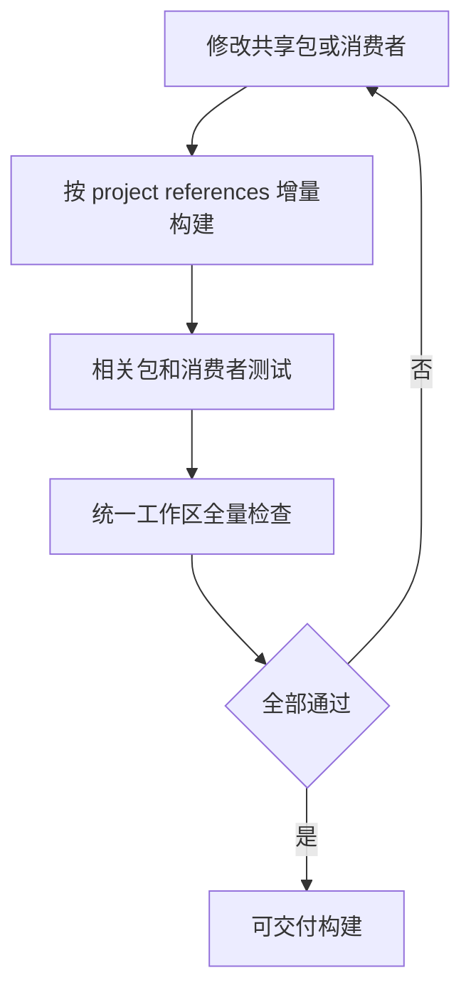

# ADR-002：统一 workspace 与本地包消费

状态：Accepted。用户已授权将共享领域包并入 DSH workspace。
依据：[共享内核技术设计](../ggb-shared-tech.md)、[ADR-001](./001-shared-kernel-two-runtimes.md)。

## Context

当前 plugin-core 应用与共享领域包共同开发。独立 workspace 的 tarball 消费要求每次共享源码修改后
打包、同步版本与重新安装。开发监听不能沿着 tarball 回到共享源码。

## Decision

1. 所有应用与包位于 `ggb-dsh/`，使用一个 pnpm workspace 与 lockfile。
2. 共享领域包保留 `@ggb-copilot/*` 包身份、公开导出和 browser-safe 边界。
3. 内部依赖使用 `workspace:*`。包导出指向 `lib/`，消费者不得跨包导入 `src/`。
4. TypeScript project references 与直接内部运行依赖对应。构建先更新依赖，再更新消费者。
5. 内部源码修改不需要打包、递增包版本或重新安装。依赖声明变化时更新 lockfile。
6. `dev.sh` 的 TypeScript watch 覆盖共享领域包。Node watch 跟踪已加载的本地包输出。
7. 质量门禁拒绝共享领域包中的 Node 能力、应用或服务端包反向依赖及无源码生成模块。

## Consequences

首次使用时在 `ggb-dsh/` 安装依赖并执行 `pnpm run check`。
`lib/`、`.cache/` 与客户端 `dist/` 为生成产物，不入库。
共享包的局部测试不能代替消费者验证；最终全量检查覆盖两者。
发布产物由 Git revision、统一 lockfile 和构建输出确定，不再维护本地 tarball 发布流程。

任一步失败时停止交付，修复对应 owner 后重新验证。本流程无持久状态机，不改变 run 状态或执行权限。
