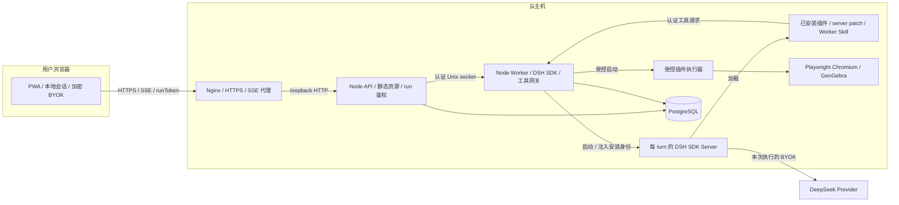

# GGB DSH 部署指南

当前云主机使用 **Node + systemd + 已安装 DSH 插件**。API 与 Worker 是同一主机上的两个进程。
Worker 核对插件安装身份，将安装包的 server patch 交给 DSH 注册四工具与 Worker Skill。
工具请求经 Worker 网关调用插件执行器。插件身份以发行锁和安装描述为准。

架构契约见 [安装式插件设计](ggb-dsh-installed-plugin-design.md)；验收状态见
[统一 Backlog](ggb-dsh-backlog.md)。本文不记录真实主机地址、数据库 URL、证书私钥或 Provider Key。

## 1. 生产拓扑



API 提供 PWA 与同源 GeoGebra 静态资源。systemd 管理进程、重启和进程组回收。
PostgreSQL 保存 run、事件、产物与用量事实。浏览器 Session 和加密 BYOK vault 保存在浏览器。
Provider Key 仅在本次执行期间传给服务端，不写入部署配置或数据库。
公网只暴露 Nginx；API 监听 `127.0.0.1:8080`。

## 2. 路径与入口

路径沿用 [`tools/deploy-ggb-dsh.sh`](../tools/deploy-ggb-dsh.sh) 的仓库布局。
`REPO` 表示仓库根目录，不是固定的主机安装目录。

| 对象 | 路径与契约 |
| --- | --- |
| 应用工作区 | `$REPO/ggb-dsh`；systemd 安装器从自身位置推导该路径 |
| 插件源码 | `$REPO/ggb-plugins`；仅源码验证需要，也可由本地启动器 `--plugin` 指定 |
| 固定插件安装 | `$REPO/ggb-dsh/.plugin-core-runtime/<archiveSha256>`；摘要读取 `vendor/plugin-core.lock.json` |
| Client 静态资源 | 工作区下 `apps/client/dist`，其中包含 `geogebra/` 与 runtime manifest |
| 本地源码覆盖安装 | `$REPO/output/deploy-ggb-dsh/run-*/plugin`，与同次 `workspace/vendor/plugin-core.lock.json` 配对 |
| 生产配置与 secret | `/etc/ggb-dsh/server.env`、`/etc/ggb-dsh/secrets/` |
| 生产 socket 与临时目录 | `/run/ggb-dsh/`；socket、DSH home 与缓存随服务生命周期清理 |
| 持久执行状态 | `/var/lib/ggb-dsh/plugin-core-runs`；保留执行所有权、隔离标记与诊断，独立于 `/run` |

本地启动器从安装包供应依赖和 runtime，再生成隔离的源码覆盖安装。`installation.json` 记录
`pluginRoot`、`privateLock`、`developmentPayloadSha256` 和 `workerSkillSha256`。
该启动器明确拒绝 `NODE_ENV=production` 和 PostgreSQL 目标，不作为生产 systemd 的 `ExecStart`。
生产直接运行构建后的 API/Worker，并加载经过核验的插件安装。

## 3. 发布前条件与构建

1. 核对 `config/runtime-versions.json` 中的 Node、pnpm、DSH、插件和 GeoGebra 兼容组合。
2. 准备专用 PostgreSQL 数据库、运行账号与迁移账号，确认备份和恢复方案。
3. 配置单一 HTTPS 域名。PWA、API、SSE 与 GeoGebra runtime 必须同源。
4. 准备两个不同的 32-byte 随机 secret 文件：`server-pepper`、`worker-secret`。
   内容必须是 64 位小写十六进制。文件权限为 0600，并允许服务用户读取和遍历父目录。
5. 确认固定 GeoGebra runtime 的同源分发许可适用于部署用途。

以下命令在 `$REPO/ggb-dsh` 执行。以能够访问工作区的部署账号供应资源；不要混用其他账号的浏览器缓存。

```bash
pnpm install --frozen-lockfile --ignore-scripts
pnpm run verify:plugin-core:release
plugin_sha=$(node -p 'require("./vendor/plugin-core.lock.json").archiveSha256')
plugin_root="$PWD/.plugin-core-runtime/$plugin_sha"
node tools/provision-plugin-core.mjs --target "$plugin_root" --browsers "$plugin_root/ms-playwright"
pnpm run provision:geogebra
pnpm run check
```

供应器核对 TGZ、sidecar、发行锁和 runtime 配置，安装插件依赖、Chromium 和 GeoGebra，并运行 doctor。
完整供应需要网络与目标 Linux 的 Chromium 系统依赖。缺资源时应停止发布；不要使用
`--dependencies-only` 供应结果启动业务 Worker。供应器拒绝覆盖已有目标；已存在的安装应先核对身份与完整性。

`provision:geogebra` 从同一固定安装加载兼容补丁，生成 Client 同源资源和 manifest。
构建后的 API 会核对 runtime 版本与摘要。所有应用、内部包、lockfile 和插件必须来自经过审查的同一发布组合。
记录 Git revision、`pnpm-lock.yaml`、runtime 配置、插件锁及安装路径，供后续回滚核对。

部署文件的离线检查为 `pnpm run check:deploy`。该检查验证 unit 渲染、预检逻辑与拒绝分支，不安装服务、
不调用 Provider、不启动 GeoGebra。它已接入默认测试与 Linux CI。API/Worker 的就绪通道与持久化回归由 Vitest 覆盖。
Linux 检查还调用 `systemd-analyze verify` 验证渲染后的 unit，不启动服务。

## 4. 生产配置

以 [server.env.example](../ggb-dsh/deploy/systemd/server.env.example) 建立 `/etc/ggb-dsh/server.env`。
该文件由 systemd 和预检入口读取，保持 root 所有且权限为 0600。替换数据库、域名与浏览器路径占位符。
预检接受单行 `KEY=value` 与单层引号，不接受 export、重复键、反斜杠转义或多行值。
值按字面量读取，不执行 shell 表达式或展开变量。
不要向其中写入 DeepSeek Key；产品使用用户浏览器提供的 BYOK。

- `GGB_V3_CLIENT_DIST_DIR=apps/client/dist` 等相对路径以 unit 的 `WorkingDirectory` 为基准。
- 不设置 `GGB_V3_DSH_WORKSPACE_ROOT` 时，Worker 使用当前工作区的发行锁。
- 不设置 `GGB_PLUGIN_ROOT` 时，Worker 从发行锁推导 `.plugin-core-runtime/<archiveSha256>`。
- `PLAYWRIGHT_BROWSERS_PATH` 必须是供应命令中 `--browsers` 的同一绝对路径，不能使用占位符或其他用户的缓存。
- `GGB_V3_AUTO_MIGRATE=0`；迁移必须先单独执行。
- `GGB_PLUGIN_CORE_OUTPUT_ROOT=/var/lib/ggb-dsh/plugin-core-runs` 必须使用持久目录；不把 owner、quarantine 或诊断放在 `/run`。
- `GGB_PLUGIN_CORE_MAX_CONCURRENT_RUNS` 与 API admission 共用容量配置，初始值为 1。

如需发布已审查的源码覆盖安装，必须成对设置 `GGB_PLUGIN_ROOT` 与 `GGB_V3_DSH_WORKSPACE_ROOT`，
分别指向同次 `installation.json` 的 `pluginRoot` 和 `privateLock` 所属工作区。
同时核对供应时的浏览器路径。不得将源码覆盖安装与仓库正式发行锁混用。
源码准备流程见 [插件源码手工验证](ggb-dsh-plugin-manual-verification.md)。

## 5. 数据库迁移

在 API admission 打开前，先备份目标 PostgreSQL，再于工作区执行一次性迁移。
数据库 URL 由部署环境安全注入 `GGB_V3_DATABASE_URL`；不要将真实连接串写入命令历史或仓库。

```bash
node deploy/migrations/apply.mjs
```

当前迁移入口只应用 `017_plugin_core.sql` 与 `018_plugin_core_delivery_contract.sql`，
建立插件 run/event/artifact/usage 表并固定交付契约。API/Worker 启动时核对 schema ledger。
缺少 018 时拒绝启动。迁移失败时停止发布，核对 ledger 与备份；不要跳过迁移或修改 ledger 强行启动。
数据库恢复必须按单独授权的方案执行，不自动逆迁移或删除历史数据。

## 6. 渲染与安装 systemd 服务

服务账号必须是已有的非 root 用户，且能读取工作区、插件安装、浏览器资源和两份 secret。
安装器沿用启动脚本的仓库定位方式，并从 `NODE_BINARY` 或当前 PATH 选择 Node 的绝对路径。
unit 模板内的 `@WORKSPACE@`、`@USER@`、`@GROUP@` 与 `@NODE@` 由安装器替换；不要直接复制模板到 `/etc`。

先在仓库根目录预览。将 `<service-user>` 替换为实际运行账号：

```bash
sh ggb-dsh/deploy/systemd/install.sh <service-user> --render output/systemd-preview
```

预览不会安装或启动服务。核对生成的工作区、用户、Node 版本和可读权限。
路径与账号名称限字母、数字、`_`、`.`、`/` 和 `-`，避免 unit 展开与模板替换歧义。
渲染预览只验证模板，不证明安装资源可用。发布前，在已授权的目标环境执行只读预检：

```bash
sudo env NODE_BINARY=<absolute-node-path> sh ggb-dsh/deploy/systemd/install.sh <service-user> --check
```

预检先以 root 读取 `/etc/ggb-dsh/server.env`，检查占位符、生产配置及持久路径。
随后通过 Linux `runuser` 切换到服务账号，使用 stdin 传入配置；数据库 URL 不进入命令参数。
服务账号检查 Node 兼容范围、两份不同的 0600 secret、编译入口、发行包摘要、插件安装、
Chromium/runtime 文件和 PWA manifest。它复用应用现有配置、安装与静态资源校验器。
预检不启动 API/Worker、浏览器或模型，不连接数据库，也不执行迁移。
已有持久目录必须可读写；首次不存在的目录由 systemd 的 `StateDirectory` 创建。
缺少 runuser、账号不可访问资源或校验失败时，预检返回非零状态；错误输出不包含配置与 secret 正文。

预检通过后，在已授权的目标环境执行：

```bash
sudo env NODE_BINARY=<absolute-node-path> sh ggb-dsh/deploy/systemd/install.sh <service-user>
sudo systemctl start ggb-dsh-worker.service
sudo systemctl start ggb-dsh-api.service
sudo systemctl status ggb-dsh-worker.service ggb-dsh-api.service --no-pager
```

安装器在每次安装前强制执行同一预检，通过后才安装并 enable unit；失败时不写 unit、不调用 systemctl。
安装器不自动启动服务或迁移数据库。
服务在只读文件系统视图下运行；socket、home、cache、scratch 在 `/run/ggb-dsh/`。
Worker 通过 `StateDirectory=ggb-dsh` 和 0700 权限管理 `/var/lib/ggb-dsh`。
执行所有权与隔离标记在服务或主机重启后保留；未知执行仍由启动时的 fence 检查隔离，不自动重放或清除。
配置变更不自动搬迁旧 `/run` 内容。若目标环境已有旧数据，须先按授权停机并确认进程退出，再迁移需保留的状态和诊断；不得只删除隔离标记来释放槽位。
unit 使用 `KillMode=control-group` 回收同一 cgroup 的子进程。
Worker 的强制停机窗口为 150 秒，API 为 45 秒；自定义应用 drain 时须同步核对外层停机窗口。
真实 Chromium 崩溃后的回收必须在目标 Linux 上验收，离线 unit 检查不能替代该验收。

## 7. Edge 与 TLS

[Nginx HTTPS 模板](../ggb-dsh/deploy/edge/nginx.conf) 代理到 `127.0.0.1:8080`。
若当前主机由 cpolar 终止公网 TLS，使用 [cpolar HTTP 模板](../ggb-dsh/deploy/systemd/nginx-ggb-app.conf)。
将对应模板的域名、证书路径与 API allowlist 对齐。

- `/api/` 禁用 buffering、cache 与上游重试，SSE 读取超时为 1 小时。
- Nginx 请求体上限为 40 MiB，与 `GGB_V3_MAX_BODY_BYTES=41943040` 一致。
- 透传 Authorization；日志、WAF、APM 不得记录 Key、runToken、题目或请求体。
- CSP 由 API 根据 PWA shell 与 GeoGebra document 分别下发，Edge 不追加 CSP 或跨域头。
- 未知 API 路径不得改写成静态 PWA fallback，公网防火墙不得直接开放 API 端口。

修改目标配置后，先执行 `nginx -t` 再 reload。

## 8. 发布验收

先做无需 Provider Key 的健康与静态资源验证：

```bash
curl -fsS -H 'Host: <public-host>' http://127.0.0.1:8080/api/v3/health/live
curl -fsS -H 'Host: <public-host>' http://127.0.0.1:8080/api/v3/health/ready
curl -fsS -H 'Host: <public-host>' http://127.0.0.1:8080/api/v3/bootstrap
curl -fsSI https://<public-host>/
curl -fsSI https://<public-host>/geogebra/deployggb.js
```

再核对静态资源 manifest、CSP、API/SSE 的 no-store、未知 API 的 JSON 404，以及数据库迁移状态。
就绪接口先检查 API admission，再通过新 Unix socket 连接完成认证握手。Worker 在接受握手前检查
插件 runtime 文件、输出目录和 PostgreSQL schema，并在 drain 时拒绝握手。探针超时不超过 3 秒，
实际使用更小的通道 ack 配置时按该配置超时。缺失探针、认证失败、资源缺失、schema 异常或断连返回 503；
API 在握手完成后再次检查 drain。`health/live` 继续只表示 API 存活。
握手沿用现有协议，不执行构图、不调用 Provider 或启动浏览器，因此不能代替真实构图验收。
检查 Worker 日志中的安装身份和 Worker Skill 摘要，确认实际加载的是本次发布的插件。

目标环境还需验收 PWA 升级、SSE 重连、取消、下载与续做；终止 Worker 后应回收浏览器子树，且不自动重放任务。
真实 Provider 构图会产生费用，必须单独授权，并使用专用测试 Key 和题目。
本机测试或历史输出不能充当目标环境证据。

## 9. 监控与排障

收集 API/Worker 的脱敏摘要、稳定错误码、耗时与用量。关注 admission reject、插件容量、执行失败、
Provider 延迟、SSE 重连与背压、TTL 清理失败。排障优先看结构化 diagnostics 与 runner 产物。
不得通过开启请求体日志收集 Key 或题目；运行目录与日志按保留策略清理，不进入 Git。

## 10. 更新与回滚

发布顺序为：核对发布身份 → 备份与迁移 → 停止旧服务 admission 并 drain → 替换经过验证的发布组合
→ 依次启动 Worker/API → 核对 ready、插件身份与公网静态资源 → 观察指标。
停机后确认插件进程、socket 和数据库连接均已清理。失败时保持 admission 关闭，核对错误与安装身份。
回滚使用先前验证过且与当前 schema 兼容的 DSH 插件安装、应用和 lockfile 组合；不自动恢复退役引擎。
不得删除数据库、产物、secret 或浏览器数据来修复发布。

## 11. 本地源码安装身份核对

本地开发可运行 `sh tools/deploy-ggb-dsh.sh --bundle --build-only` 准备源码覆盖安装，或按授权范围启动调试。
`--doctor` 以及缺少固定 runtime 时的自动供应会启动真实浏览器，须满足项目的真实运行授权边界。
本地启动器可能释放 8081/5173 的既有监听；`--build-only` 跳过端口清理，不启动业务服务。

核对本次输出中的 `installation.json` 与 Worker 启动日志：

| 字段 | 一致条件 |
| --- | --- |
| `developmentPayloadSha256` | 等于 Worker 的 `packageIntegrity` |
| `workerSkillSha256` | 与 Worker 启动日志及安装 capabilities 一致 |

旧 ready.json、安装目录存在或 Git 提交均不能证明正在运行的 Worker 已更新。
