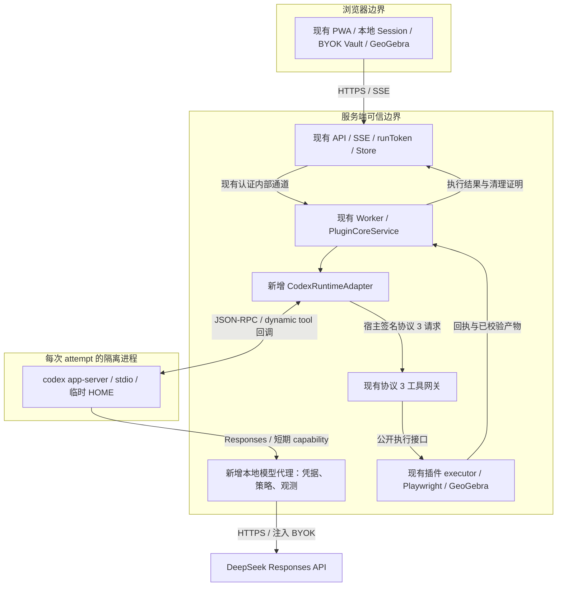
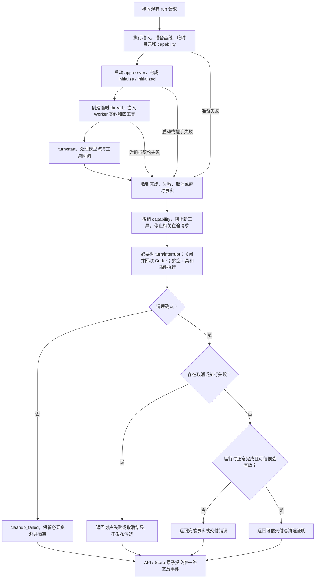
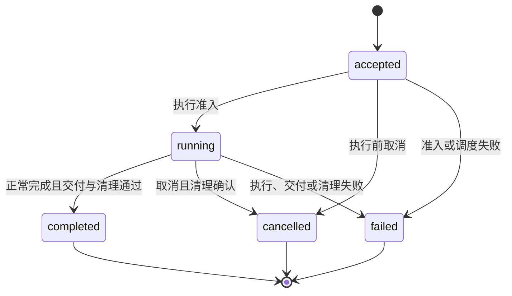

# 使用 Codex app-server 替换 DSH Agent 运行时

> 状态：拟议设计，尚未实施。设计依据核对日期：2026-10-24。
> 本文记录迁移思想、责任边界和验收条件，不表示已完成 Codex 或真实 Provider 验收。
> 项目概览见 [README](../README.md)，实施进度与验收证据归 [Backlog](ggb-dsh-backlog.md)。

## 1. 设计结论与范围

保留现有 plugin-core 业务架构，用 Codex app-server 替换 DSH 的模型循环。
Worker 继续拥有工具授权、插件执行、基线、可信候选、资源清理和执行事实。
API 与 Store 继续拥有业务 run 的持久化、事件、鉴权和原子终态提交。

首选接入方式是：Worker 使用 TypeScript 封装 app-server 的 JSON-RPC 协议，
通过 dynamic tools 调用现有四工具，通过本地模型代理访问 DeepSeek Responses API。
模型代理只做请求策略、凭据注入和流式观测，不承担 Agent 循环或工具执行。

本次迁移以保留以下能力为验收目标：

- DeepSeek BYOK、浏览器加密 Vault 与 Provider Key 不落盘。
- 文字和图片输入、图片原题转录、基线检查与续做。
- 四工具、固定参考、完整请求、revision 与 checkedRequestId。
- 三次实际构建额度、预检拒绝退款和构建失败反馈。
- GeoGebra 构造、核验、导出、重载与可信回执交付。
- GGB、预览、报告、manifest、构造脚本和会话自动标题。
- 模型与工具真实进度、逐调用用量和有界诊断。
- 取消、超时、进程清理、资源隔离、SSE 重连与快照。
- PWA、本地 Session、下载、画布导入和离线重开。

本次不引入服务端用户会话，不恢复 Native 引擎，不重写几何执行器，
不把模型更换为 OpenAI 模型作为迁移前提，也不要求先重命名整个 `ggb-dsh/` 工作区。
保留业务行为不意味着保留 DSH 专有事件格式；运行时事实需要转换成中立契约。

本文中的“必须”表示验收约束，“应当”表示默认实现选择，“可以”表示可选方案。
所有新增接口名和文件名均为拟议名称，实施时应遵守已有包边界。

## 2. 当前实现与迁移依据

### 2.1 已存在的责任分离

| 当前 owner | 已实现职责 | 对迁移的意义 |
| --- | --- | --- |
| [DSH runner](../ggb-dsh/apps/worker/src/plugin-core/dsh-runner.ts) | 创建独立 Harness session、传入文字或图片、接收模型事件、关闭运行时 | 主要替换点 |
| [PluginCoreService](../ggb-dsh/apps/worker/src/plugin-core/service.ts) | 执行准入、截止时间、基线、有限重试、交付投影和失败事实 | 保留业务流程，移除 DSH 类型耦合 |
| [工具网关](../ggb-dsh/apps/worker/src/plugin-core/tool-gateway-server.ts) | capability、身份绑定、草稿、参考读取、图片输入约束和在途调用 | 继续作为工具授权入口 |
| [Gateway](../ggb-dsh/apps/worker/src/plugin-core/gateway.ts) | 工具执行准入、配额和领域结果处理 | 保留副作用与额度控制 |
| [Installed runner](../ggb-dsh/apps/worker/src/plugin-core/installed-runner.ts) | 调用公开 executor、校验回执、接收真实产物字节 | 保留可信交付链 |
| [Execution state](../ggb-dsh/apps/worker/src/plugin-core/execution-state.ts) | epoch、候选失效、执行截止时间与隔离 | 保留候选和资源所有权 |
| [API run service](../ggb-dsh/apps/api/src/plugin-core/run-service.ts) | run 生命周期、用量投影和终态提交 | 保留浏览器可见行为 |

当前 runner 每次创建新 Harness session。浏览器会话续做依赖上传的 GGB 基线，
不依赖恢复同一个模型 session。迁移后应继续采用独立执行 attempt 和临时 Codex thread。

当前安装准入仍绑定 DSH SDK、Cordis、server patch 和安装包身份。
因此迁移不能只修改 `dsh-runner.ts`；还必须拆开插件执行兼容性与 Agent 运行时兼容性。
精确的现有交付边界见 [安装式插件设计](ggb-dsh-installed-plugin-design.md)
和 [DSH 兼容契约](../ggb-dsh/docs/dsh-sdk-compatibility.md)。

### 2.2 SDK 与 app-server 的选择

| 接入方式 | 官方定位 | 本方案选择 |
| --- | --- | --- |
| Codex SDK | 程序化启动、继续和恢复任务，用于任务自动化与集成 | 可以用于原型；需另核对工具回调等能力的覆盖度 |
| Codex app-server | 在自定义产品中处理线程、事件、工具调用、审批和历史 | 首选；Worker 直接拥有协议连接和进程生命周期 |

不同时维护 SDK 客户端和 app-server 客户端。首期使用 `stdio`，不向浏览器或公网暴露
app-server。现有 API/SSE 继续承担产品接入。

前次分析在本机 `codex-cli 0.164.0` 上离线生成了协议类型，确认存在
`thread/start`、`baseInstructions`、`developerInstructions`、`ephemeral`、
`dynamicTools`、`item/tool/call`、`turn/interrupt` 和用量通知。
这只证明协议形状，不证明工具闭环、权限或生产运行通过验收。

`dynamicTools` 与对应调用流程属于实验接口。官方文档也对 app-server 命令及
WebSocket 相关能力标注实验或生产使用限制。采用 stdio 可以减少暴露面，
不能据此推导所选组合已经具有稳定的生产支持承诺。
上线前必须固定二进制版本、摘要、生成协议及兼容测试。
依据：[app-server 文档](https://developers.openai.com/codex/app-server)、
[SDK 文档](https://developers.openai.com/codex/sdk)。

### 2.3 DeepSeek 接入可行性

当前 Worker 默认访问 DeepSeek Anthropic Messages 端点。
DeepSeek 已提供原生 Responses API 和 Codex 接入说明，因此无需预先开发
Messages → Responses 协议转换器。模型可继续使用当前 `deepseek-flash`。

| 已文档化的差异 | 拟议处理 |
| --- | --- |
| `previous_response_id` 与 `conversation` 不受支持 | 使用 HTTP Responses；每次发送完整的必要历史，不依赖增量续传 |
| `parallel_tool_calls` 与 `max_tool_calls` 被忽略 | Worker 串行准入同一 run 的工具并独立执行配额 |
| `developer` 消息按用户消息处理 | 核心 Worker 规则必须进入最终上游 `instructions`；检查实际出站请求 |
| `deepseek-flash` 支持图片 | 固定模型元数据中的图片能力，并验证图片确实传到 Provider |
| `max_output_tokens` 受支持 | 保留当前输出上限 49,152，核验最终出站字段 |
| 部分不支持字段被静默忽略 | 不把 HTTP 成功当作参数生效证据；逐项检查实际消费行为 |

模型目录必须描述真实 Provider 能力，避免沿用不适用的编码模型默认配置。
不得直接复制个人桌面配置、凭据或完整默认编码 Prompt。
依据：[DeepSeek Codex 接入](https://api-docs.deepseek.com/quick_start/agent_integrations/codex/)、
[Responses 兼容说明](https://api-docs.deepseek.com/guides/responses_api/)、
[Responses 接口](https://api-docs.deepseek.com/api/create-response/)。

## 3. 拟议架构与所有权



| 组件 | 拥有的状态或资源 | 不得承担的职责 |
| --- | --- | --- |
| Browser | 本地会话、画布、加密 Key 和附件草稿 | 模型循环、任意服务端命令执行 |
| API / Store | run、鉴权、事件游标、终态事务、持久交付 | 解释 Codex 原始内部事件 |
| PluginCoreService | attempt、截止时间、基线、重试策略和结果投影 | 把 Codex 回复当作可信交付 |
| CodexRuntimeAdapter | app-server 连接、临时 thread、调用身份映射和进程回收 | 决定几何正确性或绕开网关执行插件 |
| 本地模型代理 | 每次模型请求、短期授权、上游 Key 和流式事实 | Agent 工具循环、持久保存完整对话或原始推理 |
| 工具网关 / Gateway | capability、草稿、参考、串行执行与构建额度 | 信任模型提交的运行身份或路径 |
| 插件 executor / 接收器 | 构造核验、回执和实际产物字节 | 保存 Provider Key 或自行结算业务 run |

Provider 返回的文字、工具参数和基线对象定义都属于不可信数据。
模型只能请求领域操作；Worker 根据已认证上下文决定是否执行。

## 4. 运行时、工具与观测契约

### 4.1 中立的 AgentRuntime

从 Service 中移除 DSH `RunResult` 和事件解析依赖，定义最小运行时端口：

```ts
interface AgentRuntime {
  run(request: AgentTurnRequest): Promise<AgentTurnResult>
}
```

上述代码仅表达依赖方向。请求、返回值与错误的完整类型在实施时统一定义，
不让 Codex 适配器伪造 DSH events，也不增加通用工作流框架。

| 边界 | 输入或输出 | 不变量与失败处理 |
| --- | --- | --- |
| Service → Runtime | runId、epoch、prompt、可选 image、baseAttached、signal、剩余时间 | 运行身份来自宿主；输入约束不因切换运行时放宽 |
| Runtime → Service | 正常完成事实、finalResponse、调用用量、有界诊断和清理事实 | `completed` 必须来自明确的运行时终止事件，不能从文字推断 |
| Runtime 错误 → Service | 稳定错误分类、失败前部分事实、证据截断状态、清理状态 | 失败和取消任务仍保留可证明的用量；未知计数为 null |
| Runtime → progress observer | 模型执行事实 | 关闭 observer 后不再发送进度；不向浏览器暴露原始推理 |

DSH 和 Codex 分别转换成中立结果。现有业务失败码继续保留；新增内部故障需明确
映射关系。未经证据支持，不能把一般 Codex 错误映射成 `plugin_core_max_tokens`
或 `plugin_core_malformed_response`。

### 4.2 四工具桥接

Codex thread 注册 `ggb_inspect`、`ggb_request`、`ggb_check` 和 `ggb_build`。
插件应新增中立公开入口，例如 `./tool-manifest`，供两种运行时读取同一份说明和 schema。
Worker 契约也应通过公开入口加载；复用当前预加载规则，不改为要求模型自行找文件。

| 工具 | 保留的领域接口 | 结果含义 |
| --- | --- | --- |
| `ggb_inspect` | 基线检查或固定 reference / references | 有界对象事实或参考；无基线返回 base_missing |
| `ggb_request` | 完整 requestText，以及现有 locale、title、transcription 字段 | 保存新 revision，按现有规则使旧检查句柄失效 |
| `ggb_check` | 当前 revision | 结构通过时产生 checkedRequestId；不证明几何成立 |
| `ggb_build` | checkedRequestId | 执行构造、核验、导出与重载，接受结果仍由宿主决定 |

单次回调按下列顺序执行：

1. 接收 `item/tool/call`，检查 threadId、turnId 和工具白名单。
2. 将 Codex callId 映射为宿主 UUID，并保留关联，不能伪称两者相同。
3. 宿主补齐 runId、epoch、时间、nonce、参数摘要和 HMAC，生成现有协议 3 请求。
4. 通过现有网关串行准入，执行相同参数校验、草稿规则和额度规则。
5. 将有界结果包装为 `contentItems / success`，响应原始 JSON-RPC request id。

模型不得提供 token、宿主身份、配额、outputRoot 或基线路径。
模型看到的工具结果应继续保留不可信数据边界。

同一调用的重复回调不得重新执行副作用。连接仍有效时，可以返回已记录结果；
结果未知或连接丢失时必须终止 attempt 并结算，不能重新投递 build。
同一 run 的有副作用工具必须串行准入，不能依赖 Provider 的并行开关或工具提示。

### 4.3 四工具权限的准入条件

当前 host policy 在 Provider 请求前要求工具集合恰好等于四工具。
迁移必须验证同等边界，不能仅配置 `readOnly` 和 `approvalPolicy=never` 后宣称等价。

| 控制层 | 必须验证的行为 |
| --- | --- |
| Codex 配置与隔离 | 关闭 shell、搜索、额外图片查看工具、子 Agent、外部 MCP、Apps、插件与记忆；不加载个人配置或意外的 AGENTS / skills |
| 模型代理 | 检查最终工具集合、schema 摘要和模型返回的调用名称；非四工具调用在交给 Codex 执行前拒绝 |
| 工具网关 | 保留 capability、epoch、参数、配额、路径和进程执行边界 |

首批验证必须确认固定 Codex 版本能否原生生成恰好四工具的目录。
如果配置仍保留内建工具，下一步才评估代理中受控投影工具目录，或最小运行时注册补丁。
这两种处理均需独立兼容验证，不能静默引入，也不能用 Prompt 代替执行层限制。
未经验证，方案保持实验状态，不切换默认生产运行时。

### 4.4 模型代理与用量

当前 Provider 诊断依赖 Node fetch 插桩，不能原样观测独立 Codex 运行时。
新增本地代理以 Responses 流为观测边界，逐次记录模型调用事实。
代理只能转发到宿主固定的 Provider 目标，不能成为任意 URL 转发入口。

| 项目 | 契约 |
| --- | --- |
| 授权 | Worker 分配短期 capability，绑定 run、attempt 和有效期；Codex 子进程仅获得该 capability |
| 凭据 | Worker / 代理在内存中持有真实 DeepSeek Key；转发时注入，任务结束后释放，不进入配置、参数、日志或工具执行器环境 |
| 模型策略 | 固定模型、reasoning、输出上限和工具 schema；检查实际出站请求，而非只检查配置文件 |
| 流处理 | 增量转发 SSE；区分正常完成、截断、Provider 失败和连接中断，不伪造正常完成事件 |
| 进度 | 每次真实上游请求产生模型 started / finished 事实；工具进度继续来自网关；不从文字或 turn 总数猜测模型调用次数 |
| 用量 | 从 Provider usage 提取输入、输出、推理和缓存计数；明确缓存计数是否包含于输入总数，避免重复相加 |
| 部分事实 | 缺失计数为 null；证据截断或用量不完整时 complete=false；失败不得填零冒充完整账本 |
| 诊断 | 保存固定时间点、字节数、摘要、事件类型和必要的有界脱敏信息；不持久化完整 prompt、图片或原始推理 |
| 重试 | 每个实际上游尝试独立标识并计数；模型请求重试、工具投递重试和整个 attempt 重试分别控制 |
| 取消 | 撤销 capability，并中断对应的在途上游连接；代理不能在后台继续消耗模型调用 |

app-server 用量通知用于交叉核对，不能直接替代当前逐调用账本，也不能将累计快照反复求和。
正式用量增加 `provider` 来源；保留历史 `sdk` 和 `unknown` 的读取语义。
当前 API 将完整用量标记为 `sdk`，实施时必须同步更新该投影。

### 4.5 会话、图片和持久化

- 一个 attempt 使用一个独立临时 HOME 和 Codex thread。重试使用新的 attempt 身份。
- Browser Session 不直接映射为持久 Codex thread；基线续做继续由上传 GGB 实现。
- 图片沿用当前类型、大小、文件头、幂等摘要和传输约束，转成 Codex 图片输入。
- 模型目录必须声明图片能力；验证实际请求携带图片，不能只检查 UI 或类型。
- 图片原题转录、自动标题、构造脚本仍由已接受请求和交付事实投影，沿用现有 owner。
- `ephemeral` 不单独构成“没有落盘”的证明。临时 HOME、日志和状态目录应落在受控临时存储，
  关闭不需要的历史、记忆和遥测，并检查实际写入。
- 临时上下文只服务于本次工具循环；进程退出并完成工具清理后，按现有规则清理。
  清理失败保留必要资源并隔离，不声明已删除。

## 5. 执行流程、取消与状态机

### 5.1 正常与异常流程



Worker 必须监督 Codex 与插件执行资源。只收到父进程退出、标准流关闭或 interrupt ACK，
都不足以证明所有资源退出。继续采用现有进程树清理和部署层资源回收边界。
关闭失败的隔离资源继续占用容量；Worker 重启后不得自动清除隔离标记。

Service 应保留现有有限重试条件：空结果只在无工具执行时重试；
格式错误重试必须证明没有 build 执行、证据未截断且当前无构建候选。
所有 attempt 共用原始 run 截止时间。Codex 和代理的传输重试策略也必须纳入核对，
不能在未知副作用后自动恢复整个 turn。

### 5.2 公开状态机



| 源状态 | 事件与守卫条件 | 动作 | 目标状态 | 状态所有者与依据 |
| --- | --- | --- | --- | --- |
| 无记录 | 创建请求通过身份、输入与幂等校验 | 创建 run 和初始事件 | accepted | API / Store；沿用现有 run 契约 |
| accepted | 调度与执行准入通过 | 记录开始事实并启动执行 | running | API / Store；Worker 提供执行事实 |
| accepted | 执行前停止，确认无执行资源 | 提交取消 | cancelled | API / Store；沿用现有取消契约 |
| accepted | 准入或调度失败 | 提交已知失败，清理未知时保留该事实 | failed | API / Store；沿用现有故障分类 |
| running | 运行时正常结束、可信候选有效、清理确认且无取消冲突 | 原子保存产物、交付和终态事件 | completed | API / Store；沿用可信交付事务 |
| running | 停止请求成立且清理确认 | 不发布候选，提交取消证明 | cancelled | API / Store；Worker 提供清理证明 |
| running | 运行时或交付失败；或清理失败 | 不发布候选；必要时登记隔离 | failed | API / Store；Worker 提供失败与资源事实 |

终态不再迁移。取消与完成竞争仍由现有 Store 原子提交决定，
迟到或重复事件不能修改已提交终态。`cleanup_failed` 优先于取消；
隔离是资源状态，不新增为公开 run phase。

### 5.3 必须保留的结果判定

| 情况 | 处理 |
| --- | --- |
| Codex 正常完成，没有可信候选 | `plugin_core_no_delivery` |
| 有候选，但缺少运行时正常完成证据 | 不发布；沿用完成事实缺失的失败处理 |
| 有候选，但运行时失败、取消或超时 | 不发布候选 |
| 新 build 被准入后失败 | 不恢复此前失效的候选 |
| interrupt ACK 已返回，但资源仍在运行 | 继续等待清理，不直接提交 cancelled |
| Codex 或插件进程退出无法确认 | `plugin_core_cleanup_failed`，隔离资源 |
| SSE 断开 | 业务 run 继续，客户端按现有游标与快照重连 |
| Worker 崩溃或内部连接中断 | 沿用故障分类和 orphan fencing，不自动重放 build |

## 6. 修改边界、协议与部署

| 位置 | 拟议修改 |
| --- | --- |
| Worker `composition.ts` / `config/env.ts` | 注入中立 Runtime，选择运行时和隔离路径 |
| Worker `plugin-core/service.ts` | 消费中立结果，保留准入、基线、有限重试、候选和结算 |
| 新增 Codex adapter / 工具桥接 | JSON-RPC 生命周期、dynamic tools、调用身份和进程回收 |
| 新增本地模型代理 | Responses 转发、凭据注入、请求策略、进度、用量和有界诊断 |
| Worker `evidence.ts` / 进度与 Provider 观测 | 分离 DSH 格式与共享证据，不依赖 Node fetch 插桩观测 Codex |
| 插件公开入口 / Worker 安装准入 | 共享四工具定义和 Worker 契约；拆开 DSH 与插件执行兼容性 |
| application / 内部通道 / API | 用量来源、运行时身份、错误投影和严格 schema 的协同演进 |
| Client 相关消费者 | 验证用量来源、快照、重连、本地保存和导出；无契约变化的界面沿用 |
| 供应、doctor、Docker、systemd | 固定 Codex 二进制、协议、模型元数据和进程资源清理 |

业务 `engine` 继续是 `plugin_core`。Agent runtime 使用独立字段表示，
不能把 Codex 误建模为另一种几何引擎。

迁移期间可以使用服务端运行时开关，名称例如 `GGB_AGENT_RUNTIME=dsh|codex`。
每个新 run 固定运行时、模型和发行身份。具体身份记录位置按现有 JSON 证据与 store 契约决定，
需要新持久字段时才新增迁移，不提前承诺零 DDL。

新增用量来源或内部字段必须遵守 [协议版本规则](../ggb-dsh/docs/protocol-versioning.md)。
先检查 API、Worker、Client 和导出消费者的严格 schema，再决定版本升级；
不能把 Provider 事实继续标记为 SDK 事实以逃避契约更新。

旧 run 的结果和产物继续按其原有事实读取，不转换 DSH 历史为 Codex 历史。
回退只影响新 run 的调度；已运行的 run 由原 owner 完成或清理，不跨运行时自动重试。
依赖移除、默认切换和 DSH 路径退役应在验收后单独执行，避免长期维护无用途的兼容实现。

部署应使用服务端专用二进制和临时 HOME，不复用开发者桌面登录态。
固定 Codex 版本、文件摘要、生成协议、模型目录及插件发行身份。
API 与 Worker 的变更必须按内部协议兼容要求协同发布。
真实外部调用、部署和数据库迁移仍按 [部署指南](deploy-dsh.md) 的授权边界执行。

## 7. 实施批次与验收

### 7.1 实施顺序

| 批次 | 工作内容 | 退出条件 |
| --- | --- | --- |
| 1：验证兼容性 | 固定 Codex，生成协议，使用 mock Responses 验证动态工具、权限、图片和清理 | 四工具闭环成立；无额外工具执行；取消后资源可证明退出 |
| 2：替换运行时 | 提取中立端口，接入 adapter 和工具桥接，发布插件中立定义 | Service、可信交付和错误路径通过 mock Codex 集成 |
| 3：补齐观测与消费者 | 模型代理、用量、进度、诊断、来源字段与协议调整 | 实时、快照、重连、本地存储和导出消费同一事实 |
| 4：集成与切换 | 供应、doctor、部署资产和案例比较 | 离线与获授权的真实验收通过，默认切换和新 run 回退条件明确 |

第一批用于回答可行性问题，不提前提交完整生产替换。
前面的准入条件不成立时，不通过放宽“四工具限定”或清理证明来继续切换。

### 7.2 验收矩阵

| 范围 | 正常路径 | 必须覆盖的拒绝或恢复路径 |
| --- | --- | --- |
| 模型接入 | DeepSeek 模型、reasoning、输出上限与增量 SSE 生效 | 鉴权失败、限流、截断、上游断流、缺少终止事件 |
| 工具权限 | 恰好四工具、schema 一致、宿主身份绑定 | 内建工具、未知工具、伪造身份、失效 capability、重复调用 |
| 草稿与执行 | 完整 request → revision → check → build | 过期检查句柄、并发调用、结构拒绝、退款边界、三次构建上限 |
| 图片 | 文字加图片、仅图片、转录和题目标题 | 非法图片、未声明图片能力、图片未传出、清理失败 |
| 基线续做 | inspect、精确对象名、增量构造 | 错误摘要、缺失基线、越权路径、禁止操作 |
| 可信交付 | GGB、预览、核验、manifest、构造脚本 | 伪造回执、错绑摘要、旧候选、候选有效但运行时失败 |
| 生命周期 | 正常结束、执行前取消、运行中取消 | 启动失败、超时、关闭失败、插件残留、Worker 崩溃与隔离 |
| 进度与用量 | 模型及工具事实、逐调用用量和汇总 | 部分用量、重试计数、重复通知、证据截断、不泄露原始推理 |
| 客户端消费 | SSE、快照、下载、导入、本地重开 | 断连重连、终态竞争、迟到事件、删除会话后的迟到结果 |
| 发行与回退 | 固定 runtime、插件与模型元数据 | 摘要不匹配、协议不兼容、新 run 回退、禁止活动 run 跨运行时恢复 |

离线测试优先使用现有测试入口和 mock Provider，不运行付费调用。
相关起点包括 Worker 的 DSH runner、Service、installed gateway、图片和 Provider 证据测试，
API 的 route / settlement 测试，以及 Client 的 plugin-core runtime / session title 测试。
替换运行时后同步替换仅对旧 DSH 格式成立的测试，不为死代码保留兼容路径。

真实验收必须单独授权，并使用同一组文字、图片和续做案例比较：交付率、总耗时、
模型调用数、Token、无效 build 次数和清理结果。性能阈值与样本规模在实施验收前确定，
本文不编造已通过的指标。

## 8. 待验证事项与设计覆盖

| 待验证事项 | 影响与处理原则 |
| --- | --- |
| 固定 Codex 版本能否只注册四工具 | 最高优先级准入；必要时单独评估代理投影或最小补丁，不默认视为已解决 |
| experimental dynamic tools 的版本稳定性 | 固定运行时和生成协议，升级前重跑兼容测试 |
| DeepSeek 实际请求对指令、图片和参数的消费 | 检查出站事实并做获授权的真实验收，不能只看文档或 HTTP 成功 |
| Codex 及代理的模型请求重试 | 明确实际调用计数；禁止未知副作用后的 turn 重放 |
| 运行时内部日志、状态与临时图片写入 | 检查隔离目录和退出后清理，不以 ephemeral 作为唯一证明 |
| 模型上下文与默认编码指令是否干扰构图 | 使用专用 Worker 契约和模型元数据，以相同案例评测 |
| Codex 与插件进程树回收 | 按现有资源证明门禁验收；失败保留隔离，不提前释放容量 |
| 用量来源与运行时身份的协议演进 | 实施时核对严格消费者，确定版本和持久化变更 |

| 设计要素 | 位置 | 覆盖状态 |
| --- | --- | --- |
| 架构与信任边界 | 第 3 节 | 已提供拟议组件图及所有权表 |
| 正常、失败、取消流程 | 第 5.1 节 | 已提供拟议流程图和重试条件 |
| 状态机与竞争 | 第 5.2、5.3 节 | 已提供公开状态机、迁移表及结果判定 |
| 接口、输入输出和兼容性 | 第 4、6 节 | 已提供契约；具体新增类型与协议版本待实施确定 |

本文应用 STE 的中文清晰写作原则，不声明 ASD-STE100 英文标准合规。
当前依据包括仓库实现、官方文档及前次离线协议检查；没有真实 Provider、
GeoGebra、生产部署或资源隔离验收结果。
