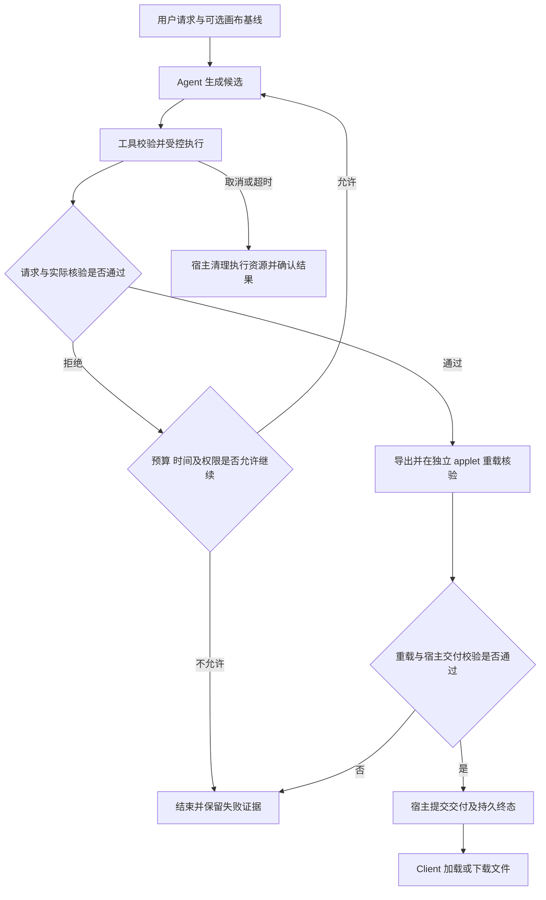

# GGB Agent 演进：从 workflow 到安装式 DSH 插件

整理日期：2026-10-23。用途：后续开发分享与方案讨论。

核心判断：工程逐步把数学决策交给 Agent，把执行、核验和文件交付收敛到插件，
把权限、资源和运行状态留给宿主。DSH 已用于早期工程；这次演进主要改变职责边界，
不能概括成“用 DSH 替换 workflow”。

## 1. 阅读口径与证据边界

本次检索范围为 2026-09-23 至 2026-10-23 的可访问相关会话。
能直接还原关键决策的记录集中在 10 月 11—23 日。本文不推定初始 workflow 的准确创建日期，
也不声称覆盖了全部历史会话。

当前仓库 Git 日志不能独立还原全部过程。本文交叉使用会话记录、采用方案、设计文档和 Backlog。
日期表示讨论或记录发生的时间，不保证是能力首次实现的时间。
历史会话中的旧工程目录已迁移，旧路径不作为当前操作入口。

本文是历史解释，不新增执行契约，不维护第二份实时进度表。
当前项目与架构见 [README](../README.md)，实施和验收状态见 [Backlog](ggb-dsh-backlog.md)。
协议版本以 [协议版本规则](../ggb-dsh/docs/protocol-versioning.md)为准。

| 术语 | 本文含义 |
| --- | --- |
| workflow / Native 九阶段 | 宿主代码明确规定数学阶段、阶段提交协议及状态转换的早期方案 |
| DSH | DeepSeek Harness；承载模型循环、工具调度及相关运行能力 |
| plugin-core | 宿主调用插件构造与核验核心的引擎方式；不等于已经完成独立安装 |
| 安装式 DSH 插件 | 工具、Worker Skill、schema 与执行入口由同一个独立安装包供应 |
| 续题 | 用户提出新需求，以当前确认的画布作为新 run 的基线 |
| 中断恢复 | 同一 run 在中断后，根据持久事实继续；不是重新创建任务 |

`ggb-construct` 是设计中的逻辑名称。源码包为 `ggb-plugins`，DSH 分发包为
`ggb-plugins-dsh`，Skill 名为 `ggb-construction`。这些名称不代表不同的数学引擎。

## 2. 时间线与关键决策

| 时间 | 决策或变化 | 转变原因 | 当时的状态与限制 |
| --- | --- | --- | --- |
| 10 月中旬前，起始日期待确认 | 使用 Native 九阶段，由宿主约束理解、规划、资料、审查、执行及完成 | 将不确定的模型输出纳入受控阶段，并管理执行副作用 | 历史已实现；不能从现有证据确定最早上线时间 |
| 10 月 11 日 | 明确“题目→数学模型→脚本→执行→验证→修正”的闭环 | 借鉴 Coding Agent 实际运行代码、依据结果修正的方法 | 该会话产出方法文档；不是新的引擎切换记录 |
| 10 月 12—14 日 | 修正结构错误反馈、Manual 责任、Review 输入和呈现属性契约 | 真实案例暴露跨阶段语义不一致，局部门禁通过仍可能画错 | 有代码修复和真实运行记录；没有证明整个 workflow 已消除同类问题 |
| 10 月 16 日 | 提出并推进独立插件：Codex 规划与修正，本地工具执行和核验 | 复用成熟 Agent 宿主，减少数学任务经过的协议和转换 | 插件路线形成；初期范围较窄，后续再加入基线编辑与续构 |
| 10 月 17 日，交接记录口径 | Web 产品采用 plugin-core，删除 Native 九阶段执行链 | 将插件的确定性执行管线接回 Web 产品，减少重复阶段协议 | 交接记载历史真实批处理 5/7 交付；两个未交付案例保留 |
| 10 月 18 日 | 提出在插件收敛后补充最小持久恢复 | 用户希望保持续题和中断恢复，而当前续题不等于同一 run 恢复 | 拟议方案；不是恢复能力已实施的证据 |
| 10 月 22—23 日 | 从工程内接入插件核心，进一步转为安装式 DSH 插件 | 宿主仍拥有工具定义、提示内容和适配逻辑，调用核心尚未完成所有权解耦 | 安装式默认链路已进入开发环境；验证分层进行，生产验收未完成 |

### 2.1 起点：workflow 用显式阶段管理不确定性

早期链路包含 Context、Intake / Brief、Plan、Manual、Review、Apply、Execute、Verify、
Finalize 等职责。宿主规定提交顺序、冻结边界和拒绝后的处理方式。

这种设计有实际价值：阶段记录能解释任务停在哪里；受控编译能限制模型执行；
checkpoint、journal、回执及租约机制用于处理执行中断和跨进程副作用。
这些机制的设计或存在，不等于所有故障恢复路径都完成了真实验收。

代价是同一题意需要经过多种表示。每个边界都要对齐要求、对象身份、来源和成功条件。
如果上游已经冻结错误理解，下游可能只能拒绝，不能直接修正。

### 2.2 10 月 11—14 日：从修字段，转向检查端到端不变量

10 月 11 日的讨论强调：Agent 应当实际执行脚本并检查数学性质。
画布出现图形、命令没有报错、截图看起来正确，都不能单独证明任务完成。

10 月 12 日的真实七案例运行提供了两个典型反例：

- 虚线续题误用 `SetLineStyle`。错误反馈引出 output、自引用和重复生产者问题，修复额度耗尽。
- 正多边形把 `Polygon(A,B,6)` 误解为“圆心＋顶点”。Plan 和 Review 未拦住，产品判完成，
  外部 runner 才发现几何错误。

10 月 14 日，虚线问题进一步暴露四个不同事实：

| 事实 | 不能直接推出的结论 |
| --- | --- |
| Brief 声明要求 | 程序已经实现要求 |
| Plan 把要求绑定到对象 | 绑定对象具有所需属性或关系 |
| Manual 提供命令与签名 | 当前参数正确表达了题目目标 |
| Review 输出合法判词 | 判词分类正确，且实际结果符合要求 |

本次虚线记录中，Review 总体为 `unverified`，不是 `passed`；系统允许继续进入 Apply，
之后才暴露静态实现缺口。应避免把这段历史讲成“所有阶段都判通过”。

推动转向的原因是：局部修补有效，但没有统一各阶段的可信事实和完成标准。
需要让来源完整性、实现完整性和证据一致性贯穿链路，而不是继续增加提示词。

### 2.3 10 月 16 日：独立插件把确定性能力集中起来

插件路线采用“宿主编写程序，GeoGebra 解释数学，工具管理证据与交付”的分工。
Codex 负责理解、规划、查资料和修正；本地工具负责结构检查、真实执行、事实采集、核验、
导出及独立重载。初期插件复用 Codex 的模型循环，不需要复制完整的 Web API 和 Worker。

数学表达逐渐转向原生 Algebra / CAS。新题优先改变程序和检查；只有缺少通用事实或执行能力时，
才扩展工具。工具仍检查输入、引用和副作用边界，不允许任意宿主脚本。

优点是减少多层数学表示和阶段协商。代价是题意提取完整性仍依赖 Agent。
程序和检查由同一个模型生成时，可能一起遗漏要求，或形成自证式检查。
插件核验器也可能有类型和门禁缺陷，不能把“插件接受”当成普遍数学证明。

初期简化还来自范围收窄。后续加入了带摘要基线的显示编辑和受控续构；
不能把早期“不支持续构”的描述套到当前版本。

### 2.4 10 月 17—18 日：plugin-core 接回 Web，并明确恢复取舍

Web 产品继续保留 Client、API、Worker 和 DSH。模型主要使用 `ggb_inspect`、`ggb_check`、
`ggb_build`，不再逐阶段提交九套数学协议。`ggb_check` 可按需使用；build 内部校验不能省略。

插件内部仍按确定的顺序完成执行和交付。减少的是模型必须协商的阶段与表示，
不是删除核验、取消、预算或鉴权。

另一个关键变化是副作用范围：插件在隔离 applet 内构建，Client 采用成功交付的完整 `.ggb`。
下一轮以当前画布为基线，生成新文件。宿主因此不必继续管理旧版逐命令的活动画布执行协议。

采用方案同时删除旧 Native checkpoint 和恢复链。10 月 18 日提案提出补充持久 owner / epoch、
候选、预算和执行记录，但明确标为未实施。当前不能声称“插件版完整保留旧版恢复能力”。
详见 [采用方案](ggb-dsh-plugin-core-adoption.md)及
[恢复边界提案](ggb-dsh-plugin-convergence-and-recovery-proposal.md)。

### 2.5 10 月 22—23 日：从调用核心，到独立安装与所有权解耦

最初的 plugin-core 接入，仍由宿主维护部分三工具定义、Worker 提示及适配逻辑。
如果插件源码更新而宿主副本未更新，就可能出现契约和提示不一致。

安装式方案让同一发行包提供工具定义、Worker Skill、schema 和公开执行入口。
宿主通过版本化协议调用安装包，保留权限覆盖、调用认证、预算、进程管理、取消及最终提交。
领域实现只维护一份，发布和验收边界也更明确。

桌面 Skill 入口不能直接代替服务端工具入口。桌面宿主可读取 Skill 并执行 CLI；
受限 SDK Server 禁用通用 shell 和文件工具，因此插件新增了服务端三工具入口。
两者复用领域核心，但采用不同的宿主适配。

独立发布也带来新成本：必须固定 SDK、插件、Skill 摘要、GeoGebra、浏览器和协议的兼容组合。
安装成功不等于 runtime 就绪，工具成功不等于宿主已接受交付。
详见 [安装式设计](ggb-dsh-installed-plugin-design.md)。

## 3. 用一张图说明责任变化

下图是历史职责对比，不替代 README 的当前架构图。

```mermaid
flowchart TB
  subgraph W[早期 workflow]
    W1[宿主规定数学阶段与提交协议] -->|多阶段候选和判词| W2[宿主编译及执行准入]
    W2 -->|受控执行| W3[GeoGebra 与结果核验]
  end
  subgraph C[plugin-core 接入]
    C1[DSH Agent] -->|三工具请求| C2[宿主适配与调用网关]
    C2 -->|调用核心| C3[插件构造 核验 导出 重载]
  end
  subgraph I[安装式 DSH 插件]
    I1[DSH Agent] -->|模型请求为不可信输入| I2[安装包提供三工具与 Worker Skill]
    I2 -->|认证调用| I3[宿主管理权限 预算 取消与进程]
    I3 -->|受控执行| I4[同包执行器与核验核心]
    I4 -->|回执与产物| I5[宿主复验并原子提交]
  end
```

三种方式都需要数学核验。最后一种把领域实现与宿主运行控制分开，
没有把不可信的模型输出直接变成可执行浏览器代码。

## 4. 正常路径、失败路径和完成边界

以下是插件方式的概念流程，省略 HTTP、SSE 和字段细节，不是新增状态或接口。

图中循环不表示无限重试，也不表示宿主自动恢复模型任务。模型总结不能决定 `completed`。
工具级进度不是终态；曾经 build 成功也不能覆盖取消、SDK 异常或宿主交付校验失败。
精确状态迁移、清理异常和竞争处理见安装式设计第 6—7 节。

| 边界 | 提供方与消费方 | 必须保留的保证及失败处理 |
| --- | --- | --- |
| 领域请求 | Agent → 插件 | 插件检查结构和能力边界；非法请求返回诊断，不靠宿主修补 JSON |
| 执行授权 | 宿主 → 插件执行器 | 路径、基线、身份和额度由宿主管理；不接受模型自行扩大权限 |
| 核验事实 | GeoGebra / 插件 → 宿主 | 实际对象、条件及重载证据进入交付门禁；必需核验不足不能由模型总结补成成功 |
| 交付提交 | 插件 → 宿主 → Client | 宿主核对请求、基线、构建回执与产物关联，再提交持久结果；不能只凭路径或成功文字接受 |
| 用户续题 | Client → 新 run | 当前画布成为新基线；不是恢复旧 run，也不隐含旧任务剩余额度 |

## 5. 三种方式的优缺点

| 比较项 | workflow | plugin-core | 安装式 DSH 插件 |
| --- | --- | --- | --- |
| 主要优势 | 阶段、审查与状态显式，适合表达复杂控制要求 | 减少模型协议和重复解释，集中执行与核验 | 在 plugin-core 基础上，形成独立发布和单一领域 owner |
| 主要成本 | 跨阶段契约、重复表示和异常转移复杂 | 宿主与插件仍可能保留重复适配或提示 | 安装供应、版本兼容、进程和可信交付协议 |
| 扩展数学能力 | 可能牵动多层 schema、编译与审查 | 优先使用原生程序和通用检查 | 同左，并需通过插件发布与宿主兼容验收 |
| 需求遗漏风险 | 冻结错误后可能在多阶段传播 | Agent 仍可能漏要求，程序与检查可能共同出错 | 安装解耦不能消除模型语义风险 |
| 故障定位 | 阶段明确，但根因可能出现在更早的转换 | 聚焦候选、执行、核验和交付 | 还需区分安装、SDK、Provider、执行器与宿主接收 |
| 恢复取舍 | 曾建设 checkpoint 等恢复机制，保证范围需按历史证据判断 | 删除旧恢复链，以完整文件收束副作用 | 保留隔离、取消和持久交付；不自动恢复同一 run |

不能仅用代码量、阶段数或测试数判定优劣。workflow 的复杂度部分来自更大的责任范围；
插件的简化也部分来自范围收窄。两者不能按名称直接比较能力强弱。

## 6. 已实现、历史验证与拟议方案

本节记录整理时的事实分类，后续变化统一查 Backlog，不在本文追加逐次验收进度。

- **已实现的架构变化**：plugin-core 为唯一引擎；Native 九阶段执行链已删除。
  开发默认链路从固定安装包加载三工具、Worker Skill 和执行器；支持基于当前画布的新 run 续题。
- **历史真实验证**：10 月 17 日原切换链路有真实 Provider 批处理，5/7 交付。
  该证据不能代替后续安装包的验收，也不能解释为数学任务总体成功率。
- **安装式链路的分层验证**：Backlog 记录 mock Harness 配合真实 GeoGebra 的构建、取消和 PWA 全链验证；
  后续记录一次真实 PWA 画圆，以及一次真实 Provider 正多边形交付。
  正多边形的产物补验使用本机 fixture 下载与 PWA 导入，不是原任务鉴权下载端点的独立复验。
- **仍待验证或观察**：复杂题与目标环境批量回归、生产部署、目标 PostgreSQL 迁移演练、
  部署层 Worker 崩溃后的资源回收，以及两个历史未交付案例。
- **拟议方案**：10 月 18 日最小持久恢复设计。当前安装式方案不以该提案实施为前提，
  不提供同一 run 自动恢复或交付恢复。持久 owner / epoch 与重启隔离不能单独证明恢复已实现。

上一轮聊天分析曾按较早的交接口径描述安装式链路尚未调用真实 Provider。
整理本文时，最新 Backlog 已包含上述真实运行证据，因此本文采用更新后的事实。
不同批次的 mock、真实模型、真实浏览器和部署证据必须分别表述。

## 7. 分享时的讲述顺序与结论边界

建议围绕五个问题组织分享：

1. 为什么先设计 workflow：用阶段、编译和状态约束模型及执行副作用。
2. 为什么仍然画错：阶段字段合法、来源存在与数学目标实现是不同事实。
3. 插件减少了什么：减少重复数学表示和模型协商，把执行与核验集中到一条管线。
4. 为什么还要安装式改造：调用核心不等于解耦，工具、Skill 和执行器需要同一发布 owner。
5. 保留了什么取舍：权限和交付边界继续保留；同一 run 恢复仍是独立工作。

可用于分享的结论是：让 Agent 处理需要判断的部分，让代码强制执行可以检查的约束。
早期 workflow 积累的来源、核验和运行控制经验仍然有效。
需要减少的是重复解释同一数学事实的协议，而不是这些约束本身。

目前没有条件一致的前后性能实验，不能给出提速比例，也不能声称插件全面提高正确率。
后续比较应使用相同题集、模型配置、预算及核验口径，分别观察需求遗漏、拒绝往返、耗时和实际交付。
这是一项建议，不是已经开展的评测。

## 8. 证据索引与文档覆盖

会话 ID 用于后续在本机记录中检索。下表的主题概述不是另行命名会话。

| 日期 | 会话 ID | 支持的历史事实 |
| --- | --- | --- |
| 10 月 11 日 | `01a1289e-32fb-7292-b460-53437d5ab9c8` | 将 Coding Agent 的执行、验证和修正闭环迁移到 GeoGebra |
| 10 月 12 日起 | `01a13087-33ec-71f1-9bd5-e39d3e95eee9` | Review / Manual 修复、七案例真实运行与命令结构问题 |
| 10 月 14 日起 | `01a138ff-dcab-7972-95f9-0866b17b67ff` | 虚线遗漏、冻结边界和跨阶段完成标准冲突 |
| 10 月 16 日起 | `01a14227-6683-7721-bc67-824dbcfb0b4d` | 插件化目标、Codex 与本地执行核验的责任划分 |
| 10 月 16 日起 | `01a143e6-ffa2-7b40-bb96-35d9e8c100e0` | 调试复杂度分析、保持续题与恢复的简化诉求 |
| 10 月 22 日起 | `01a16282-2b15-7e03-97e9-cd5e9159c0ae` | 安装式解耦设计、分批实施及后续真实运行问题 |

可提交仓库的事实入口：

- [plugin-core 采用方案](ggb-dsh-plugin-core-adoption.md)：冻结决策和删除范围。
- [切换交接](ggb-dsh-plugin-core-cutover-handoff.md)：历史切换验证与旧 run 处理。
- [恢复边界提案](ggb-dsh-plugin-convergence-and-recovery-proposal.md)：拟议恢复与当前能力的区别。
- [安装式插件设计](ggb-dsh-installed-plugin-design.md)：所有权、公开入口、可信交付及迁移契约。
- [统一 Backlog](ggb-dsh-backlog.md)：最新实施、离线检查、真实运行和未完成事项。

历史 output 路径和本机会话不保证随仓库分发。对外分享前如需截图或定量结论，
需另行整理对应证据；本文不把旧日志内容复制为新的验收报告。

| 文档要素 | 覆盖位置与范围 |
| --- | --- |
| 架构 | 第 3 节对比历史责任边界；当前完整架构引用 README |
| 流程 | 第 4 节提供概念流程与失败出口；精确规则引用安装式设计 |
| 状态机 | 本文不定义新的运行状态机；运行状态与合法迁移由安装式设计第 7 节维护，避免重复契约 |
| 契约 | 第 4 节比较输入、授权、核验、交付和续题边界；字段与版本由原专题维护 |

本文使用中文 STE 清晰写作原则，不声明为 ASD-STE100 合规文本。
