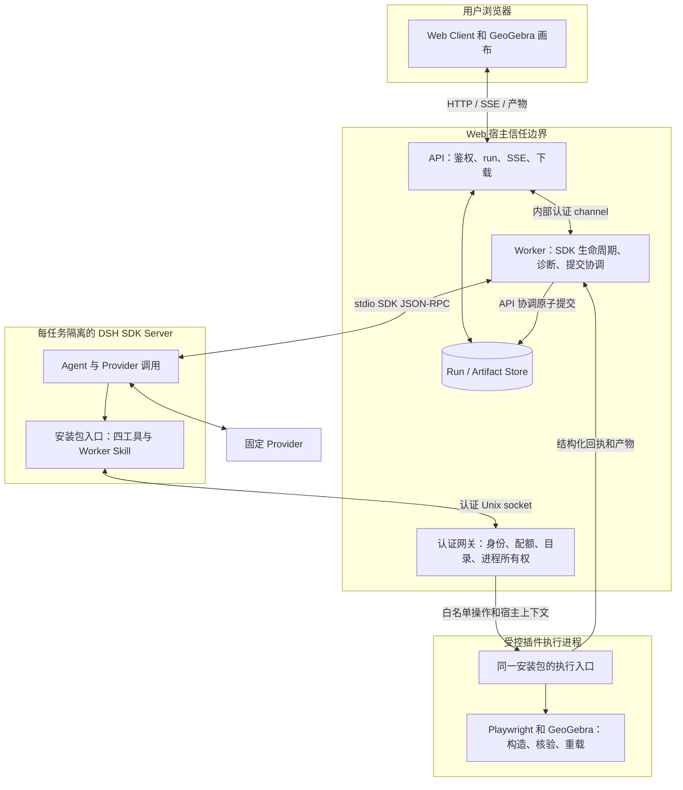
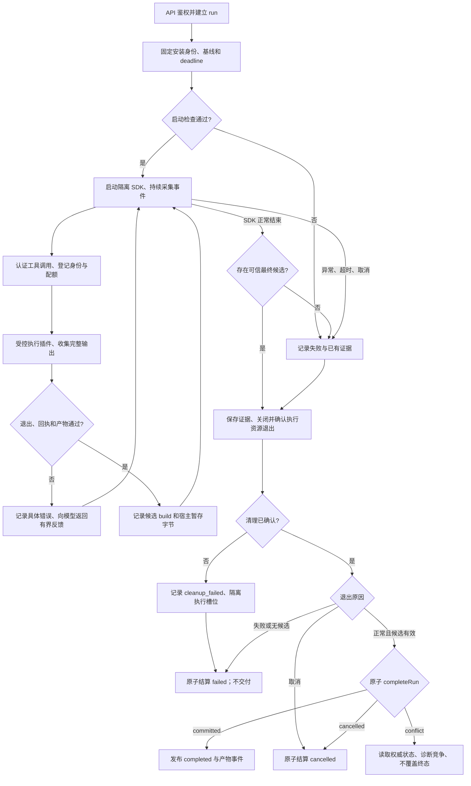
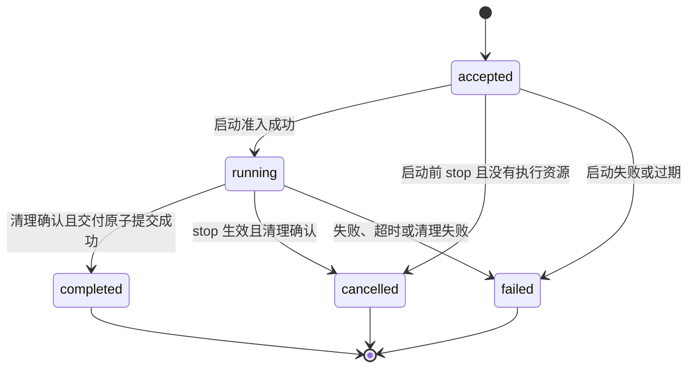
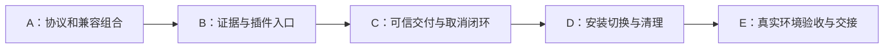

# 通过安装式 DSH 插件解耦 GeoGebra 构图能力

日期：2026-10-22。状态：**目标设计，按批次实施**。实施与验收事实统一见
[Backlog](ggb-dsh-backlog.md)，不能将某批次通过视为整套方案已经验收。

本文定义插件与 Web 宿主的目标边界、协议、迁移顺序和验收条件。初稿编写阶段只修改文档；
后续实施按各批次授权进行，不因设计获准而自动取得真实 Provider、GeoGebra、部署或数据库迁移授权。

## 1. 范围、依据与文档归属

目标：构图能力作为独立发布、独立安装的 DSH 插件进入运行环境。Web Client 和 Web API 继续提供
当前产品，Worker 作为薄执行宿主，继续使用 DSH SDK Server 和按任务隔离的 Harness。

本文使用 `ggb-construct` 作为逻辑名称，**不决定更改包名**。当前插件源码包为 `ggb-plugins`，
DSH 分发包为 `ggb-plugins-dsh`，Skill 为 `ggb-construction`。

### 1.1 文档归属

| 文档 | 职责与关系 |
| --- | --- |
| [根 README](../README.md) | 当前项目概览、结构与架构；本方案实施前不改写为目标架构 |
| [plugin-core 采用方案](ggb-dsh-plugin-core-adoption.md) | 当前引擎及冻结决策的依据；本文只提出后续安装式边界 |
| 本文 | 安装式插件解耦的目标职责、跨包契约和迁移验收条件 |
| [恢复边界提案](ggb-dsh-plugin-convergence-and-recovery-proposal.md) | 独立的拟议恢复设计；本文不以其实施为前提，不引入同一 run 自动恢复 |
| [统一 Backlog](ggb-dsh-backlog.md) | 实施、离线验证与真实验收进度的唯一入口；本文不维护进度表 |
| [切换交接](ggb-dsh-plugin-core-cutover-handoff.md)、[部署指南](deploy-dsh.md) | 已验证事实及部署步骤；实施验收后同步更新 |

### 1.2 源码审查基线

宿主 HEAD：`af4caa64`。读取时工作区已有其他文档修改及指向外部插件仓库的 `ggb-plugins` 符号链接。
以下保留设计初稿的源码基线，用于说明迁移原因。当前装配已改为固定安装包；
以 [兼容契约](../ggb-dsh/docs/dsh-sdk-compatibility.md) 和 Backlog 的本批证据为准。外部插件源码不受宿主 HEAD 固定。

| 可定位依据 | 当前事实 | 设计影响 |
| --- | --- | --- |
| [DSH runner](../ggb-dsh/apps/worker/src/plugin-core/dsh-runner.ts) | `sdk-minimal` 加载仓库内两份 patch；每轮建立并默认删除临时 home | 改为加载安装包，验证临时 home 与插件发现方式 |
| 宿主工具（旧 `packages/bundle-ggb`，已删除） | 注册 inspect/check/build，依赖宿主 application 包 | 工具迁入插件，解除宿主包依赖 |
| Prompt loader（旧 `system-prompt.ts`，已删除） | 从插件读取 worker.md，并比对宿主 profile 与插件能力清单 | 领域内容由插件加载，宿主仅核对兼容性和任务事实 |
| [工具网关](../ggb-dsh/apps/worker/src/plugin-core/tool-gateway-server.ts) | 认证包含 requestId/toolCallId，dispatch 未完整传递这些身份 | 执行、诊断、回执必须保留完整关联 |
| 执行包装器（旧 `tools/plugin-core-runner.mjs`，已删除） | 调用内部 CLI 路径、解析报告、移动交付到固定目录 | 插件专属编排迁入插件，取消固定目录成功判定 |
| [Worker service](../ggb-dsh/apps/worker/src/plugin-core/service.ts) | 读取固定 delivery；manifest 摘要可覆盖实际摘要 | 改为从已接受回执导入并检查产物 |
| [API run service](../ggb-dsh/apps/api/src/plugin-core/run-service.ts) | 完成调用仅特别处理 cancelled | 明确处理 conflict，禁止覆盖并发终态 |
| [插件 DSH 入口](../ggb-plugins/dsh/index.js) | 仅向 skills 注册候选 Skill，注入 CLI 路径 | 直接安装当前包不能替代受限四工具链路 |
| [插件 package](../ggb-plugins/dsh/package.json) | 本地版本 0.8.3，声明 DSH >=0.2.1-rc.2 | 需要重新选择并验证兼容组合 |
| [宿主 runtime 配置](../ggb-dsh/config/runtime-versions.json)、[供应锁](../ggb-dsh/vendor/plugin-core.lock.json) | DSH 0.2.0-rc.2，供应插件 0.8.0 | 不能假设当前版本可直接组合 |

### 1.3 用语与要求强度

- **必须**：验收条件；不满足时不能宣布本方案完成。
- **应当**：默认选择；偏离时必须记录原因和验证证据。
- **可以**：可选行为，不构成默认能力。
- **宿主**：本工程的 API、Worker、执行网关和 run/artifact store。
- **插件适配入口**：在 DSH 内注册模型工具和加载领域 Skill 的模块。
- **插件执行入口**：同一安装包提供的受控程序，执行 inspect/check/build。
- **构建回执**：插件执行结果；经宿主身份、协议、退出状态及产物校验后才能成为可信交付依据。
- **调用账本**：宿主持久保存的逐调用事实；不等于 DSH 原始会话日志。

### 1.4 不在本次范围内

不增加 ACP、长驻会话池、新 Agent Pipeline、通用插件市场或通用执行框架。不恢复 Native 阶段、
旧 checkpoint 或自动重放。不增加因网络中断、SDK 异常或进程退出触发的构建重试。
唯一例外是 `MALFORMED_RESPONSE` 且证据未截断、尚未调用 `ggb_build` 时，允许重跑一次模型 turn；
只读的 inspect/check 可以重复，已经调用 build 或已有构建事实的 turn 不重放。浏览器 SSE 重连仍只读取事实。

## 2. 目标架构与职责

以下图和后续契约均为**拟议目标**。



API 与 Worker 继续作为现有部署组件。图中的插件两个入口属于同一个发行包，不是两个独立服务。
浏览器只访问 Web API，不连接 DSH。插件安装不提供操作系统隔离，继续使用受控子进程、环境白名单、
部署权限与输出目录约束；不向 Agent 开放通用 shell 来替代现有网关。

### 2.1 所有权

| 责任 | 所有者 | 消费方及限制 |
| --- | --- | --- |
| 四个工具的参数、说明、模型反馈 | 插件 | DSH；工具名保持 ggb_inspect / ggb_request / ggb_check / ggb_build |
| Worker Skill、领域请求 schema、几何与重载核验 | 插件 | 宿主不得维护第二份领域规则 |
| CLI 编排、文件命名、核验报告、交付清单 | 插件 | 宿主通过公开执行及报告契约消费 |
| 模型循环与 SDK 通知 | DSH | Worker 管理启动、超时、关闭与有界采集 |
| 运行身份、capability、build 配额、deadline | 宿主 | 插件不能自行延长 deadline、增加额度或变更身份 |
| SDK 权限 overlay、最终工具白名单和执行守卫 | 宿主 | 配置在插件 patch 后应用；缺少或超出四工具集合时在模型请求前拒绝 |
| 基线字节、输出目录、进程树 | 宿主 | 插件只取得本次授权资源；输入基线不得被覆盖 |
| API 鉴权、幂等、SSE、终态、TTL | API 与现有 Store | 插件不访问宿主数据库、run token 或 HTTP 管理接口 |
| 产物字节校验、接收与存储 | 宿主 | 插件声明摘要不能覆盖宿主计算值 |
| Provider Key | API/Worker 按 run 临时持有，DSH 用于模型调用 | 不写日志和数据库；插件执行子进程不继承 Key |
| 本地会话、画布、续题基线 | Client | 新需求建立新 run；不触发旧 run 恢复 |

### 2.2 插件的两个适配入口

当前桌面入口可继续通过 skills 服务提供 Skill。新增服务端入口必须注册四工具，加载包内 Worker Skill，
调用认证宿主网关。两入口共享 schema、构造与核验实现，不复制领域管线。

领域 Prompt 由插件拥有；宿主只提供本次是否附带基线等可信任务事实。服务端所需 Skill 应当在开始模型
调用前确定加载，不依赖模型自行发现，也不回退到桌面的 CLI 操作说明。

### 2.3 Web 图片输入契约

Client → API → 认证内部通道 → Worker → SDK 的创建任务请求可以携带一张 `image`。
插件继续处理模型产生的领域请求，不读取浏览器剪贴板或宿主附件草稿。

| 字段或边界 | 已实现要求 |
| --- | --- |
| `image` | 可选；省略表示纯文本任务。显式 `null` 和未知字段拒绝。 |
| `image.mediaType` | 仅接受 `image/png` 或 `image/jpeg`。 |
| `image.dataBase64` | 规范 Base64，不接受 Data URL；解码后为 1..3 MiB，文件头必须匹配声明类型。 |
| Client 校验 | 解码后必须可显示，宽高为正，像素数不超过 2000 万；校验失败保留原草稿。 |
| 请求大小 | 最大图片和 8 MiB 基线同时存在时，包含协议开销仍小于 16 MiB 内部请求帧。 |
| SDK 适配 | 无图片时传原文本；有图片时传 `text` 和 `image` 内容块，图片字段为 `data`、`mimeType`。 |
| 鉴权与幂等 | 内部通道签名覆盖图片；HTTP 请求摘要包含图片。同一 run 的附件变化产生幂等冲突。 |
| 持久化 | 图片不写入服务端 run、SSE 或诊断。SDK 临时 home 可能包含输入；确认进程退出后清理，图片任务不保留调试 home。清理失败沿用隔离及诊断规则。 |

图片草稿只在当前页面内存中保存，归属于一个本地会话。用户切换会话时显示对应草稿。
删除附件、替换附件、删除会话或卸载页面时，Client 释放相应预览 URL。
读取中的图片禁止发送，并允许取消；已取消、已替换或已删除会话的异步读取结果不能恢复草稿。
创建任务失败时保留草稿。创建成功时只清除该次发送的附件，不能清除其他会话或后续选择的图片。
仅图片输入使用界面语言的默认构图指令；普通文字粘贴保持浏览器行为。

此恢复不恢复 Native 引擎，也不变更插件四工具契约。API 和 Worker 必须同时更新到支持可选 `image`
字段的宿主版本；旧 Worker 的严格 schema 不接受此字段。离线测试覆盖传输和 SDK 内容块，真实
Provider 是否接受图片以及识图质量仍须独立验收；本轮不调用真实 Provider。

### 2.4 最后一次构建失败摘要

宿主执行状态按 run 保存最后一次实际构建的身份和结果。在启动执行器前登记 `buildId`；
执行器返回后更新摘要。配额拒绝不生成新构建，也不覆盖上次摘要。成功构建清除先前的失败摘要。
任务结算先复制摘要到响应，再释放内存状态；后续 run 不继承该摘要。

Worker 的 `error.details`、持久化 `failure.details` 和 `plugin_core.failed.details` 使用同一有界契约。
API 以原子失败提交同时保存 run 和事件。SQLite 沿用快照，PostgreSQL 沿用 JSON 字段，无新增 DDL。

| 字段或分类 | 来源和限制 |
| --- | --- |
| `kind: not_built` | 宿主没有登记过实际构建；不包含 `lastBuildId`。只读参考资料不算构建。 |
| `kind: structure_rejected` | 插件声明 preflight 拒绝，且进程没有提供失败或不安全退出事实。 |
| `kind: execution_failed` | 执行器未返回有效结果、异常退出、超时、取消或清理未确认；不推断核验结论。 |
| `kind: verification_failed` | 执行未报告进程故障，插件返回 verification_failed 或具体失败检查。 |
| `lastBuildId` | 宿主生成的 UUID；存在构建记录时提供。 |
| `error` | 原始失败码及脱敏消息，分别最多 64、512 字符。 |
| `failedChecks` | 最多 3 条 requirementId、checkId、method、status 和可选 reason；不包含完整报告或宿主路径。 |
| `reasons` | 最多 3 条脱敏原因，每条最多 512 字符。 |

SDK 失败码和进程清理失败码仍作为主错误，已有构建失败摘要作为附加证据。成功构建之后发生 SDK
失败时，不虚构构建失败。前端从实时事件和重连快照读取相同摘要，显示分类、构建 ID 和具体原因。
无摘要的历史失败继续按原有消息显示。`plugin_core_no_delivery` 仅表示缺少可信交付，不单独证明核验失败。

### 2.5 会话自动标题与构造记录

Client 在首条用户消息写入本地后，从该消息生成标题，不调用模型。标题压缩空白、清理展示用
Markdown，并保留数学运算符；最多 32 个用户可见字符。仅图片的通用指令回退为“图片构图”或
“Image construction”。既有历史会话不做批量回填。

标题采用 IndexedDB 单个 readwrite 事务更新。手工改名记录 `titleSource: manual`，自动命名记录
`titleSource: automatic`；字段缺失的历史默认标题仍可识别。通用图片指令先回退为“图片构图”，
完成后按下述原题优先规则升级自动图片标题；手工标题永不覆盖。
更新后广播现有 `session_updated` 事件。

图片任务成功交付时，Worker 从该 accepted build 的请求中提取宿主原始 prompt 后追加的图片转录，
将其以“原题（图片识别）”或“Original problem (image transcription)”引用段放在最终汇总之前。
保留转录中的条件、问题、选项与换行；不以构造脚本代替原题，不补写缺失转录。
该段是模型识别的输入文字，不声明已核对图片识别准确性。纯文字任务、未成功交付和缺少转录时不新增该段。
转录随现有 `finalResponse` 进入持久终态、SSE、重连快照和本地最终报告，不增加图片字节存储或模型调用。

Client 优先从该原题段生成题目标题。首条用户消息对应的图片任务，可以原子替换仍等于该消息初始
自动标题的名称，包括“帮我完成这道题”一类指令；手工标题与已经升级后的题目标题不能覆盖。
后续任务不凭原题段覆盖首题的非通用自动标题；无原题段的历史交付沿用现有主题提取回退。

| 当前状态 | 事件 | 结果 |
| --- | --- | --- |
| 默认标题、未标记来源 | 首条用户消息写入 | 设置自动标题 |
| 自动图片标题 | 成功交付后的主题提取 | 升级为题目标题 |
| 自动标题 | 后续消息或迟到建议 | 保留标题 |
| 任意现存会话 | 手工改名 | 设置手工标题，包括手工输入“新会话” |
| 手工标题 | 自动建议 | 保留手工标题 |
| 会话已删除 | 迟到建议 | 忽略，不重新创建会话 |

自动标题保留数学表达式中的中英文逗号和冒号，包括坐标、命令参数及列表；长度上限和手工标题优先规则保持不变。

Worker 在成功回执、产物字节和核验报告完成校验后，从本次 accepted request 生成 `construction`。
该字段由宿主生成，随交付原子保存，不增加插件 receipt 的 artifact，也不改变插件产物清单。

| 字段 | 契约 |
| --- | --- |
| `schemaVersion / origin` | 固定为 `1 / host-accepted-build` |
| `buildId / domainRequestDigest / baseSha256` | 必须与本次 trustedBuild.binding 一致；缺少绑定或替换绑定时拒绝提交 |
| `text` | UTF-8 可执行 GGB 命令，最大 256 KiB；只保留构造步骤顺序，可含 native source、freePoint 和 command 的等价命令 |

CAS 步骤从本次已核验报告的 construction 对象读取实际表达式，输出对象赋值；已有函数声明保留原声明。
它记录实际物化结果，不把 CAS 命令直接当作代数区命令重放。独立数字、布尔值或点缺少 XML 表达式时，可用报告中的常量事实赋值；禁止用当前值替代依赖定义。
缺失 CAS 物化证据时省略整个可选脚本，避免交付不完整脚本。
每个带 `initial` 的步骤后紧随 `SetCoords(id,x,y)`，再输出下一构造步骤，保留点的约束关系和初始位置。
记录不包含核验 checks、交互测试、完整基线或宿主文件路径。基线任务只记录本次增量，并标明基线摘要。
记录文本只含可粘贴到 GGB 输入的命令，不包含技术元数据、样式、视图或显示模式；无命令或超过
256 KiB 时省略该可选字段，不影响已成功的交付。Client 将记录保存到对应 run 的本地交付，在该 run
的最终报告下以“GGB 构造脚本”显示；复制和下载使用同一命令原文。下载格式为 UTF-8 `.txt`。
切换会话或离线重开保留已保存记录，历史无记录交付不显示记录控件。

宿主和前端应同步更新；新增字段沿用 JSON 持久化，无新增数据库 DDL。

### 2.6 SDK 模型与工具级真实进度

Worker 只从当前 SDK session 的实时 `step/start`、`step/end` 通知及四工具的实际调用发布进度。
SDK 返回的历史事件仅用于诊断，不补发为实时进度。重复、倒退、错误 session、无开始的结束及关闭后的通知被忽略。
API 将进度写入 run 事件；SSE 读取持久事件。Client 显示最近一次执行事实；时间只影响已运行时长，不能产生阶段或完成百分比。

| 事实来源 | 显示内容 | 不变量 |
| --- | --- | --- |
| 尚无执行事实 | 等待执行事件 | 不声称模型已开始规划 |
| SDK `step/start / step/end` | 模型第 N 步已开始 / 已结束，等待后续执行 | 必须匹配当前 session 和合法步号；不展示模型原文 |
| `ggb_inspect` 调用与返回 | 读取参考或基线 | 不推断模型已理解题目 |
| `ggb_check` 调用与返回 | 结构预检 | 不声称浏览器已经启动 |
| `ggb_build` 拒绝/接受 | 调用被拒绝，等待后续处理 / 工具结果已接受 | 不据此声称模型正在修复或宿主正在交付 |
| 获得配额后的 `ggb_build` 调用 | 构造与核验、配额槽位 `attempt/limit` | 不拆分没有独立事件的核验、重载与导出阶段 |
| 工具返回或抛错 | `accepted / rejected / failed` | 拒绝只表示等待后续处理，不声称模型正在修复 |

内部通道 8 在同一个已认证 run 连接上发送 `plugin-core.progress`，绑定原始 `requestId`、`runId`。
握手请求和应答均要求版本 8；API、Worker 与兼容锁必须一起升级。进度帧不能完成最终结果 waiter。
字段仅包含事实来源（`model` 或工具名）、状态、宿主调用 ID、可选 SDK 步号、构建 ID/配额及时间、顺序号。
模型事实只允许 `started / finished` 且必须带步号；工具事实不允许步号或 `finished`。不携带参数或模型原文。
每 run 最多发布 128 条。未知字段、非法状态、错误 run、重复或倒退的顺序号被忽略。
连接积压超过 64 KiB 时丢弃进度；进度观察异常不改变工具执行结果。

Store 在运行状态、未请求停止且顺序号递增时原子接收进度。PostgreSQL 使用同一 run 行锁，
SQLite 使用既有写事务；completed、failed、cancelled 后不再追加进度。
进度沿用事件 JSON，无新增数据库 DDL。

`plugin_core.ready.run.progress` 包含快照游标覆盖的最新执行事实。构建返回和执行异常帧带齐本次 `buildId / attempt / limit`，后续模型、inspect 和 check 事实携带最近构建信息。
超额拒绝只保留最近槽位次数，不继承前次构建身份，不产生第四次构建。前端以“最近构建 N/M”表示槽位，退款后可以复用同一槽位；该值不是已消费配额。
重连快照不依赖浏览器上一帧补齐次数。Client 忽略其他 run、旧游标及终态后事件。
SSE 提前结束或网络断开后，Client 只重连同一 run，使用当前游标；最多重试 4 次，等待 0.5、1、2、4 秒。
鉴权等永久错误不重试；取消监听立即停止等待。重连不重新创建任务，也不重放工具调用。
已有生命周期终态仍由最终交付或失败/取消结算产生，工具进度不能改变终态。

### 2.7 单次完整请求与已检查版本

插件公开 `./drafts`，负责一次完整请求的解析、版本及检查句柄。宿主在认证的
run/turn/epoch 中创建草稿实例并注入原始 prompt；模型通过一次 `ggb_request`
提交 `requestText`。`requestText` 只包含 `plan` 和可选 `clarifications`；
locale、title、图片 transcription 作为同级小字段，原始 prompt、输出路径和 base
始终由宿主注入，模型不能覆盖。

| 操作 | 条件 | 结果 |
| --- | --- | --- |
| request | requestText 为合法 JSON 对象，正文 ≤128 KiB | 保存完整请求并增加 revision；撤销旧检查句柄 |
| check | revision 匹配 | 经原有完整 checker 成功后生成 UUID 检查句柄及完整请求摘要 |
| build | 当前有效 checkedRequestId | 执行冻结副本，回执绑定该完整请求摘要 |

一次成功 request 只增加一个 revision；写入失败不改变已有请求，也不产生部分状态。
最多 256 个 revision；草稿仅保存在内存中，关闭 turn 或进程退出后不恢复，不自动重放。
不接受文件路径、shell、网络或任意文件读写。旧 section 操作仅保留为底层兼容，
不再出现在模型 schema 或 Worker Skill 中。

requirements 保留 id/source/purpose 和完整 checks；program 使用 id/source，
可选 mode/outputs/initial；组装时显式补齐 op=native 和默认 mode=algebra。
CAS、initial、独立 expected（含嵌套数组）、原始来源、交互及呈现字段完整保留。
孤立 check、重复 requirement、缺失 expected 或必需采样均不得通过最终完整检查。

## 3. 安装、兼容与运行资源契约

### 3.1 发布与解析

插件必须发布预编译完整包，包含服务端适配入口、执行入口、协议 schema、Skill、能力清单、runtime 锁和
安装器。插件不得依赖 `@ggb-copilot/application`、宿主源码、相邻 checkout 或 Codex 缓存。
跨边界 schema 从插件的公开子路径导出，schema 导入不得启动浏览器或执行安装。首期不拆通用协议框架。

下表为目标安装描述。公开入口由插件 exports 固定，宿主不得硬编码包内 dist 目录。
当前入口与 SDK 组合的冻结结果见 [SDK 兼容性](../ggb-dsh/docs/dsh-sdk-compatibility.md#安装式插件的隔离验证组合)。

| 字段 | 来源与约束 | 消费方 |
| --- | --- | --- |
| pluginName / pluginVersion | 安装包清单；非空名称和固定版本 | 启动检查与 run 记录 |
| packageIntegrity | 宿主发布锁；覆盖所安装发行包的完整性，不由模型提供 | 安装校验、运行身份固定 |
| dshCompatibility | 插件声明及验收矩阵 | 不兼容时在 Provider 调用前拒绝启动 |
| hostProtocolVersion | 本文第 4 节，目标版本 2 | 两端必须明确支持 |
| requestProtocolVersion | 插件领域请求版本；本方案保持 2 | 插件结构校验 |
| receiptSchemaVersion | 本文第 5 节，版本 2 | 回执与持久化消费方 |
| serverAdapter / executor / schemas | 包的公开入口，必须解析到同一安装版本 | DSH loader / 宿主 runner |
| modelFacingTools | 四工具的准确列表 | 服务端工具发现检查 |
| workerSkillSha256 / runtimeIdentity | Skill 摘要；GeoGebra、Playwright 版本及可用摘要 | 启动校验、回执关联 |

发布锁覆盖发行包与 runtime；可写 setup 产物必须能对照 runtime 锁检查，不能仅凭 doctor 标记认定完整。
升级插件不得静默替换在途 run 使用的安装根；每个 run 固定版本与资源身份。

### 3.2 安装和生命周期

1. 构建镜像或发布准备阶段安装精确版本，校验发行包，运行 setup 和 doctor。
2. 发布产物保留经准备的插件安装根；运行阶段按只读方式使用，浏览器资源来自该版本的已验证配置。
3. 每任务分配独立 DSH home 和工作目录；每次 build 分配独立输出目录。
4. SDK 从已验证的安装描述加载插件。请求期间不安装包、不下载 runtime。
5. 关闭执行资源后才删除任务临时 home；长期安装根不属于任务清理范围。
6. 升级或回滚切换完整的兼容组合。不得为旧版本保留无消费者的源码读取分支。

### 3.3 实施前必须解决的兼容问题

| 问题 | 所需证据 | 未解决时的处理 |
| --- | --- | --- |
| DSH 0.2.0-rc.2 与插件声明范围不一致 | 固定一组 SDK、插件、Node/runtime 版本并通过离线启动测试 | 不进入切换批次 |
| sdk-minimal 是否具备所需 tools/skills 服务 | 使用安装包的真实 SDK 初始化与工具发现结果；无需 Provider 调用 | 补最小 profile 配置，不能启用整套桌面权限 |
| 临时 dshHome 如何加载持久安装 | 选定 SDK 支持的 profile/bundle/patch 解析方式，验证删除 home 不影响插件 | 不假设桌面安装命令可直接用于 SDK |
| 本地插件与供应包版本、浏览器配置不同 | 在仓库外安装的发行包验收及目标机器 runtime 记录 | 不用源码 checkout 成功替代发行包验收 |

加载方式采用插件公开安装描述中的 serverPatch 加 sdk-minimal，Worker Skill 直接贡献到 systemPrompt，
不要求引入桌面 skills 服务。确切 SDK 版本、隔离依赖锁和复现命令由上述 SDK 兼容性文档维护。
桌面 CLI 保持 envelope 1。宿主通过公开 `./executor` 消费 envelope 3 和回执；纯报告门禁通过
`./delivery-contract` 导出，与插件 build/preview 复用同一实现。默认链路切换属于批次 D。

## 4. 工具与宿主执行协议

### 4.1 三层边界

| 边界 | 所有者 | 输入与输出 |
| --- | --- | --- |
| 领域请求 protocol 2 | 插件 | 模型提供构图请求；插件返回结构问题与核验事实 |
| 工具到宿主协议 version 3 | 插件发布 schema；宿主维护授权策略 | 认证调用、宿主分配的执行上下文、调用结果 |
| 宿主到执行器 envelope 3 | 插件 | check/inspect/build 响应、操作和上下文绑定、数据 schema、preflight/execution 阶段；上下文仍为版本 2 |
| API/Worker 和 Client/API | 宿主 | 保留现有 run、SSE、产物协议；内部字段变化按版本规则升级 |

工具网关当前使用 version 3，拒绝 version 1/2。模型参数已从完整 request 改为分段草稿与检查句柄，不能与旧安装包混用。
领域请求和执行上下文仍为 2；executor 为 3，receipt 为 2。
执行入口不必破坏桌面 CLI 的现有 envelope；应当提供明确的服务端公开入口。
未知版本拒绝，不猜测降级；删除旧入口时同步清理仅为旧入口存在的测试。

### 4.2 模型可见接口

| 工具 | 输入 | 正常结果 | 拒绝或失败 |
| --- | --- | --- | --- |
| ggb_inspect | 可选固定 reference 主题，无路径参数 | 省略参数返回基线对象；指定主题返回当前插件内的有界参考 | 无基线且未指定主题返回 base_missing；拒绝任意路径或 URL |
| ggb_request | 完整 requestText、locale/title/transcription；正文 ≤128 KiB | 当前 revision 和完整请求摘要；一次保存完整请求 | JSON 语法、宿主字段、大小或 revision 拒绝，不改变已保存版本 |
| ggb_check | 当前 revision | 完整结构检查；成功返回 checkedRequestId 和完整请求摘要 | 返回具体字段路径和 issues；不启动浏览器、不证明几何成立 |
| ggb_build | checkedRequestId | 有界核验摘要与宿主关联的结果标识 | 插件领域拒绝和执行故障分类返回；不得伪装成功 |

参数必须闭合；模型不能提供 outputDir、base 路径、运行身份、配额或凭据。工具结果中的对象名称、
定义与文字均按不可信数据呈现。模型不接收内部路径和完整诊断，简短反馈必须保留可修正的问题。
模型入口要求当前已检查版本的句柄；build 内部仍自行完成结构、构造、重载及交互核验。句柄不是成功凭证，也不是执行授权；授权仍由宿主 capability 提供。

### 4.3 认证调用与宿主上下文

| 字段 | 类型与来源 | 不变量 |
| --- | --- | --- |
| protocolVersion | 工具 envelope 字面量 3；执行上下文仍为 2 | 接收端精确校验 |
| requestId / toolCallId | 适配层生成的 UUID v4 | 全链保留；若 SDK 可提供调用身份，另建映射，不伪称二者相同 |
| runId / turnId / epoch | 宿主提供；沿用现有标识格式与正整数 epoch | 必须匹配当前有效 capability |
| toolName | 四工具枚举 | 非白名单操作在启动子进程前拒绝 |
| arguments / argumentsDigest | 原始工具参数及其 canonical JSON 的 SHA-256 | 校验原始调用参数，不能用摘要代替参数校验 |
| issuedAt / nonce / authentication | 沿用现有时间窗、随机 nonce 和 HMAC 签名规则 | 签名覆盖整个未签名 envelope；验证后才执行；令牌不持久化 |
| buildId | 宿主为每次接受的 build 生成 UUID v4 | 模型不能指定；和 requestId 一对一关联 |
| domainRequestDigest | 宿主对实际传给插件的领域请求计算 canonical JSON SHA-256 | 排除宿主路径与身份；草稿按公开契约补齐 native op、默认代数模式和可信元数据后计算；执行期间不得再改写；不同于 API requestDigest 和 argumentsDigest |
| baseRef / baseSha256 | 宿主提供的本次基线引用与摘要，均可为 null | 同时存在或同时为空；执行前检查实际字节；禁止插件覆盖输入 |
| outputRoot / deadline | 宿主独立目录与绝对截止时间 | 插件不能扩权或延长；实际预算取 run 和操作预算较早者 |

buildId 及后四项只进入认证后的宿主到执行器请求，不进入模型参数或签名之前的模型输入。
基线路径等内部字段在本机边界中传递；向模型和浏览器返回时移除。
重复 requestId/nonce 拒绝且不再次执行；同一请求超时不得自动重新投递。

同一 run 的有副作用工具必须串行准入，配额检查与预留必须原子执行，不能只依赖工具的并发提示。
维持当前最多三次 build 的策略和浏览器执行前拒绝退款规则；每次预留至多退款一次，启动事实必须可定位。
本方案不因重启恢复模型或重置同一 run 的额度。

### 4.4 资源上限与错误

首期沿用当前对应边界的限制：领域请求 128 KiB、工具帧 256 KiB、执行器 stdout 1 MiB、
stderr 有界尾部 64 KiB、交付 GGB 6 MiB、可选预览 3 MiB、报告和 manifest 各 1 MiB、run deadline 10 分钟。
交付 JSON 上限 16 MiB，完整响应帧上限 17 MiB，均按 UTF-8 字节计量。
API 为每个 run 建立独立连接；有无换行的超限响应均只影响该 run。
preview 缺失合法；存在但为链接、非普通文件、空文件或超限时必须拒绝。
编码后仍须满足所在 channel 的帧上限，不能只检查二进制大小。具体操作超时延用现有配置并受总 deadline 限制。

以下为拟议**内部错误分类**，不是已发布 API failure enum。公开错误仍映射现有稳定码并保留诊断关联；
如需增加公开码，必须同步 schema、Client 与版本规则。

| 分类 | 触发条件 | 宿主动作 |
| --- | --- | --- |
| unauthorized / expired / duplicate | 身份、时间窗或防重放校验失败 | 不执行；记录可安全取得的调用身份，不记录 token |
| invalid_request / plugin_rejected | 参数或领域 schema 不合法、核验未通过 | 保留具体 issues；允许当前 Agent 在既有预算内修改请求 |
| protocol_invalid / exit_failed / output_limit | 返回结构不合法、异常退出、输出超限 | 分类为执行故障；终止并清理，不自动重放 |
| sdk_failed / timeout / cancelled | SDK 异常、超时或取消 | 停止新调用，保存证据，执行清理 |
| artifact_mismatch / verification_invalid | 产物关联或摘要错误、报告缺失或不完整 | 禁止完成，不用 unknown 替代缺失报告 |
| cleanup_failed / commit_conflict | 无法确认进程退出、持久提交竞争 | 按第 6、7 节处理，不返回伪成功 |

## 5. 构建回执与交付契约

### 5.1 回执字段

执行器必须返回一个完整 JSON envelope。stdout 只承载协议结果，诊断写 stderr；宿主收集完流并取得退出
状态后解析。正常的成功与领域拒绝均以退出码 0 返回合法 envelope；非零退出或 signal 属于执行故障，
即使输出包含 ok:true 也不能接受。结构化领域拒绝与内部异常必须分开。

| 字段 | 类型与约束 |
| --- | --- |
| receiptSchemaVersion | 字面量 2；旧回执不能用于新的完成提交 |
| runId / turnId / epoch / requestId / toolCallId / buildId | 必须与本次执行上下文逐项一致 |
| domainRequestDigest / baseSha256 | 必须与宿主计算值一致；无基线为 null |
| pluginName / pluginVersion / packageIntegrity / runtimeIdentity | 必须匹配本次 run 固定的安装身份 |
| status | succeeded 或 rejected；执行故障由宿主记录，不能补造成功回执 |
| issues | 有界结构化数组；至少保留 code、message 和可用的字段 path；成功时为空 |
| verification | 成功时为 reportSha256、reportBytes、summary；summary 上限 2 KiB，由插件公开投影产生；拒绝时为 null |
| artifacts | succeeded 时包含 result_ggb、verification、manifest；preview 可选；rejected 时为空 |
| artifacts 中每项 | kind、相对输出根的文件引用、bytes、sha256、contentType；kind 唯一，摘要为小写 64 位 hex |

插件负责报告 schema 与“满足交付条件”的语义，宿主调用插件公开的纯校验函数消费，不复制几何 checker。
所有必需检查必须满足插件契约；不适用项目必须由报告显式说明，不能以缺字段或 unknown 代替。

manifest 可以记录 GGB、报告和预览摘要，但不记录自身摘要。manifest 的摘要由外层回执提供，避免自引用。
回执本身的摘要由宿主持久化时计算，不反向写入同一回执。

### 5.2 可信接收与产物归属

回执不是插件自行签名即可获得的权限。宿主必须将它关联到本次认证调用和受控子进程，确认退出状态、
身份、协议和安装版本，再读取产物计算实际 bytes/sha256。

- 每个 build 写入独立目录；禁止共享 run/delivery 作为成功事实来源。
- 相对路径不得越过该 build 输出根；拒绝绝对路径、父目录穿越、越界符号链接及非普通文件。
- 接收阶段在进程退出后读取受控目录，将已校验字节保存在宿主内存；提交使用这些字节，不再复制 accepted/ 暂存目录。
- 文件名由插件决定。宿主按 kind 接收，不再假设构图文件名总是 result.ggb。
- 缺失必需产物、摘要/大小不符、报告不可读或不完整时，禁止生成候选交付。
- 输出目录不能与长期插件安装根或基线目录重合；失败产物只作为受限证据保存，不发布为正式交付。

### 5.3 多次构建与最终选择

每次接受 ggb_build 执行时，宿主先清空旧候选，再登记新的 buildId。只有该次成功回执及产物通过接收后，
才能设置候选。后续接受的 build 失败或被插件拒绝时，不回退到旧成功目录。宿主准入前拒绝的调用不替换候选。
inspect/check 不改变候选。此规则不改变 build 配额和退款策略。

最终 completed 必须同时满足：

```text
SDK 本轮正常结束且无取消/超时
  + 最后一次被接受执行的 build 已形成可信候选
  + 回执、请求、基线、安装身份和产物完全关联
  + 插件核验契约满足且实际字节摘要一致
  + 当前 run 允许提交且存储返回 committed
  = completed
```

SDK 异常时，即使曾有工具成功，也只保留诊断与构建事实，不自动完成或重放。本方案不提供交付恢复。
模型最终文字不是成功凭证；是否有预览图也不是 completed 的必要条件。

## 6. 正常、失败与取消流程



工具执行故障清理后是否允许模型修正，取决于剩余 deadline、配额和资源健康；清理未确认时必须终止 run。
图中的循环是同一 DSH Agent 对证据的正常响应，不是宿主自动重试或恢复。

### 6.1 失败证据

Worker 的 `request` 参考和首轮系统提示使用安装包内同一份
`references/worker-request.md`。CLI 的完整请求信封不进入该主题。
简单任务可直接按注入契约提交；有知识缺口时只读取相关的 1–2 个主题，通常累计不超过 3 个。
批次上限仍为 6 个固定标识、24 KiB，不豁免基线检查；整章组合仍可能超限。
Worker 预加载常用步骤、检查、命名、样式与采样契约，不要求确认字段前读取整章。
`reference` / `references` 可使用插件发布的固定小节，例如 `program.outputs`、
`verification.engine`、`interactions.parameters`；不增加工具或开放文件路径。
小节与所属整章的覆盖关系来自安装包 `referenceCoverage`，宿主不按字符串猜测关系。
完整读取整章可标记其所属小节；读取一个小节不标记整章或相邻小节。
只有完整响应验证成功后才更新覆盖记录；失败或超限不记录，refresh:true 可显式重读。
题目来源、一种充分构法、独立期望、完整依赖和有效样本准备好后提交 check/build。
参考只用于具体缺口，不遍历链接或在提交前模拟全部校验；不削弱任何核验条件。
安装包通过 `PRELOADED_REFERENCE_TOPICS` 声明已注入的完整主题；未声明时宿主不假定已注入。
Worker 在每个认证 turn 内只保存已读主题标识，重复读取返回 `alreadyAvailable`，不重复附带正文。
混合批次只读取缺失主题，仍保留原始调用身份、鉴权、逐调用证据和进度事件。
只有完整主题的身份、正文和最终序列化字节数通过检查后才更新记录；失败读取不改变记录。
关闭 turn 即销毁记录，不跨 run、turn 或 epoch 复用。上下文压缩后确实丢失正文时，
模型可用 `refresh:true` 显式重读；该参数必须附带固定主题，不允许任意路径或超限响应。
派生对象必须用 `dependsOn` 覆盖每条关系的全部定义输入，不能只保留滑块依赖；
当前坐标正确不能代替依赖验收。
工具验证已声明的检查，不负责从任意题目自动补全遗漏条件。
`type` 检查使用 `objectType`，`expected` 只用于 `expression`。
requirement 的 `source` 逐字引用用户原文、转写或已确认回答，显示美化只放在 `caption`。
Client 发送续做请求时重新读取选中对象，不复用输入框提示缓存。
每个对象带精确 `label`、引擎 `type` 和显示 `displayName`，最多 16 项；按标签去重，不按显示名合并。
Client 将这些信息序列化为有界 JSON 数据块，与用户要求一起进入现有 `prompt`。
API、内部通道和 SDK 按原链路传递；标签按基线 inspect 确认，显示名不作为对象身份或指令。
本地消息与自动标题保留原始用户输入；服务端请求摘要绑定实际发送的完整 prompt。
取消选择时不附上下文。对象缺失、元数据截断、导出期间选择/画布/会话改变时拒绝发送，不静默猜测目标。
后台 Session 只使用自己的本地基线，不读取前台选择；后台交付不加载到前台画布。
后台交付先以 GGB 字节摘要保存；首次打开该 Session 时校验摘要、加载并转为常规画布快照。
该选择是浏览器用户上下文，不增加宿主权限，也不替代插件的目标存在性和核验门禁。
图片任务必须在首次 `ggb_request` 前转写成完整数学问题文本，保留已知条件、方程、
标签、约束、提问及识别歧义。转写不是图片摘要、答案或模型推断出的条件。
Worker 从已验证的 SDK 图片输入设置认证 turn 的图片事实，不从 prompt 关键词或模型字段推测。
图片任务首次保存缺少非空 `transcription` 时，返回可修复工具错误 `image_transcription_required`；
在调用插件 draft 和失效旧交付之前拒绝，不改变版本、已检查句柄或构建额度。
只有插件完整保存成功后才记录可沿用转写。后续修复可省略该字段，但显式空数组不能清除它。
失败保存、关闭 turn 和新 turn 不继承未保存或其他 turn 的转写状态；文字任务无需转写。
宿主只校验输入存在性和保存状态，不认证识别准确性；来源检查仍由插件按原文执行。
Host task facts 和 Worker 提示要求选择一种充分构法，在完整检查准备好后提交；
只为具体知识缺口读取参考，不通过检索重复确认已注入契约或比较已知构法。
这属于提示策略和首次保存门禁，不新增模型轮次、自动重试或基于时间的阶段推测，
也不承诺未经真实 Provider 测量的延迟改善。
修改模式允许受限参数采样：目标可以是基线或新增的独立、可移动、未固定数值滑块。
参数值必须变化、位于区间并满足步长。仅样式编辑不支持采样；修改模式不开放鼠标拖动。
每个样本独立重载最终 GGB，在同一副本设置目标值、核验、恢复原值并核验完整快照。
采样差异只允许目标值和依赖数学字段变化；无关变化、样式变化和增删对象阻止交付。
最终回执绑定原请求、采样与恢复证据；采样不回写交付画布或原始基线。
零样本报告和交付摘要使用 `not_sampled`；有样本且通过才显示交互 `passed`。
旧报告的 `passed` 加零样本可继续复核，但摘要和 Client 必须显示“未采样”，不改写原证据。
缩放证据独立保留，不能替代参数或拖动采样。SSE、重连与本地恢复沿用同一交付摘要。
Worker 遇到明确不支持的采样时报告能力限制，不原样重试，也不能删除必需 sampled 检查。
本批离线模拟覆盖执行、恢复、取消、拒绝与投影；真实引擎和 Provider 验收另行授权。
固定 GeoGebra 5.4.932.1 把精确同名 caption 存成空默认值；核验仅在请求 caption
等于精确对象名且实际读回为空时按等价处理，仍检查标签模式。自定义 caption 不放宽。

Worker 必须在等待整个 RunResult 前通过 SDK 支持的通知接口采集有界事件。采集异常不能清空已经取得的
事实。每个工具调用在准入、开始和结束处登记 requestId、toolCallId、buildId 及可用 SDK 映射。

持久证据包括：脱敏请求及摘要、身份、安装版本、准入/启动/结束事实、具体 issues、工具结果、
异常类型/位置/稳定码、退出码/signal、可取得的 stderr 尾部、清理结论、用量及缺失原因。
未知用量保持 null，不能记成零；传输错误不能统一归为插件领域拒绝。

每轮 Provider 的受限 `.stream.json` 增加 `performance`，只保存时间和计数：

| 字段 | 来源与含义 |
| --- | --- |
| `timing.requestSentMs / responseHeadersMs` | SDK stream 开始至调用 Provider `POST /messages` 的原始 fetch／收到该请求响应头的实测偏移，单位 ms；请求元数据采集在发送时间点之前完成 |
| `timing.firstByteMs / firstEventMs` | 第一个非空响应字节块／可解析 SSE 事件；心跳字节不代表模型已生成内容 |
| `timing.firstContentMs / firstThinkingMs / firstTextMs / firstToolInputMs` | 首个非空内容及各内容类别的实测偏移；空起始块和签名不算内容 |
| `timing.lastContentMs / streamEndMs` | 最后一个非空内容／`message_stop` 事件的实测偏移 |
| `timing.observedContentSpanMs / postStreamMs` | 首尾内容间隔／`message_stop` 至 SDK stream 关闭的间隔；没有相应观测时为 null |
| `content.thinking / text / toolInput` | 各类 `starts`、`deltas` 和 UTF-8 `bytes`，包含非空起始内容，不记录正文或签名 |

未收到的时间为 null。取消和异常不伪造 `message_stop`；零字节计数仅表示未观测到内容。
同一 origin 的图片、其他路径、GET 及其他 origin 的响应不写入该轮的 Provider 时间点或状态。
字节数不是 token 数，首尾内容间隔不是纯推理耗时，不能据此推测模型决策。
结合既有请求上下文字节、用量和工具开始／结束账本，区分模型流与工具执行开销。
诊断限额、写入失败和未知 block 不改变流内容、任务预算或模型策略。
本批保持 `reasoning:high` 和 `maxTokens:49152`，不修改 Provider 的历史 reasoning 回传。

首期事件预算采用条数和总字节双限制，沿用已有帧、输出与响应上限；事件采集的准确上限须在批次 B
固定到配置及测试。超限保留截断标记、首个根因、调用关联及有界尾部，不因日志截断放宽执行预算。

顺序必须是：采集异常和已收到证据 → 持久化初始诊断 → 撤销 capability、关闭并等待退出 →
补写退出/清理诊断 → 清理临时 home。不得依赖保留完整原始模型日志定位问题。
证据持久化失败必须形成可观察的存储错误，不能静默吞掉；仍须继续进程清理。

诊断不得包含 Provider Key、capability、签名 secret；上传文件内容和原始模型日志不复制到公共日志。
诊断采用 run 关联的受限存储与 retention，默认不出现在 SSE 或产物下载列表。
确认进程清理后，Worker 删除 base.ggb 和 builds/，只保留 run 内的诊断与 usage.json。
诊断保留 7 天，Worker 在启动时和每小时清扫到期目录；旧 usage.jsonl 按相同期限淘汰。
活动、清理未知、有 owner 标记或 quarantine 标记的目录不得由 TTL 自动删除。
每次执行取得独占 owner 和递增的持久 epoch；启动时将残留 owner 隔离并占用槽位。
此机制只阻止未知资源复用，不自动恢复或重放模型任务。
Worker 启动前必须确认 POSIX 进程清单可用；Windows 和缺少 ps 的环境在启动时明确拒绝。

### 6.2 进程所有权与取消

Worker runner 拥有插件执行进程树，DSH runner 拥有 Harness 进程树。插件执行入口负责关闭其浏览器。
DSH 适配器不得自行启动宿主无法管理的执行器。POSIX 下避免内层再次 detached 形成新进程组；若保留额外
子进程，必须登记并纳入回收。其他支持平台须提供对应的树清理实现及测试，不能把 POSIX 结论直接外推。

收到 stop 或超时后：拒绝新工具调用，传播取消，先请求正常关闭；超过既有关闭预算则强制终止，
等待进程退出和输出流关闭后记录结论。进程组 kill 返回、SDK close 返回或 socket 断开均不能单独证明清理完成。

正常取消确认后才结算 cancelled、释放槽位并清理输入。清理失败时记录失败原因并隔离对应执行槽位，
不得继续复用；人工或进程级回收确认后才能释放。客户端可以先显示 stopRequested，不能提前宣称资源已退出。
整个宿主崩溃时依靠部署层进程组/容器边界回收；已有过期 run 的失败收敛不能作为退出证明。
TTL、删除和 shutdown 必须遵守相同边界，不得在活跃执行器仍可能写入时删除输出目录。

## 7. Run 状态与原子提交

保持现有持久 phase：accepted、running、completed、failed、cancelled。清理中是执行内部阶段；
不为此增加一个公开 phase。stopRequested 与 phase 分开记录，API/Store 不得仅因 stop 标记提前落取消终态。



| 原状态 | 事件与守卫 | 动作及目标 | 状态所有者 |
| --- | --- | --- | --- |
| accepted | 身份和运行准入通过，无有效 stop | CAS 到 running；启动 Worker 任务 | API/Store |
| accepted | stop 已持久化，确认未启动执行资源 | 原子写 cancelled 及事件 | API/Store |
| accepted | 启动失败或执行期限过期 | 原子写 failed 及原因 | API/Store |
| running | SDK 正常结束、候选可信、清理确认、无有效 stop | 产物、回执关联、用量、completed 事件一起提交 | API/Store |
| running | stop 生效且所有执行资源退出已确认 | 原子写 cancelled 及清理证据引用 | API/Store |
| running | 异常或超时，完成清理尝试 | 原子写 failed；清理失败附隔离事实，槽位仍不可复用 | API/Store |
| 任意终态 | 重复/迟到完成、取消或失败 | 保留权威终态；记录重复或冲突，不增加第二个终态事件 | API/Store |

### 7.1 提交与竞争

创建 run 时必须固定 deliveryContract（legacy 或 receipt-v1）。receipt-v1 缺少回执时必须拒绝，
不能依据结果字段是否存在来回退到 legacy。迁移 018 持久化此字段；内部通道 8 贯通该值与清理确认及统一大小上限；旧通道在握手阶段拒绝。
Store 必须校验 bytes、sizeBytes、sha256 及交付引用一致；回执必须绑定已接受调用，不能仅存一个外部
传入的 ok:true。Worker 的可信接收与 Store 的数据一致性检查分别存在，Store 不执行几何核验。
构建调用记录、回执、清理证据的必要关联须扩展现有 plugin-core store，不建立第二套 run store。
Memory、SQLite、PostgreSQL 必须具有一致的完成校验和竞争语义；具体表/列与迁移号在实现时确定。

| completeRun 结果 | 调用方要求 |
| --- | --- |
| committed | 才能发布完成与可下载产物；提交包含本次可信回执关联和所有正式产物 |
| cancelled | 只有已有取消守卫及清理证据满足时才结算取消；不发布交付 |
| conflict | 读取持久状态；相同已提交交付按幂等结果处理，不同终态保留并诊断；仍为非终态则记录提交故障并按 CAS 失败收敛，不能静默结束 |

当前 Store 的 stop 分支可能直接转为 cancelled；实施时必须一并调整 completeRun、failRun、cancelRun、
markRunning、期限清扫及 API 的取消/删除入口，确保没有执行资源时或清理确认后才能取消结算。
若竞争无法在当前事务收敛，必须保存可检索诊断并由现有期限清扫失败收敛，不启动模型或重放 build。
失败和取消提交自身的 conflict 同样不能覆盖既有终态。stopRequested 与 cleanup_failed 同时出现时，
不得由 stop 分支掩盖清理失败；应结算 failed 并保留槽位隔离事实。
API→Worker 通道异常或缺失有效清理证明时，结算 worker_unavailable，清理状态保持未知。
该记录不能被 stop 转成 cancelled，也不能由普通删除或 TTL 清除；只有执行 owner 可以提供清理事实。

## 8. 代码迁移清单

下表是未来实施清单，本轮不执行。宿主路径相对 ggb-dsh；插件路径相对独立插件仓库。

| 位置 | 动作与最终职责 | 关联消费者/检查 |
| --- | --- | --- |
| 插件 dsh/index.js、dsh/package.json、cordis.patch.yml | 增加受限服务端入口、公开 schema/执行入口；桌面与服务端共享领域实现 | 插件打包/入口测试、SDK 加载检查 |
| 插件 skills/ggb-construction/worker.md、capabilities 生成器 | 插件自己加载领域 Prompt；生成安装能力与协议声明 | 不手改生成能力数据；打包完整性检查 |
| 插件 CLI/执行与 delivery 模块 | 接收宿主上下文，输出完整回执，拥有报告和命名规则，响应取消 | 插件 schema、核验、交付、进程清理测试 |
| packages/bundle-ggb | 工具定义、反馈与工具侧认证客户端迁入插件；切换后删除无消费者包及引用 | 工具测试迁到插件；宿主只测边界 |
| profiles/ggb-plugin-core | 删除宿主旧 profile；宿主保留 sdk-minimal 和安装准入，使用包公开 server patch | profile/工具发现、禁止 shell 回归 |
| apps/worker/src/plugin-core/system-prompt.ts | 领域加载迁入插件；删除内部 worker.md 路径耦合，保留宿主任务事实 | Prompt/基线场景测试 |
| 同目录 dsh-runner.ts | 加载固定安装、订阅有界事件、明确退出/清理结果 | SDK 正常、异常、超时、临时 home 测试 |
| 同目录 tool-gateway-server.ts、gateway.ts | 贯通调用身份；认证、串行配额、账本；不复制领域校验 | 认证、防重放、并发、退款与取消测试 |
| 同目录 process-runner.ts | 只负责受控进程、限制、完整流收集、退出与清理 | 非零退出、signal、输出超限、树清理测试 |
| 同目录 host-policy.ts、host-policy-plugin.ts | 宿主拥有最后应用的权限 overlay、模型前工具集合校验和执行白名单 | 插件省略禁用项、额外/缺失工具、动态执行拒绝与本地 SDK 反例 |
| tools/plugin-core-runner.mjs | 专属 CLI 编排、报告解析、移动交付迁入插件；删除固定目录包装器 | 清理脚本路径、环境变量与旧测试 |
| apps/worker/src/plugin-core/service.ts、base-registry.ts | 管理任务、基线、最终候选、回执接收与清理；不扫描固定目录 | 旧文件、多构建、失败证据、基线保护测试 |
| apps/worker/src/composition.ts、config/env.ts、plugin-core/preflight.ts | 按安装描述装配；廉价启动检查不启动真实浏览器 | 启动、安装解析与环境配置测试 |
| packages/application 的工具协议、channel、run 契约 | 移出插件所有的 schema；保留宿主契约和公开错误映射 | 两端消费者同步；按独立边界规则升级版本 |
| apps/api/src/plugin-core/run-service.ts、取消/删除/TTL 入口 | 消费可信交付；处理所有提交结果；清理确认后取消 | HTTP/SSE、停止竞争、删除与过期回归 |
| packages/run-persistence 三种 Store 及迁移 | 保存必要调用/回执/清理关联；一致的原子验证和 CAS | Memory、SQLite、PostgreSQL 契约测试 |
| tools/provision-plugin-core.mjs、vendor 锁 | 使用精确版本安装包、完整性及 setup/doctor，输出安装描述 | 仓库外安装、混版/缺失资源拒绝 |
| deploy/container、systemd、local | 安装根只读；任务目录独立；取消源码 checkout 默认回退；明确进程组回收 | 容器与目标机器验证，需单独授权 |
| apps/client 的 adapter/projector/画布消费者 | 保持 HTTP/SSE 和基线交付；必要时消费有界诊断标识，禁止终态提前显示 | 重连不重跑、下载摘要、加载失败保留旧画布 |
| workspace 清单、project references、锁文件、检查脚本 | 删除失去消费者的 bundle 构建与路径；只有依赖变化才更新锁 | 包边界、增量构建、受影响检查 |
| README、采用方案、兼容/协议文档、交接与 Backlog | 实施后同步各自职责；仅记录实际通过的验收 | 链接、版本、事实与进度一致性 |

共享几何包若仍有 Client 或其他消费者，不属于删除范围。不得为切断 server 插件依赖删除仍可达的共享能力。

## 9. 实施顺序与批次退出条件



| 批次 | 工作范围 | 退出条件 |
| --- | --- | --- |
| A | 固定插件公开入口、协议 schema、错误映射、SDK/runtime 组合；确定安装描述和迁移字段 | 仓库外安装包可在目标 SDK 下初始化并发现四工具及 Worker Skill；不调用 Provider；未知版本明确拒绝 |
| B | 先补当前链路失败证据与调用身份；插件新增工具入口并接收宿主上下文 | SDK 中途异常、工具拒绝都有可关联证据；凭据不泄露；采集预算固定；未切换默认入口 |
| C | 构建回执、独立目录、候选选择、产物接收、Store 原子提交、取消和树清理一起闭环 | 失败/篡改/迟到结果不能完成；清理未确认不能复用槽位；三种 Store 行为一致 |
| D | 将默认 SDK 配置切到安装插件；移除宿主重复工具及专属包装器；修改供应与部署资产 | 运行不需要插件源码/相邻 checkout/Codex 缓存；清理无消费者入口；定向及集成检查通过 |
| E | 在授权环境进行真实 Provider、GeoGebra、浏览器和部署验收 | 第 10 节适用真实验收通过；记录精确版本、镜像及运行证据；更新交接和当前架构 |

首期直接扩展现有 Gateway、Runner、Service、Store；不先建设抽象插件管理层。
每批一次完成相关修改后定向验证；只在依赖变化时安装，不重复成功检查。
默认使用模拟 SDK/插件和本机受控测试子进程。真实浏览器、Provider、部署及数据库迁移需要分别授权。
回退发布切换上一个完整宿主与插件组合，不在同一 run 中切换插件或重新执行已开始的构建。

## 10. 验收标准

下列均为待执行标准，不表示已通过。离线协议检查、真实 SDK 初始化、真实 GeoGebra 和真实 Provider
验收必须分别记录。证据存放忽略目录，不提交用户数据、诊断日志或数据库。

| ID | 场景与操作 | 可观察通过条件 | 验证层 |
| --- | --- | --- | --- |
| AC-01 | 仓库外安装精确发行包，隐藏插件源码与其他客户端缓存 | 插件完整就绪；SDK 初始化、四工具发现和 Worker Skill 加载成功 | 安装与 SDK，无 Provider |
| AC-02 | DSH/协议不兼容、Skill/CLI 混版、runtime 缺失 | Provider 调用前拒绝；返回具体安装/兼容错误 | 离线 |
| AC-03 | 删除一个已结束任务的临时 home，再创建新任务 | 安装根不变，新任务可加载同一插件；目录不串用 | 离线与 SDK |
| AC-04 | 错误签名、旧 epoch、重复 nonce/requestId、模型注入路径 | 不启动执行器、不增加构建副作用；拒绝证据可关联 | 网关 |
| AC-05 | 并发 build、第四次 build、浏览器启动前拒绝 | 不超配额；退款至多一次；同一 run 不并行写输出 | 网关与插件 |
| AC-06 | 构建 A 成功、B 失败；预先放入旧 delivery | B 执行被接受后 A 不成为候选；旧目录不能触发 completed | 集成，模拟执行器 |
| AC-07 | 替换 GGB/报告、伪造摘要、缺报告、越界符号链接、重命名 GGB | 篡改和越界拒绝；合法命名按 kind 接收；实际下载字节一致 | Runner/Service/API |
| AC-08 | 退出码非零但输出成功、signal、截断 JSON、stdout 超限 | 明确分类为执行故障；收完流才解析；无正式产物 | Runner |
| AC-09 | SDK 收到部分事件后抛错、随后临时 home 被删除 | 已有事件、根因、逐调用证据和退出事实仍可检索；未知用量为 null | SDK 模拟与诊断 |
| AC-10 | 诊断内容含模拟 Key/token，日志超限或存储失败 | 敏感值被移除；截断有标记；存储故障可观察且仍执行清理 | 离线 |
| AC-11 | 取消或超时发生在插件/浏览器运行中 | Harness、执行器和浏览器进程树退出；取消终态在清理确认后发布 | 受控真实进程；浏览器需授权 |
| AC-12 | 模拟关闭失败、API 断连、Worker 崩溃、TTL/删除竞争 | 清理失败槽位不复用；部署层回收可验证；断连不重放；活跃输出不被清理 | 故障注入与部署 |
| AC-13 | completeRun 的 committed/cancelled/conflict 及重复/迟到提交 | 单一权威终态；无静默非终态；无未绑定产物；取消与清理守卫一致 | 三种 Store + API |
| AC-14 | 新构图、显示修改、基线续构 | 插件核验及重载满足契约；基线输入不变；产物可加载 | 真实 GeoGebra，需授权 |
| AC-15 | Web 创建、SSE 重连、下载、加载失败及下一题 | 重连不启动模型；下载摘要与卡片一致；加载失败保留旧画布；新 run 基线准确 | Client/API，真实端到端需授权 |
| AC-16 | 无源码镜像部署、插件升级与完整组合回退 | 新 run 使用选定组合，在途 run 固定原版本；不重放；目标版本可定位 | 发布演练，需授权 |
| AC-17 | 搜索依赖与旧路径，运行受影响构建与测试 | 插件无宿主源码依赖；宿主无插件内部路径和重复领域实现；公开契约可独立消费 | 静态检查与定向测试 |

AC-11 必须观察子孙进程和受控测试资源的退出，不能只断言调用过 kill/close。
AC-13 必须覆盖停止与完成并发，不能只测试三个返回字符串。PostgreSQL 未实际运行时必须标为未验收。
只有适用条件均有证据后，才能声明“安装式插件解耦完成”；离线成功不能代替 AC-14 至 AC-16 的真实验收。

## 11. 设计覆盖与本轮验证边界

| 要素 | 位置 | 状态 |
| --- | --- | --- |
| 架构与信任边界 | 第 2 节 | 目标边界；按批次实施，验收见 Backlog |
| 正常与异常流程 | 第 6、9 节 | 目标流程；故障注入证据按批次记录于 Backlog |
| 状态机与竞争迁移 | 第 7 节 | 已提供目标守卫，与现有需改动处显式区分 |
| 安装、输入输出、回执和兼容契约 | 第 3 至 5、7 节 | 字段及不变量；公开入口与复现以 SDK 兼容性专题为准 |
| 实施与验收映射 | 第 8 至 10 节 | 已定义清单和退出条件，无实施进度声明 |

初稿基于源码和配置形成设计，做过文档 diff、链接和图文一致性检查；当时未运行业务测试、SDK 初始化、
Mermaid 渲染、真实 Provider/GeoGebra 或部署验收。后续实施检查见 Backlog 与 SDK 兼容性文档，
不能将初稿的未验证说明当作当前批次状态。已应用 STE 清晰写作原则；未完成完整规则和词典核对，
不声称中文文档符合 ASD-STE100。
