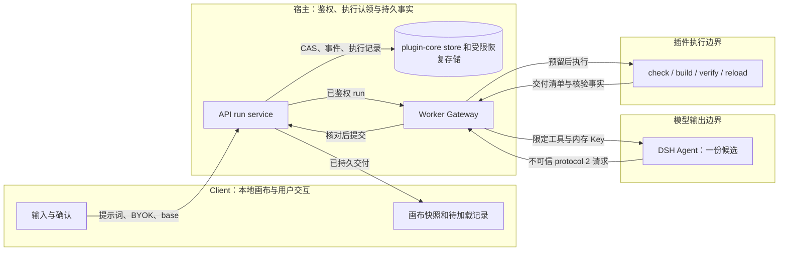
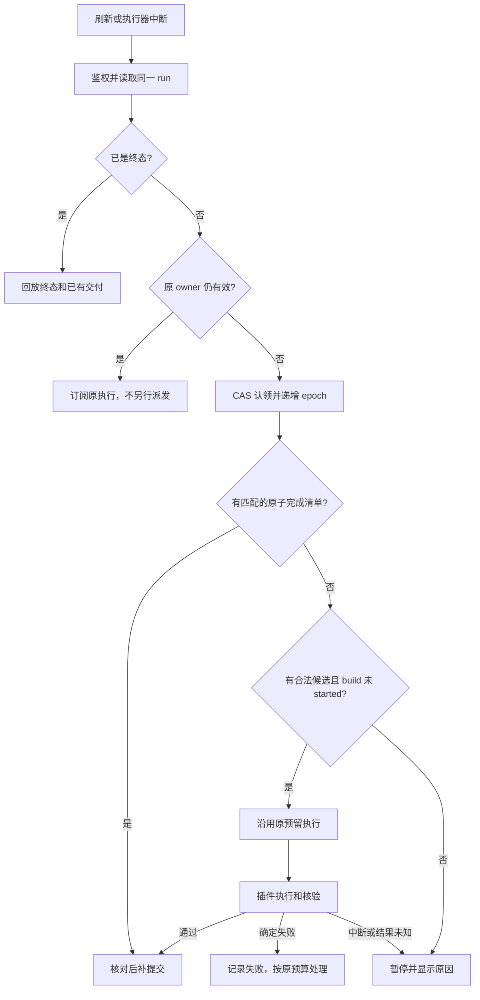
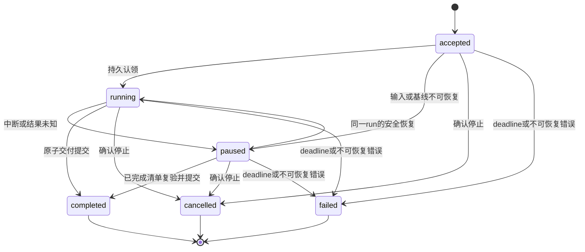

# Native 向插件方式收敛：阶段、协议与恢复边界方案

日期：2026-10-18。状态：**拟议方案，未实施**。本轮只新增本文，不改代码、不运行真实 Provider 或 GeoGebra。

## 1. 当前基线与方案范围

本次定位发现，原工作目录 `/Users/lijunqiang1/workspace/ggb_old/ggb_copilot` 已不存在。
同一工程现位于 `/Users/lijunqiang1/workspace/ggb-agent`。读取时 HEAD 为 `2c7d86bc`。
当前引擎已经是 plugin-core；`406bc61d` 已删除 Native 九阶段。本文不恢复已删除代码或旧文档。

[采用方案](ggb-dsh-plugin-core-adoption.md)是当前架构与冻结决策的 owner；
[切换交接](ggb-dsh-plugin-core-cutover-handoff.md)是当前验收事实的 owner；
[统一 Backlog](ggb-dsh-backlog.md)是实施状态的 owner。本文只提出后续设计，不更新这些文件的实施状态。

用户要求保持续题与中断恢复。当前实现已经支持以当前画布作为下一轮 base，
但交接文档明确删除了旧 checkpoint、回执与恢复代码。**当前续题能力不能代替 Worker 崩溃恢复能力。**
本文保留已完成的插件收敛，补充独立于数学阶段的最小恢复设计。
这会修改采用方案中“不保留事务或恢复语义”的部分取舍；只有实施并验收后，才能同步修改权威文档。

### 1.1 可定位的实现依据

下表路径均相对仓库根目录。历史阶段映射来自既有 session，不能作为当前可调用接口。

| 依据 | 当前事实 | 设计影响 |
| --- | --- | --- |
| `ggb-dsh/packages/bundle-ggb/src/plugin-core-tools.ts` | 仅提供 `ggb_inspect`、`ggb_check`、`ggb_build` | 保留三工具，不恢复阶段工具 |
| `ggb-dsh/apps/worker/src/plugin-core/gateway.ts` | build 默认最多 3 次；计数在内存 Map；浏览器前置拒绝会退款 | 恢复时必须读取持久计数，不能重新创建额度 |
| `ggb-dsh/apps/worker/src/plugin-core/service.ts` | 默认只对空 turn 增加一次新 session；共用总 deadline | 不扩大此例外，不把中断当作空 turn |
| `ggb-dsh/apps/worker/src/plugin-core/dsh-runner.ts` | 新建 Harness session；结束默认删除 DSH home；无 checkpoint | 不能宣称 SDK 已支持断点继续 |
| `ggb-dsh/apps/worker/src/plugin-core/tool-gateway-server.ts` | capability 绑定 run/turn/epoch；在内存校验 | 进程重启须撤销旧 capability；持久 epoch 防旧执行提交 |
| `ggb-dsh/tools/plugin-core-runner.mjs` | 写 request.json；插件交付移到稳定目录 | 补充请求、执行记录与交付清单的持久关联 |
| `ggb-dsh/packages/run-persistence/src/plugin-core-store.ts` | 原子完成与产物事件；明确没有旧 Native 恢复语义 | 扩展现有 store，不增加第二套 run store |
| `ggb-dsh/apps/api/src/plugin-core/run-service.ts` | runId 幂等、token 鉴权；浏览器断开不取消执行 | 保留；恢复不得再次 create 同一数学任务 |
| `ggb-dsh/apps/client/src/runtime/plugin-core-adapter.ts` | ready 快照与 SSE event cursor | 展示重连只回放，不启动模型 |
| 插件包 `skills/ggb-construction/worker.md` | 一份 protocol 2 请求；新建、显示修改、续构各有边界 | 继续由插件包拥有模型契约 |

### 1.2 术语与要求强度

- **必须**：验收不满足即不能声明完成。
- **应当**：默认设计；偏离时必须记录原因与验证。
- **可以**：可选行为，不构成默认能力。
- **续题**：用户提出新需求，以当前已确认画布创建新 run。
- **恢复**：同一 run 从已持久化事实继续，不新增修复机会或重置计数。
- **候选**：完整、合法的一份插件 protocol 2 请求；半段 JSON 不是候选。
- **执行记录**：宿主记录一次 build 的预留、启动、完成及不确定结果；不是模型输出协议。
- **交付**：通过插件核验及重载、并由宿主原子提交的产物集合。

## 2. 阶段合并：模型一个候选，宿主三个工作段

历史九阶段按职责映射如下；不要求当前代码恢复旧阶段枚举。

| 历史职责 | 目标归属 | 合并或删除内容 | 保留的约束 |
| --- | --- | --- | --- |
| Context | 准备输入 | 与基线检查合并；按需 `ggb_inspect` | 当前画布摘要、准确对象名与基线 digest |
| Intake / Brief | 生成候选 | 与 Plan 合并；删除独立 Brief 提交与接受循环 | 原题、用户明确补充、需求 source；示意构型假设必须说明 |
| Plan | 生成候选 | 一份 `prompt/locale/plan` 请求 | 原生程序、声明输出、requirements/checks、样式与交互 |
| Manual | 按需参考 | 删除接受 Plan 后才能查询和逐步骤冻结绑定的阶段协议 | 固定插件/runtime 版本；资料是参考数据，不能修改权限 |
| Review | 候选校验与有限语义判断 | 删除独立模型判词、逐条件 assessments 与重复来源归并 | 引擎不可检查的要求保留未验证；不能由模型宣称通过 |
| Apply | 执行准入 | 合并到 `ggb_build` 宿主准入 | 请求合法性、预算、基线、owner/epoch、执行权限 |
| Execute | 插件 build | 与 Verify 共用管线 | 隔离 applet、受限原生数学语句、实际输出身份 |
| Verify | 插件 build | 与 Execute、导出重载合并 | 类型、几何、样式、相关交互及基线保全检查 |
| Finalize / 结果呈现 | 宿主交付提交 | 与产物提交、SSE、Client 加载对齐 | hash/字节一致性、原子提交；模型总结不决定 completed |

宿主工作段是“准备输入 → 生成/校验候选 → 执行/交付”。这些名称用于理解职责，
不是三个新模型提交协议，也不是三套 checkpoint。

`ggb_check` 保持可选；`ggb_build` 内部仍必须校验。语法、类型、命名、权限等确定性问题
由工具一次报告可独立确认的错误，不再要求 LLM 出具第二份结构证明。
不新增独立 Review 调用。不能机械核验的语义风险，由同一 Agent 说明限制或提出确有必要的问题。
需要正式用户澄清时，只持久化用户原答与待答状态；不能把 Agent 提议视为用户授权。

## 3. 协议删除、收窄与保留清单

### 3.1 删除模型协商协议

以下为目标删除清单；当前多数已随九阶段删除，实施时只查残留，不重新建设。

| 删除对象 | 替代方式 | 防止误删的边界 |
| --- | --- | --- |
| 独立 Brief schema、Brief digest/revision 与接受状态 | 原题 + 请求 requirements.source + 用户原答 | 不删除输入摘要与用户来源事实 |
| 自定义 Semantic Plan、多层对象映射和由模型填的执行 IR | protocol 2 的原生 program/edits/updates | 插件内部编译结构仍由插件维护 |
| 每步骤 Manual document 身份、签名绑定与关闭状态 | 固定 runtime + 实际命令执行校验 | 不删除插件版本及能力摘要校验 |
| Review assessments、issues/sourceEvidence 等第二份模型账本 | 同一份 requirements 与引擎 verification | 不把未验证项抹成 passed |
| 模型 Apply patch、重复的样式/对象投影协议 | 当前请求直接进入受限 build | 输出路径、base 字节和权限始终由宿主提供 |
| 多阶段拒绝指纹/修复计数及阶段开关 | 当前工具预算与错误反馈 | 不删除 build 限额、deadline 和取消 |
| 基于旧 Native checkpoint 的兼容恢复入口 | plugin-core 同一 run 的执行恢复记录 | 旧 run 继续按当前探针返回拒绝，不转成 plugin run |

“删除协议”指删除模型必须反复生成的表示。下列工程协议不得因此删除：
API requestDigest、run token、HMAC/nonce、tool argumentsDigest、epoch、artifact hash、SSE eventId、
数据库 CAS、执行预留与结果提交记录。

### 3.2 保留一个领域请求和两个宿主结果边界

| 边界 | 提供方 → 消费方 | 最小内容 | 禁止混入 |
| --- | --- | --- | --- |
| 插件请求 protocol 2 | Agent → Gateway → 插件 | prompt、locale、plan；保持插件现有 mode 规则 | 模型提供的 base 路径、outputDir、权限和运行状态 |
| 工具结果 | 插件 → Agent | accepted/rejected、字段错误、实际观察与有界核验结果 | Key、服务端路径、可执行指令伪装成参考数据 |
| 交付结果 | 宿主 → Client | runId、产物 ID/hash/bytes、verification、usage、持久终态 | 仅靠 finalResponse 断言成功 |

不要为本次收敛再设计一套 geometry DSL。DSH 只适配宿主工具，不复制插件 schema、Skill 或核验器。
插件请求合法性由插件负责；宿主只检查安全信封、体积、能力和调用身份。
JSON Schema 描述不等于 Provider 已启用 constrained decoding。协议简化不能承诺消灭非法 JSON。

## 4. 目标架构与信任边界

只扩展当前 owner：application 拥有跨进程类型；run-persistence 拥有持久事实；
Worker 拥有执行认领和插件调用；API 拥有产物提交及对外授权；Client 拥有本地画布采用。
不新增通用工作流引擎、第二套调度服务或插件内的账户体系。

## 5. 必须保留的执行边界

| 边界 | 必须保证 | 失败处理 |
| --- | --- | --- |
| 运行身份 | runId + requestDigest + token 一致；重复 create 返回同一 run | 冲突拒绝，不重新开始模型 |
| 基线 | 服务端核对 base hash；模型只能读受限 inspect | 基线不一致暂停；不猜测对象或自动换 base |
| 执行权限 | 仅受限原生数学表达式、CAS、结构化样式/修改 | 禁止 JS、网络、文件、脚本及任意浏览器 eval |
| 所有权 | 持久 owner/epoch 认领；新 owner 撤销旧 capability | 旧 epoch 的工具请求与结果均拒绝 |
| 预算 | 启动 build 前原子预留；已启动或结果未知均计数 | 额度不足停止；重启不清零 |
| 取消 | stop 为持久请求；终态由 store 决定 | 取消后的迟到结果不能提交或覆盖画布 |
| 核验 | 实际对象类型/身份、题设、样式与交互覆盖来自插件事实 | failed/unverified 不成为正式成功交付 |
| 提交 | GGB、manifest、verification、事件与终态原子关联 | 提交失败可重做提交，不重跑构造 |
| Client 采用 | 加载前保留旧画布；校验交付 hash；写入待加载记录 | 刷新后继续同一次加载；失败恢复旧画布 |
| 用量与凭据 | Key 仅内存；不完整 usage 保留 unknown | 不编造计费值，不为取用量补发模型请求 |

保留的是必要保证，不是旧九阶段实现。尤其不恢复逐 GeoGebra 命令的浏览器事务协议。
插件在隔离画布完成整次 build；Client 只采用已交付 GGB，缩小恢复的副作用范围。

## 6. 最小持久记录：围绕一次请求和一次执行

以下字段是**拟议新增内部契约**，不是已实现 schema。实施时扩展现有 plugin-core store，
不从 Native checkpoint 复制。请求、base、产物字节放入受限且有 TTL 的恢复存储；
数据库只保存引用和摘要。Key、工具 token、原始 SSE、任意模型思考不得进入恢复记录。

| 记录 | 必要字段或事实 | 写入时机与 owner |
| --- | --- | --- |
| run 执行控制 | owner、epoch、ownerExpiry、原始 deadline、pauseReason | Worker 通过 store CAS；deadline 不随恢复后移 |
| 当前候选 | requestRef、requestDigest、baseDigest、plugin/runtime/Skill digest | 完整 JSON 校验成功后，build 准入前；Worker |
| 调用额度 | buildLimit、已占用 build 数、emptyTurnRetryUsed、turn 执行状态、usage 完整性 | 启动前预留，返回后结算；store 原子更新 |
| build 执行记录 | buildId、requestDigest、epoch、状态、完成清单引用 | 状态为 reserved / started / committed / rejected / outcome_unknown |
| 交付清单 | 请求/base/runtime digest、文件 hash/bytes、verification、完成标记 | 插件在核验成功后原子发布；宿主复验关联 |
| Client 待加载记录 | runId、deliveryId、旧画布引用、期望 hash、加载状态 | 采用新交付前持久写入；Client |

执行记录只表达工程事实。模型不能填写 started 或 committed。
预留提交与执行启动之间必须有可检查的顺序：先持久记录 started，再启动子进程。
崩溃可能发生在二者之间；此时宁可保持不确定，也不能用“可能还没开始”归还名额。
前置拒绝退款只允许在确定浏览器尚未启动时原子进行一次。恢复不能再次退款。

ownerExpiry 只负责判断是否能认领，不是新 deadline。另一个 owner 认领后必须先递增 epoch。
对仍存活的旧子进程完成取消/隔离，禁止旧进程的结果直接提交。
不同机器之间恢复需要相同的受限持久存储；仅有 Worker 本地目录不足以声称支持跨机恢复。

## 7. 中断恢复的范围与流程

### 7.1 按中断位置确定动作

| 中断位置 | 恢复动作 | 是否调用模型或重新 build |
| --- | --- | --- |
| 浏览器断线/刷新，服务端仍运行 | 读取 ready 与 event cursor，回放事件 | 两者都不调用 |
| 交付已提交，Client 尚未加载完 | 核对 artifact，继续待加载记录 | 两者都不调用 |
| 插件已原子交付，API 尚未提交 | 核对 buildId/request/base/runtime 与文件 hash，补做宿主提交 | 两者都不调用；禁止只凭目录存在认领成功 |
| 完整候选已保存，build 只有 reserved、没有 started | 原 owner 失效后认领；沿用同一个预留 buildId 执行 | 不调用模型；执行原先尚未开始的 build |
| build 已 started，回执丢失 | 优先寻找对应原子完成清单；没有清单则 outcome_unknown 并暂停 | 不重新 build，不退款，不假装从某条命令继续 |
| 模型返回非法/截断 JSON | 保存有界错误证据，暂停；完整候选不被覆盖 | 不修补 JSON，不自动重发 |
| 模型请求中断，未形成完整候选 | 显示“生成未完成，尚无可恢复构造”；保留原预算和基线 | 不把它改判为空 turn，也不自动开新 session |
| 用户已取消或 deadline 已到 | 固定 cancelled/failed 终态，保留证据 | 不能通过恢复绕过终态 |
| 原始 base 或 runtime 缺失/不匹配 | 暂停，说明缺失项 | 不换版本、不从当前画布偷偷重建 |

**限制必须显式展示：**外部 Provider 已发出的请求不能靠本地 checkpoint 接着生成半段 JSON。
当前 SDK 的原会话恢复能力尚未确认。本文不承诺恢复任意 token 位置，
也不把“创建新 session 再问一次”称为无重试恢复。
本方案保证已持久候选、未启动预留、已完成交付和展示状态可恢复；结果未知的外部操作安全暂停。
若要求“生成中断后必定继续产出”，必须先验证 SDK 的继续机制及其调用计数，不能在本方案中隐含增加名额。

### 7.2 拟议状态机

现有对外状态为 accepted/running/completed/failed/cancelled。
拟增加一个 `paused` 状态与受控 pauseReason，不新增九阶段 phase。
下图及迁移均为拟议；实施需同步 schema、API、SSE、store、UI 和测试。

| 源状态 | 事件与守卫 | 动作 | 目标状态 | 状态 owner |
| --- | --- | --- | --- | --- |
| accepted | 输入已绑定，预算和 deadline 有效 | CAS 认领，写 epoch | running | store，Worker 发起 |
| accepted | 所需 base 缺失 | 写 pauseReason，不调用模型 | paused | store |
| running | owner 丢失、非法 JSON 或结果未知 | 冻结已有记录及额度 | paused | store |
| paused | deadline 有效、未取消、owner 可认领、原执行未启动或同一执行仍可接管 | CAS 后沿用原记录；不重置预算 | running | store |
| running / paused | 匹配的完成清单通过复验且未取消 | 原子提交产物、事件和终态 | completed | API + store |
| 任意非终态 | 确认 stop | 撤销执行能力，记录取消 | cancelled | store |
| 任意非终态 | deadline 到期或确定不可恢复 | 保留失败证据与未知用量 | failed | store |

终态没有恢复出边。重复恢复返回当前事实；并发恢复只有一个 owner。
非法迁移拒绝且不触发副作用。暂停可留存至原 deadline；不通过无限暂停延长执行窗口。
SSE 重连、恢复按钮与重新生成必须分开：恢复按钮不能暗中创建新 run。

## 8. 续题与预算契约

### 8.1 续题

1. Client 以实际当前画布生成 base；用户拖动或样式调整后的字节必须被包含。
2. 持久保存本轮 base 摘要、原题和本地画布引用，再创建新 run。
3. Worker 通过 inspect 提供准确标签；模型不能把名称猜测作为修改授权。
4. 显示修改走 edits；续构走 program/updates/styles。保持插件现有互斥规则。
5. 交付成功前，旧画布和旧交付均保留。新结果加载成功后，更新当前画布引用。
6. 失败或中断不得把半成品作为下一轮 base，也不得覆盖用户在等待期间做出的修改。
   当前画布已变化时，要求用户选择是否采用交付；不要自动覆盖或自动开启合并 build。

续题是用户提出的新任务，具有独立 run。系统不得用“续题”伪装失败任务的自动重试。
历史对话只提供参考；当前 base 与用户本轮要求决定实际修改边界。

### 8.2 不增加重试名额

- 当前 build 上限保持 3；配置更低时沿用更低值。一次 started 或 outcome_unknown 占一个名额。
- 当前空 turn 最多一次补充 turn 的例外保持原触发条件；只有已完整返回且符合现有 isEmptyTurn 判断时适用。
- 错误、中断、超时、非法 JSON 不能变成新的空 turn 机会；恢复也不重新获得该例外。
- SDK 单次 turn 内可能包含多个模型请求；“一个 turn”不能被报告成“一个 Provider 请求”。
  恢复设计必须保留实际调用与用量事实，不增加新的模型格式恢复调用。
- 请求修订仍需消耗现有 build 额度；原先前置校验退款规则只在确定未启动时适用。
- 原始 deadline、模型参数与 token 上限均不提高。恢复读取、事件回放和提交复验不调用模型。
- 禁止去引号、补括号、删除尾部、XML 清洗等 JSON 自动修补。只接受完整合法输入。
- 不给 ggb_check 新增重试上限，也不把它当作无限循环入口；保留当前 deadline 及 SDK 终止边界。

## 9. 分批实施方案与文件归属

本节只给出实施顺序，不能作为已完成状态或部署授权。已有九阶段删除不重复实施。

| 批次 | 修改范围 | 完成条件 | 暂不做 |
| --- | --- | --- | --- |
| A：固定当前契约和恢复缺口 | application、store；扩展原模型/执行记录类型与 schema | 当前 limits、deadline、empty retry 状态可持久读取；新增 paused 契约一致 | 不恢复 Native store，不更换 Provider |
| B：持久执行准入 | Worker gateway/service/tool server、store | build 原子预留、可证明退款、owner/epoch 认领；重启额度不重置 | 不自动重跑 outcome_unknown |
| C：交付恢复 | plugin runner、插件 delivery、API completeRun | buildId 与请求/base/runtime 绑定；清单原子发布；提交重放幂等 | 不逐命令恢复，不用目录存在代表通过 |
| D：Client 续题和恢复呈现 | plugin-core adapter/projector、session/canvas | ready/SSE 去重；待加载记录；旧画布恢复；明确暂停原因 | 不让浏览器执行模型命令 |
| E：简化残留与验收 | bundle tools、插件 worker Skill、权威文档、相关测试 | 删除重复规则，保留一份领域请求及一份核验 owner | 不改题面、容差或预算迎合 Case |

批次 A–D 是完整恢复功能的一组依赖。不能只加入 paused UI 就宣称恢复完成。
新增持久 schema 使用新的迁移，不重写已发布的 017；迁移和部署仍需另行授权。
当前原型不建设旧 Native 数据兼容读取。旧 run 保留证据及现有拒绝探针。

已完成的 Skill 单一来源应保留：由插件包发布 worker.md 和能力 digest；宿主只提供运行状态。
不要再在宿主 profile 中复制数学命令技巧或维护另一份检查器名单。

## 10. 验收矩阵与证据要求

实施时先离线验证，最后统一全量检查。真实 Provider 与 GeoGebra 单独授权，不属于本文执行范围。
纯文档本轮只检查链接、结构与 diff，不运行代码全量检查。

| 行为 | 必要离线断言 | 现有测试 owner / 计划扩展 |
| --- | --- | --- |
| 单一协议 | 三工具可达；旧阶段不可达；禁止路径/Key 进入模型结果 | worker plugin-core-gateway、system-prompt、preflight tests |
| 预算持久化 | 第 1/2/3 次占额后重启；第 4 次仍拒绝；退款仅一次；并发预留不超额 | gateway tests + run-persistence plugin-core-store tests |
| 空 turn | 原例外最多一次；中断、JSON 错误、重启不新增 turn | plugin-core-service、dsh-runner tests |
| 执行认领 | 两个恢复者竞争只有一个胜出；旧 epoch 结果不能提交 | tool-gateway、channel、store tests |
| 原子交付 | 在清单写入前后、API 提交前后注入崩溃；仅完整关联可补提交 | runner、store、API plugin-core-route tests |
| 未知结果 | started 后无完成清单：paused/outcome_unknown；不退款、不重发 build | runner/service/store fault tests |
| 非法 JSON | SDK 离线流回放；确认工具零执行、未修补、无自动新 session | dsh-runner tests；有界 Provider/SDK hash 对照需在当前路径验证 |
| 续题 | 新建 → 样式修改 → 续构；准确 base hash；依赖对象不被越权修改 | plugin-core-runtime、session、插件 modify tests |
| Client 加载 | 提交后刷新、加载失败、期间用户改画布；旧画布不丢失 | client plugin-core-runtime、geogebra-host tests |
| 用量/取消 | usage 缺失为 unknown；stop 与完成竞态；迟到结果不覆盖取消 | API/store/service tests |

真实验收必须使用同一套原题、同一 Provider/模型参数与额度，先固定输入和通过标准。
原有插件七题与 Native 七题不同，不能拿两组结果直接计算架构改进比例。
除初题外，必须验证约定续题以及 Worker/API/Client 各边界的中断；失败不自动重跑。
留存版本 digest、输入/base/request hash、调用与执行记录、终态、完整核验、GGB hash 和截图。
模型生成的 checks 必须对照原题审查；有限鼠标采样不能被解释为全域数学证明。

当前交接记录的本机集成结果为 5/7，不是插件 Codex 七题的 7/7。
两个 no_delivery 案例应分别检查真实调用证据，不仅凭错误码认定模型责任或排除工程问题。
本方案不把删掉阶段视为完成稳定性验收。

## 11. 退出条件与未确认事项

必须同时满足以下条件，才能声明“插件收敛完成且保留恢复边界”：

1. 模型只维护一份插件领域请求；无独立 Brief/Review/Apply 协商链。
2. 续题使用实际当前画布，修改边界与交付 hash 保持一致。
3. 服务端与 Client 恢复都通过故障注入；未启动预留可继续，已完成交付可补提交。
4. 结果未知或非法 JSON 明确暂停；不重跑、不退款、不把未验证项改成成功。
5. 重启、重连、重复恢复均不增加 build/empty-turn 机会，不延长 deadline。
6. 全量离线检查通过；真实产品能力仅按已授权、已执行的证据报告。

尚需实施前确认：SDK 是否有可靠的原会话继续接口；宿主持久恢复存储的部署位置与 TTL；
插件完成清单能否稳定关联宿主 buildId；Client 当前画布并发变更的确认 UI。
这些项目不影响已明确的阶段/协议删除方向，但决定恢复覆盖范围。
在证据不足时保持暂停，不通过增加一次 Provider 请求掩盖缺口。

### 文档覆盖与本轮验证

| 显性要素 | 位置 | 状态 |
| --- | --- | --- |
| 架构及信任边界 | 第 4–5 节 | 已提供拟议图与责任表 |
| 正常/异常流程 | 第 7–8 节 | 已提供拟议流程图与逐断点动作 |
| 状态机及守卫 | 第 7.2 节 | 已提供拟议状态图与迁移表 |
| 接口与持久不变量 | 第 3、5、6、8 节 | 已提供；字段未实施 |

已应用 STE 中文清晰写作原则；未声称 ASD-STE100 合规。
图表本轮做静态核对，未做渲染验收。本文不是迁移、部署、真实调用或修改业务代码的授权。
