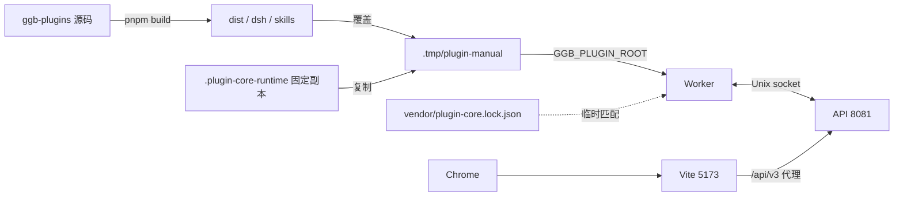
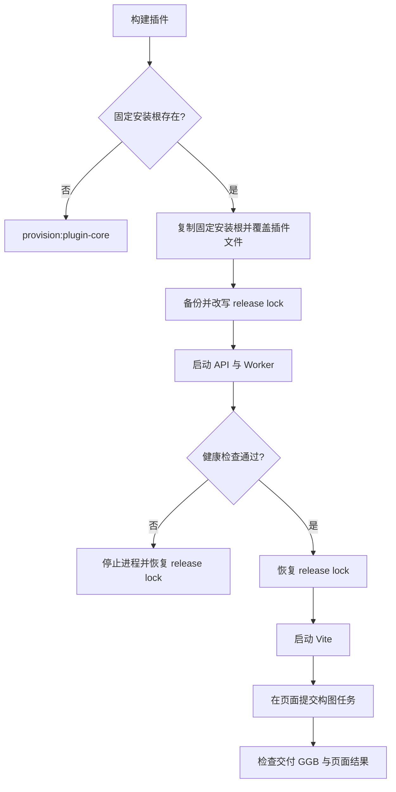

# 插件源码改动的手工验证

本文说明如何用当前 `ggb-plugins` 源码构建插件，并在 `ggb-dsh` 的本地 API、Worker 和 Vite 页面中手工验证。本文只记录开发验证流程，不定义发布供应或生产部署。

项目结构、技术栈和架构概览见[根 README](../README.md)。工作区日常运行见[工作区 README](../ggb-dsh/README.md)。生产发布见[部署指南](deploy-dsh.md)。

## 1. 范围与前置条件

本文适用于以下情况：

- `ggb-plugins` 源码有未提交改动。
- `ggb-dsh` 的 vendor TGZ 仍指向旧插件。
- 验证者需要在本机页面中运行真实构图，而不是只运行插件单元测试。

前置条件：

1. Node.js 和 pnpm 满足 [`runtime-versions.json`](../ggb-dsh/config/runtime-versions.json) 的范围。
2. `ggb-plugins` 和 `ggb-dsh` 已安装依赖。
3. 使用下文一键启动器时，缺少的插件 runtime 会自动供应。使用分步命令时，先执行 `pnpm run provision:plugin-core`。
4. 8081 端口空闲。Vite 代理固定指向 `http://127.0.0.1:8081`。
5. 5173 端口空闲；如果 Vite 使用其他端口，后续必须同步 `GGB_V3_ALLOWED_ORIGIN`。
6. DeepSeek API Key 只在页面 Settings 中输入。不要把 Key 写入 shell、文档或 Git。

## 2. 覆盖要素

| 要素 | 位置 | 状态 | 依据 |
| --- | --- | --- | --- |
| 架构图 | 3.1 | 已提供 | `tools/manual-verify-plugin.sh` 与 Worker 安装校验实现 |
| 流程图 | 3.2 | 已提供 | 启动器的覆盖、锁恢复和健康检查步骤 |
| 状态机 | — | 不适用 | 本文描述一次性手工流程，没有持久状态迁移；Worker 运行状态由 `PluginCoreExecutionState` 维护 |
| 契约 | 5、6、7 | 已提供 | 启动器、环境变量、端口、锁文件与健康检查 |

## 3. 架构与流程

### 3.1 组件与信任边界



说明：

- 启动器复制固定安装副本，再覆盖当前 `dist/`、`dsh/`、`skills/` 和 `capabilities.json`。
- Worker 从 `GGB_PLUGIN_ROOT` 读取测试安装根。
- 启动器临时改写 `vendor/plugin-core.lock.json`，使 Worker 的包文件摘要校验通过。
- Worker 就绪后，启动器立即恢复原锁文件。
- API 与 Worker 通过本地 Unix socket 通信。
- Vite 是开发页面的信任边界；浏览器只访问 5173，API 代理去掉浏览器 Origin。
- 测试安装根和运行产物只写入 Git 忽略目录。

### 3.2 操作流程



## 4. 命令

以下命令中的仓库根固定为本文示例路径。请按实际 checkout 替换。

```sh
export REPO=/Users/lijunqiang1/workspace/ggb-agent
```

### 4.0 一键本机启动（推荐）

在仓库根运行：

```sh
sh tools/deploy-ggb-dsh.sh                # 插件、后端、前端构建后启动 API/Worker/Vite
sh tools/deploy-ggb-dsh.sh --bundle       # 构建 bundle，由 API 在 8081 提供页面
sh tools/deploy-ggb-dsh.sh --build-only   # 只构建和校验独立安装，不启动服务
```

首次安装依赖时加 `--install`。`--doctor` 会额外启动本机 GeoGebra/浏览器，须按任务授权使用。
脚本检查当前 vendor 锁对应的固定安装：供应标记必须记录 doctor 通过，包摘要、兼容组合和 runtime 资源检查必须通过。
完整安装直接复用。缺少安装、供应标记、runtime 资源或 doctor 成功记录时，脚本调用现有供应器自动安装依赖、Chromium 和 GeoGebra runtime，并运行 doctor；该步骤可能下载资源、启动本机浏览器。
自动供应同样适用于 `--build-only`。`--doctor` 额外核验源码覆盖后的安装。
不完整目录会先保留为同级 `.incomplete-<随机值>` 目录，再供应原目标；脚本不删除备份。
包摘要或安装身份不匹配时停止，不覆盖现有安装。供应或 doctor 失败时停止，不启动服务；分阶段日志保留在下述日志目录。
并发供应由同级 `.provisioning` 目录互斥；强制结束后，确认没有供应进程再手工移除该目录并重试。
Client GeoGebra runtime 仍需预先供应；缺失时提示执行 `pnpm run provision:geogebra`。
构建 Client 前，启动器使用源码覆盖安装的公开 `runtime-compatibility` 入口准备 Client runtime。
`04b-provision-client-compatibility.log` 记录该步骤。供应器检查原始或已修复文件的摘要；不匹配时停止。
该步骤为两个固定版本补齐 Directrix 路径起点初始化，保留 `Point(d)` 和几何依赖。
已供应的 Client runtime 可以原地复用；manifest 记录兼容补丁身份和修复后文件摘要。
独立运行供应器时，先供应包含此公开入口的新插件，再运行 `provision:geogebra`。
源码包尚未更新到 vendor 时，可传 `--plugin-root /absolute/development/installation`；旧安装不伪装成已修复安装。
PWA 的 runtime 缓存升为 `ggb-runtime-v2`。新 Service Worker 激活时删除旧代缓存；
新代首次下载绕过旧 HTTP 缓存，随后复用修复后的资源。已加载的旧 applet 需在刷新页面后重新创建。
启动模式会在构建前清理所需端口的 TCP 监听进程：默认清理 8081 和 5173，`--bundle` 只清理 8081。
脚本通过 `lsof` 取得 PID，先发送 SIGTERM，等待最多 5 秒；仍占用时发送 SIGKILL，并确认端口可用。
清理期间若出现新的监听 PID，脚本退出，不继续终止新进程。`--build-only` 不执行端口清理。
清理日志保存在本次输出目录的 `00-release-ports.log`；构建完成后会再次检查端口。

`REPO` 可覆盖仓库根；`--plugin PATH` 和 `--pinned-root PATH` 可覆盖插件源码及固定安装根。

此入口使用独立开发安装和独立 workspace 中的派生锁，通过宿主现有完整性和兼容性校验。
它不改写仓库 vendor 锁，不需要恢复锁文件；下面 4.1–4.7 保留旧手工分步入口的操作说明。
依赖、插件版本或 runtime 身份改变时，脚本拒绝复用旧安装，须先按正式供应流程准备匹配组合。

默认同时启动 API/Worker 和 Vite，打开 `http://localhost:5173`。bundle 模式打开 `http://127.0.0.1:8081`。
端口固定为 8081/5173；启动前按上述规则终止占用所需端口的监听进程。`Ctrl-C` 停止脚本所属进程。
脚本不读取 `.env`、不提交模型任务；Provider Key 在页面 Settings 中输入。

分阶段日志、派生锁和安装身份保存在 `output/deploy-ggb-dsh/run-*/`，属于忽略目录。
本机 SQLite、稳定 pepper 和构图诊断保存在 `ggb-dsh/.local/deploy/`；不要提交或公开这些数据。
脚本拒绝 `NODE_ENV=production` 和 PostgreSQL 目标；此入口不是生产部署或 release 发布。

### 4.1 安装依赖

```sh
cd "$REPO/ggb-plugins"
pnpm install --frozen-lockfile --ignore-scripts

cd "$REPO/ggb-dsh"
pnpm install --frozen-lockfile --ignore-scripts
```

### 4.2 构建插件

```sh
cd "$REPO/ggb-plugins"
pnpm build
```

可选检查：

```sh
pnpm test
node dist/src/cli.js doctor
```

如果要验证正式 TGZ，再执行 `pnpm pack:dsh`。本文的手工验证使用当前 `dist/` 和 `dsh/`，不依赖新 TGZ。

### 4.3 构建后端

```sh
cd "$REPO/ggb-dsh"
pnpm exec tsc -b apps/api apps/worker
```

### 4.4 构建前端

开发模式：

```sh
cd "$REPO/ggb-dsh"
pnpm exec tsc -b apps/client
```

生产 bundle：

```sh
cd "$REPO/ggb-dsh"
pnpm --filter @ggb-copilot/client run bundle
```

产物位于 `apps/client/dist/`。

### 4.5 启动后端（终端 A）

```sh
cd "$REPO/ggb-dsh"
sh tools/manual-verify-plugin.sh
```

等待启动器输出以下两行：

```text
plugin test root: /Users/.../ggb-dsh/.tmp/plugin-manual
backend ready on http://127.0.0.1:8081; release lock restored
```

启动器完成以下动作：

1. 构建当前插件源码。
2. 复制固定安装副本到 `.tmp/plugin-manual`。
3. 覆盖当前插件构建产物。
4. 备份并临时改写 `vendor/plugin-core.lock.json`。
5. 启动 `deploy/local/dev.sh`。
6. 健康检查通过后恢复 release lock。
7. `Ctrl-C` 时停止 API 和 Worker。

启动器固定使用 `GGB_V3_WATCH=0`，避免 Worker 在 release lock 恢复后重启。修改后端源码后，重新执行启动器。

如果 8081 端口被占用，先检查并释放：

```sh
lsof -nP -iTCP:8081 -sTCP:LISTEN
```

### 4.6 启动前端（终端 B）

```sh
cd "$REPO/ggb-dsh"
pnpm run dev
```

打开：

```text
http://localhost:5173
```

页面操作：

1. 打开 Settings。
2. 填入 DeepSeek API Key。
3. 打开 New Session。
4. 输入构图题目，例如 `画一个正多边形`。
5. 等待交付卡片出现。
6. 检查 GGB 预览并下载文件。

### 4.7 单端口构建模式

该模式由 API 提供构建后的前端，不使用 Vite。

```sh
cd "$REPO/ggb-dsh"
pnpm run build

GGB_V3_CLIENT_DIST_DIR="$PWD/apps/client/dist" \
GGB_V3_GEOGEBRA_ROOT="$PWD/apps/client/dist/geogebra" \
sh tools/manual-verify-plugin.sh
```

打开：

```text
http://127.0.0.1:8081
```

## 5. 验证清单

后端健康检查：

```sh
curl -fsS http://127.0.0.1:8081/api/v3/health/ready
```

预期结果：

```json
{"status":"ok"}
```

页面和 GGB 检查：

- 边数滑块的范围为 3 到 12。
- 边数滑块的步长为 1。
- 多边形命令使用整数边数，例如 `round(sides)` 或 `round(n)`。
- 顶点数等于 `round(sides)` 或 `round(n)`。
- 全部顶点到圆心的距离一致。
- 全部边长一致。
- 下载 `.ggb` 后重新导入，对象集合与交付预览一致。
- 交互采样值 7、12 等通过；3.5、4.5、7.5 不作为交付样本。

## 6. 环境与端口契约

| 名称 | 本文取值 | 作用 |
| --- | --- | --- |
| `GGB_PLUGIN_ROOT` | `ggb-dsh/.tmp/plugin-manual` | Worker 加载的测试插件安装根 |
| `PORT` | `8081` | API 监听端口；Vite 代理目标 |
| `GGB_V3_ALLOWED_ORIGIN` | `http://localhost:5173` | Vite 开发页面的 CORS 允许来源 |
| `GGB_V3_CLIENT_DIST_DIR` | `apps/client/dist` | 单端口模式下的前端产物目录 |
| `GGB_V3_GEOGEBRA_ROOT` | `apps/client/dist/geogebra` | 单端口模式下的 GeoGebra runtime 目录 |
| `vendor/plugin-core.lock.json` | 仓库内文件 | Worker 校验插件文件摘要；启动器临时改写并恢复 |
| `.tmp/plugin-manual` | Git 忽略目录 | 当前源码的测试安装根 |
| `DEEPSEEK_API_KEY`（页面 Settings） | 浏览器 Vault | 只在页面 Settings 中保存；不写入 shell |

## 7. 失败处理

| 现象 | 原因 | 处理 |
| --- | --- | --- |
| `04a-provision-plugin-core failed` | 自动供应或 doctor 失败 | 检查启动器打印的阶段日志；修复下载、依赖或浏览器问题后重新运行启动器 |
| `plugin_core_package_integrity_mismatch` | 使用了未匹配的安装根 | 不要直接把 `GGB_PLUGIN_ROOT` 指向源码目录；执行 `tools/manual-verify-plugin.sh` |
| 启动器被强制终止，锁文件仍被修改 | 进程被强制终止，清理未执行 | 在 `ggb-dsh` 执行 `git checkout -- vendor/plugin-core.lock.json` |
| 健康检查超时 | API 或 Worker 启动失败 | 读取启动器输出和 `.local` 日志；检查 8081 端口、插件依赖和 runtime |
| 页面请求 404 或 CORS 错误 | 后端端口不是 8081，或 Vite 端口改变 | 保持后端在 8081；把 `GGB_V3_ALLOWED_ORIGIN` 设为实际 Vite 地址后重启后端 |
| 插件改动没有生效 | 只修改源码，没有重新构建 | 先执行 `cd ggb-plugins && pnpm build`，再启动启动器 |
| 页面无法提交任务 | 未保存 Provider Key | 在 Settings 中保存 Key；不要通过 shell 传入 |

## 8. 边界

- 本文验证当前源码构建，不验证正式 TGZ。正式发行必须更新 `vendor/plugin-core.lock.json`、vendor 包和 `config/runtime-versions.json`，然后执行 `pnpm run provision:plugin-core`。
- 启动器只用于本地开发。它临时改写 release lock，不能用于生产或并发验证。
- 手工验证调用真实 Provider 时会产生费用。执行前必须取得授权。
- `.tmp/plugin-manual`、`.local` 和 `output/` 中的运行证据不进入 Git。
