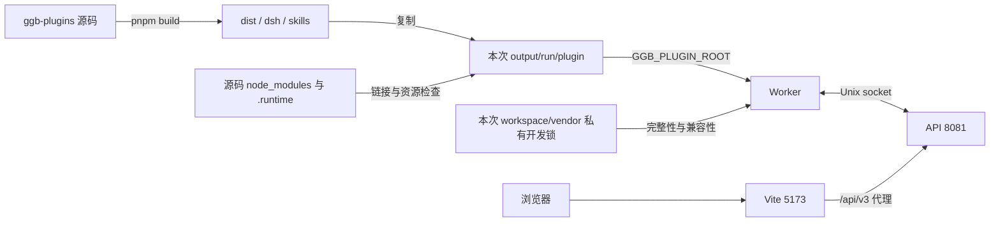
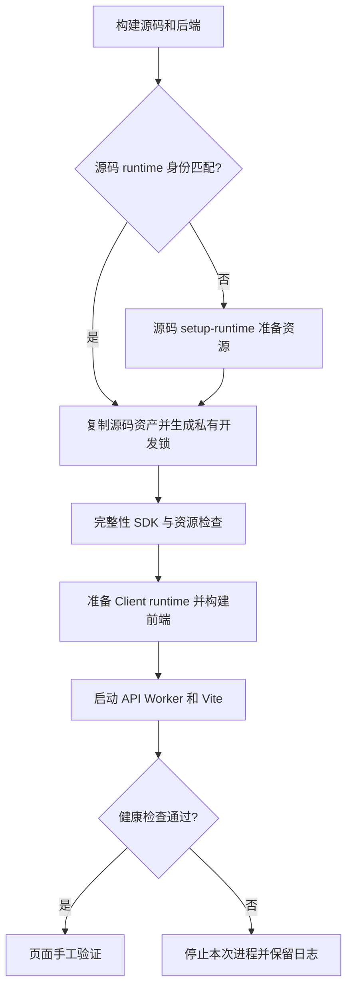

# 插件源码改动的手工验证

本文说明如何用当前 `ggb-plugins` 源码构建插件，并在 `ggb-dsh` 的本地 API、Worker 和 Vite 页面中手工验证。本文只记录开发验证流程，不定义发布供应或生产部署。

项目结构、技术栈和架构概览见[根 README](../README.md)。工作区日常运行见[工作区 README](../ggb-dsh/README.md)。生产发布见[部署指南](deploy-dsh.md)。

## 1. 范围与前置条件

本文适用于以下情况：

- `ggb-plugins` 源码有未提交改动。
- `ggb-dsh` 的 vendor TGZ 仍指向旧插件。
- 验证者需要在本机页面中运行真实构图，而不是只运行插件单元测试。

前置条件：

1. Node.js 和 pnpm 满足 [`runtime-versions.json`](../ggb-dsh/config/runtime-versions.json) 的范围。
2. `ggb-plugins` 和 `ggb-dsh` 已安装依赖。
3. 使用下文源码启动器时，缺少或版本不匹配的源码 runtime 会自动准备。
4. 8081 端口空闲。Vite 代理固定指向 `http://127.0.0.1:8081`。
5. 5173 端口空闲；如果 Vite 使用其他端口，后续必须同步 `GGB_V3_ALLOWED_ORIGIN`。
6. DeepSeek API Key 只在页面 Settings 中输入。不要把 Key 写入 shell、文档或 Git。

## 2. 覆盖要素

| 要素 | 位置 | 状态 | 依据 |
| --- | --- | --- | --- |
| 架构图 | 3.1 | 已提供 | `tools/deploy-ggb-dsh.mjs` 与 Worker 安装校验实现 |
| 流程图 | 3.2 | 已提供 | 启动器的源码快照、私有开发锁和健康检查步骤 |
| 状态机 | — | 不适用 | 本文描述一次性手工流程，没有持久状态迁移；Worker 运行状态由 `PluginCoreExecutionState` 维护 |
| 契约 | 5、6、7 | 已提供 | 启动器、环境变量、端口、锁文件与健康检查 |

## 3. 架构与流程

### 3.1 组件与信任边界



- 当前源码资产复制到每次独立目录，依赖与 runtime 来自源码目录。
- Worker 读取本次开发锁；仓库 vendor 包、发行锁和已安装插件不参与这条开发启动链路。
- SDK/协议兼容性、文件完整性和资源身份检查仍由现有宿主 loader 执行。
- API 与 Worker 使用本地 Unix socket；浏览器通过 Vite 访问开发页面。
- 开发目录、日志和运行产物写入 Git 忽略目录，停止时无需恢复发行文件。

### 3.2 操作流程



## 4. 命令

以下命令中的仓库根固定为本文示例路径。请按实际 checkout 替换。

```sh
export REPO=/Users/lijunqiang1/workspace/ggb-agent
```

### 4.0 一键本机启动（推荐）

在仓库根运行：

```sh
sh tools/deploy-ggb-dsh.sh                # 插件、后端、前端构建后启动 API/Worker/Vite
sh tools/deploy-ggb-dsh.sh --bundle       # 构建 bundle，由 API 在 8081 提供页面
sh tools/deploy-ggb-dsh.sh --build-only   # 只构建和校验独立安装，不启动服务
```

首次安装依赖时加 `--install`。`--doctor` 会额外启动本机 GeoGebra/浏览器，须按任务授权使用。
此脚本只用于开发环境，以当前 `ggb-plugins` 源码为准，不读取或复用 vendor TGZ、
固定插件安装根或 Codex/DSH 已安装插件。每次构建后，把源码资产复制到本次输出目录，
使用源码目录的 `node_modules` 和 `.runtime`，生成本次独立 workspace 与开发锁。
源码版本变化无需先更新正式插件包。缺少或版本不匹配的源码 runtime 通过源码 setup-runtime 脚本准备；
可用 `--runtime-archive PATH` 指定本机 GeoGebra ZIP。`--install` 安装源码和宿主依赖，
`--doctor` 额外运行开发目录 smoke 检查；SDK/协议兼容性、资源身份与宿主完整性检查仍然有效。
失败时不启动服务，不退回旧插件，也不改写 vendor 发行文件。
Client GeoGebra runtime 也由源码公开入口准备；缺少资源时使用指定的 `--runtime-archive` 或下载固定归档。
构建 Client 前，启动器使用源码开发目录的公开 `runtime-compatibility` 入口准备 Client runtime。
`04b-provision-client-compatibility.log` 记录该步骤。供应器检查原始或已修复文件的摘要；不匹配时停止。
该步骤为两个固定版本补齐 Directrix 路径起点初始化，保留 `Point(d)` 和几何依赖。
已供应的 Client runtime 可以原地复用；manifest 记录兼容补丁身份和修复后文件摘要。
独立运行 Client 供应器时，传 `--plugin-root /absolute/development/installation` 使用本次源码目录，
不要求更新 vendor；不传该参数的正式供应路径仍校验固定发行包。
PWA 的 runtime 缓存升为 `ggb-runtime-v2`。新 Service Worker 激活时删除旧代缓存；
新代首次下载绕过旧 HTTP 缓存，随后复用修复后的资源。已加载的旧 applet 需在刷新页面后重新创建。
启动模式会在构建前清理所需端口的 TCP 监听进程：默认清理 8081 和 5173，`--bundle` 只清理 8081。
脚本通过 `lsof` 取得 PID，先发送 SIGTERM，等待最多 5 秒；仍占用时发送 SIGKILL，并确认端口可用。
清理期间若出现新的监听 PID，脚本退出，不继续终止新进程。`--build-only` 不执行端口清理。
清理日志保存在本次输出目录的 `00-release-ports.log`；构建完成后会再次检查端口。

`REPO` 可覆盖仓库根；`--plugin PATH` 可覆盖源码目录；不再支持固定安装根 `--pinned-root`。

此入口使用独立开发安装和独立 workspace 中的派生锁，通过宿主现有完整性和兼容性校验。
它不改写仓库 vendor 锁，不需要恢复锁文件。
源码、依赖与 runtime 身份由本次开发锁记录；生产固定发行包仍按正式供应流程维护。

默认同时启动 API/Worker 和 Vite，打开 `http://localhost:5173`。bundle 模式打开 `http://127.0.0.1:8081`。
端口固定为 8081/5173；启动前按上述规则终止占用所需端口的监听进程。`Ctrl-C` 停止脚本所属进程。
脚本不读取 `.env`、不提交模型任务；Provider Key 在页面 Settings 中输入。

分阶段日志、派生锁和安装身份保存在 `output/deploy-ggb-dsh/run-*/`，属于忽略目录。
本机 SQLite、稳定 pepper 和构图诊断保存在 `ggb-dsh/.local/deploy/`；不要提交或公开这些数据。
脚本拒绝 `NODE_ENV=production` 和 PostgreSQL 目标；此入口不是生产部署或 release 发布。

### 4.1 只检查构建或额外运行 doctor

```sh
sh tools/deploy-ggb-dsh.sh --build-only
sh tools/deploy-ggb-dsh.sh --doctor
```

第一条只构建并核对开发目录，不启动服务，也不调用模型；若源码 runtime 缺失，仍需准备资源。
第二条额外运行本机 GeoGebra/browser smoke，再启动开发服务。真实 Provider 验证需另行授权。
依赖缺失时使用 `--install`；离线准备 runtime 时使用 `--runtime-archive /absolute/runtime.zip`。

无需手工复制已安装插件或改写仓库 release lock；源码改变后重新执行同一启动命令即可。

## 5. 验证清单

后端健康检查：

```sh
curl -fsS http://127.0.0.1:8081/api/v3/health/ready
```

预期结果：

```json
{"status":"ok"}
```

页面和 GGB 检查：

- 边数滑块的范围为 3 到 12。
- 边数滑块的步长为 1。
- 多边形命令使用整数边数，例如 `round(sides)` 或 `round(n)`。
- 顶点数等于 `round(sides)` 或 `round(n)`。
- 全部顶点到圆心的距离一致。
- 全部边长一致。
- 下载 `.ggb` 后重新导入，对象集合与交付预览一致。
- 交互采样值 7、12 等通过；3.5、4.5、7.5 不作为交付样本。

## 6. 环境与端口契约

| 名称 | 本文取值 | 作用 |
| --- | --- | --- |
| `GGB_PLUGIN_ROOT` | `output/deploy-ggb-dsh/run-*/plugin` | Worker 加载的测试插件安装根 |
| `PORT` | `8081` | API 监听端口；Vite 代理目标 |
| `GGB_V3_ALLOWED_ORIGIN` | `http://localhost:5173` | Vite 开发页面的 CORS 允许来源 |
| `GGB_V3_CLIENT_DIST_DIR` | `apps/client/dist` | 单端口模式下的前端产物目录 |
| `GGB_V3_GEOGEBRA_ROOT` | `apps/client/dist/geogebra` | 单端口模式下的 GeoGebra runtime 目录 |
| `GGB_V3_DSH_WORKSPACE_ROOT` | 本次 `workspace/` | Worker 读取其中的私有开发锁，不读取仓库发行锁 |
| 本次 `workspace/vendor/plugin-core.lock.json` | Git 忽略目录 | 当前源码文件摘要、SDK 与 runtime 身份 |
| `DEEPSEEK_API_KEY`（页面 Settings） | 浏览器 Vault | 只在页面 Settings 中保存；不写入 shell |

## 7. 失败处理

| 现象 | 原因 | 处理 |
| --- | --- | --- |
| `04a-prepare-source-runtime failed` | 源码 runtime 准备失败 | 检查启动器打印的阶段日志；修复下载、依赖或浏览器问题后重新运行启动器 |
| `plugin_core_package_integrity_mismatch` | 使用了未匹配的安装根 | 不要直接把 `GGB_PLUGIN_ROOT` 指向源码目录；重新执行 `sh tools/deploy-ggb-dsh.sh` |
| 健康检查超时 | API 或 Worker 启动失败 | 读取启动器输出和 `.local` 日志；检查 8081 端口、插件依赖和 runtime |
| 页面请求 404 或 CORS 错误 | 后端端口不是 8081，或 Vite 端口改变 | 保持后端在 8081；把 `GGB_V3_ALLOWED_ORIGIN` 设为实际 Vite 地址后重启后端 |
| 插件改动没有生效 | 只修改源码，没有重新构建 | 重新执行源码启动器，核对输出的源码路径与版本 |
| 页面无法提交任务 | 未保存 Provider Key | 在 Settings 中保存 Key；不要通过 shell 传入 |

## 8. 边界

- 本文验证当前源码构建，不验证正式 TGZ。正式发行必须更新 `vendor/plugin-core.lock.json`、vendor 包和 `config/runtime-versions.json`，然后执行 `pnpm run provision:plugin-core`。
- 启动器只用于本地开发。它不修改 release lock，不能用于生产部署。
- 手工验证调用真实 Provider 时会产生费用。执行前必须取得授权。
- `.tmp/plugin-manual`、`.local` 和 `output/` 中的运行证据不进入 Git。
