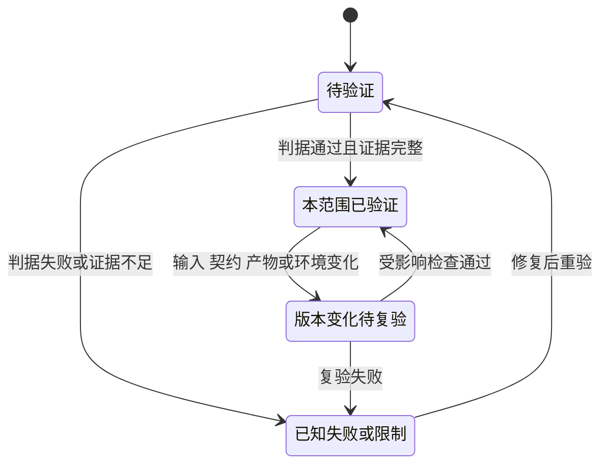
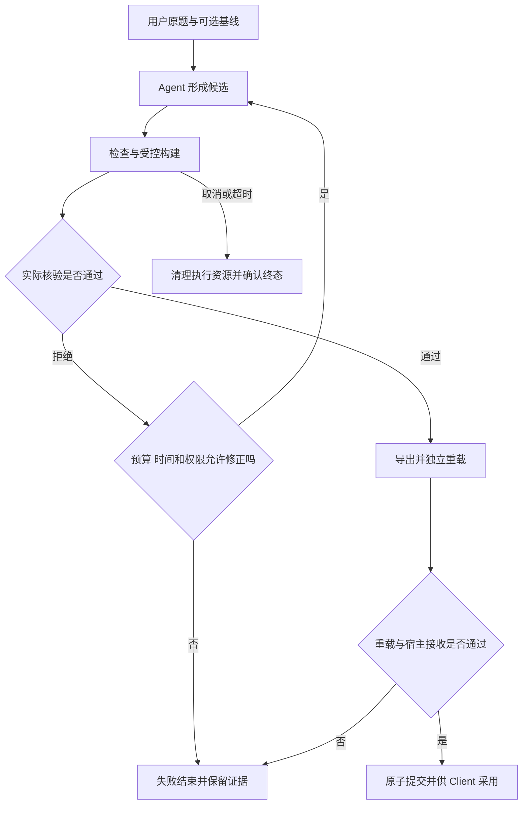
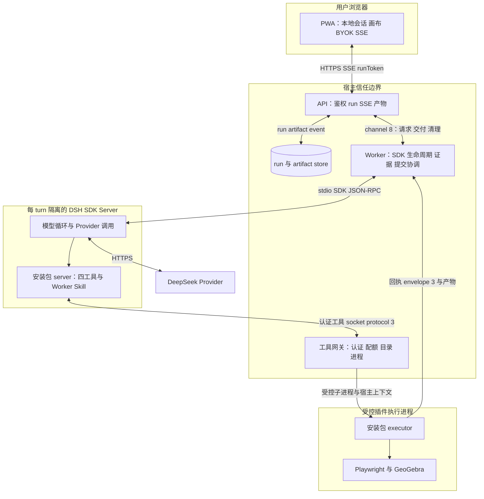
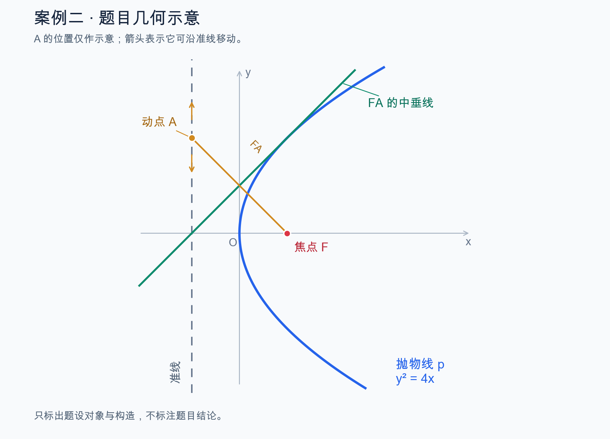

# 从一个数学问题到 Agent 交付：Pipeline、plugin-core 与标准 DSH 插件

初稿：2026-10-23。更新：2026-10-24。用途：开发经验分享与可复用的方法材料。

分享可以从一句最普通的请求开始：**“画一个圆。”**

几行 GeoGebra 命令就能画出圆。但让 Agent 交付这个圆，还需要回答：模型是否理解了问题？
文件是不是刚才验证的那一份？用户拖动对象以后，关系还在不在？
我们后来确实跑通了真实模型、浏览器和文件交付；同一次画圆却用了 15 次模型调用。
这个结果同时带来了两个结论：交付链路可行，调用成本还值得继续分析。

**先证明一个问题能被执行和核验，再把确定性能力做成插件，最后验证 Agent 能使用插件完成用户任务。**
这就是本文的主线。三个阶段分别需要证据，不能把“能画出来”“插件能安装”“Agent 能交付”混成一个结论。
画圆的历史实测在第 7.1 节展开，其他片段均能追溯到第 10 节的会话或项目记录。

现场分享可先讲第 2、7 节的真实转折，再用第 3—5 节提炼方法；第 6.4 节保留为架构问答参考，
第 9 节可直接用作讲述提纲。无需在现场逐项朗读全部契约和验证表。

历史路线是：**Pipeline → plugin-core → 基于标准安装插件的 DSH 调用**。
这不是大家必须照走的开发顺序。项目先建设了阶段较多的 Pipeline，后来通过插件实验重新划分责任。
下面把真实经历与从中归纳的方法分开，供其他团队按自己的最小问题直接开始。

## 1. 分享的主线与阅读边界

最初的问题是：用户给出一道数学题，Agent 能否生成可交互的 GeoGebra 构图？
进一步的问题是：构图出错时能否准确解释，成功结果能否独立重载，用户能否继续修改？
产品交付还要回答：谁持有凭据、谁决定成功、取消后谁关闭浏览器、前端到底加载了哪份文件？

因此，交付目标不是一段看起来正确的脚本，而是：

> 保留题目条件与必要依赖，执行真实数学引擎，提供可检查的证据，交付用户实际能打开和操作的文件。

本文按三个层面组织分享：

| 层面 | 本文回答的问题 | 阅读位置 |
| --- | --- | --- |
| 真实经历 | 为什么从 Pipeline 转向 plugin-core，再改为独立安装插件 | 第 2 节 |
| 可复用方法 | 从问题实验到插件、DSH Agent 和用户交付，各阶段怎样验证 | 第 3—6 节 |
| 经验与限制 | 如何归因、怎样避免局部通过冒充整体完成、哪些仍未验收 | 第 7—9 节 |

历史会话检索范围为 2026-09-23 至 2026-10-23；可直接还原的关键讨论集中在 10 月 11—23 日。
本次依据项目记录补充了 10 月 24 日的发布与引擎验证经验。日期表示讨论或记录日，不等于首次上线日。
最初 Pipeline 的准确创建日期尚未确认，不能补造。

本文不维护第二份实时进度表，也不新增运行协议。当前架构见 [README](../README.md)，
设计边界见 [安装式插件设计](ggb-dsh-installed-plugin-design.md)，实施与验收事实见
[Backlog](ggb-dsh-backlog.md)。文中的建议方法不表示所有步骤都已在本项目完成验收。

本文的“应”表示建议做法；“必须”只用于引用现有契约中的验收条件。分享或评审时，应分别标明
“本次已验证”“历史证据”和“拟议方案”，不能把建议方法写成已经实现的产品能力。

## 2. 真实经历：三次架构选择分别解决什么问题

### 2.1 Pipeline：先把任务过程显式化

早期 Pipeline 在工程中称为 workflow / Native 九阶段。宿主明确规定 Context、Intake / Brief、
Plan、Manual、Review、Apply、Execute、Verify、Finalize 等职责及提交边界。
DSH 已用于早期工程，因此后来不是“引入 DSH 替换 Pipeline”，而是改变宿主与模型的分工。

这种方案适合探索阶段：可以看到任务停在哪一步，约束模型输出，并为执行副作用建设受控编译、
checkpoint、journal、回执和租约机制。机制存在不等于所有恢复路径都已完成真实验收。

困难在于，同一道题经过多份表示和多次解释。每个阶段都要重新对齐来源、对象身份、样式和完成条件。
上游冻结了错误理解后，下游可能只能拒绝，无法直接修正。

10 月 12—14 日的真实反例，让“阶段更多是否更可靠”变成了一个具体问题。

**片段一：图画出来了，正多边形的构法却错了。**
模型把 `Polygon(A,B,6)` 理解成“圆心＋顶点”，实际命令中的两点确定一条边。
Plan 和 Review 没有拦住这个理解，外部 runner 才发现几何错误。
多一份模型判词，并没有自动提供独立于原构法的证据。

**片段二：一句“用虚线连接”，在流程里丢失了。**
用户要求把已有点与路径上的点用虚线线段连接。后续摘要仍提到虚线，机器读取的冻结 Brief 却没有相应样式要求。
模型曾尝试补入，但又受到冻结边界和样式路由规则的约束。各层分别遵守规则，整个任务仍走不通。

| 用户看到的要求 | 流程中的变化 | 暴露的责任问题 |
| --- | --- | --- |
| 用虚线连接 | 文字摘要保留，结构化呈现要求遗漏 | 保存原文不等于完整提取要求 |
| 补上虚线设置 | 已冻结的要求限制后续修改 | 发现来源遗漏后缺少清楚的异常出口 |
| 继续执行 | Review 总体为 `unverified`，允许进入 Apply | 未验证不能含糊地被当成已经实现 |

10 月 14 日的会话中，用户直接追问：

> 针对 SOP 中那么多问题，做了不少改良，为什么无法补上漏洞？

这成为一次重要转折：修复单位应从“某条报错”变成“一条用户要求从输入到交付的完整生命周期”。
**声明要求、绑定对象、实际实现、核验证据是不同事实。** 局部字段合法不能合成任务正确。
以上来自会话 S2、S3；其中虚线案例不能讲成“Review 总体 passed 后仍然失败”。

### 2.2 plugin-core：把可执行与可核验的能力集中起来

10 月 11 日，会话 S1 提出了一个直接的想法：Coding Agent 能写 Python、运行程序、检查结果，
能否把这种方法搬到 GeoGebra Script？这形成了“题目→数学模型→脚本→执行→验证→修正”的闭环。

10 月 16 日，会话 S4 又提出更具体的交付目标：

> 我想把这个 Agent 要完成的工作做成一个插件，输入相同，在最后验证时，也是调用 Playwright 进行验证，
> 成功后生成一个 GGB 文件，并打开浏览器，展现渲染成果。

这里开始改变的是责任分配。先在现成宿主 Agent 中做独立插件实验，再把能力接回 DSH Web 产品：

> 宿主 Agent 负责理解、规划与修正；本地工具负责真实 GeoGebra 执行、事实采集、核验、导出和独立重载。

这样遇到“命令是否可执行”的问题，可以先绕开模型，直接验证工具；遇到“模型有没有理解题目”的问题，
再检查 Agent 输入和工具使用。两类问题终于可以分别定位。

数学表达逐渐转向原生 Algebra / CAS。新题优先改变程序和检查，缺少通用能力时才扩展工具。
插件不为每道题增加路由，也不重新实现一套 GeoGebra 数学语言。输入仍受结构、容量和副作用边界约束。

随后 Web 产品采用 plugin-core：保留 Client、API、Worker 和 DSH，由模型调用少量领域工具，
替代逐阶段提交数学协议。插件内部仍有执行与交付流水线；取消、预算、鉴权和核验并未删除。

另一项简化是副作用范围：插件在隔离 applet 中构建，Client 采用完整 `.ggb` 文件。
用户续题时，以当前画布为新 run 的基线，不再沿用旧版逐命令的活动画布执行协议。
旧 Native checkpoint 恢复链也被删除，这是能力取舍，不能描述为等价保留。

### 2.3 标准安装插件：从“能调用核心”到“领域能力独立发布”

最初的 plugin-core 接入，宿主仍保存部分工具定义、Worker 提示和适配逻辑。
调用了插件核心，却还可能存在两份会漂移的领域契约。

10 月 22—23 日的安装式改造，将工具、Worker Skill、schema 和公开执行入口放入同一个发行包。
宿主按版本化协议加载和调用插件，继续负责身份、权限、资源、取消和最终提交。

本文的“标准插件”指遵守 DSH 的声明、安装、发现及服务端接入契约。
它不表示已经公开上架市场，不表示采用 MCP，也不表示任意 SDK 版本都兼容。
`ggb-construct` 是逻辑名称；源码包、DSH 分发包和 Skill 分别名为
`ggb-plugins`、`ggb-plugins-dsh`、`ggb-construction`。

桌面 Skill 入口与受限 SDK Server 入口也不同：

| 入口 | Agent 如何调用 | 接入时要额外证明什么 |
| --- | --- | --- |
| 桌面 Skill | 宿主读取 Skill，通过已有命令执行能力运行 CLI | 安装资源路径正确、CLI 生命周期与宿主能力匹配 |
| 受限 DSH Server | 插件注册工具并加载 Worker Skill，通过认证网关执行 | 不依赖通用 shell、任意文件读取或桌面缓存；工具白名单和权限覆盖生效 |

两入口复用领域核心，不复制数学业务。不能因为桌面能用，就宣布 Web Agent 已接通。

### 2.4 时间线摘要

| 时间 | 关键决策 | 转变原因与证据边界 |
| --- | --- | --- |
| 10 月中旬前，起始日期待确认 | Native Pipeline 管理数学阶段与执行状态 | 阶段显式，但多份数学表示带来对齐成本 |
| 10 月 11 日 | 明确执行、验证与修正闭环 | 方法讨论，不是引擎切换记录 |
| 10 月 12—14 日 | 修正 Brief、Manual、Review 和执行属性契约 | 真实反例显示局部规则不足以保证完整目标 |
| 10 月 16 日 | 以独立插件验证确定性能力 | 复用成熟 Agent 宿主，减少重复模型协议；初期同时收窄能力范围 |
| 10 月 17 日，交接记录口径 | Web 采用 plugin-core，删除 Native 九阶段执行链 | 历史真实批处理 5/7 交付；不是后续安装包的成功率 |
| 10 月 18 日 | 提出最小持久恢复 | 拟议设计；续题不能代替同一 run 恢复 |
| 10 月 22—23 日 | 安装式 DSH 插件接入与分层验收 | 独立发布领域能力；安装、SDK、真实模型和产品验收分别进行 |
| 10 月 23—24 日 | 请求接口、参考读取、runtime 供应与 Client 升级继续完善 | 反映真实 Agent 使用成本及客户端环境差异；离线和本机通过不等于生产或付费模型回归通过 |

## 3. 如何从“一个问题”开始，而不是先建设完整框架

以下是从本项目归纳的建议方法，不是要求新增一套阶段引擎。
每一步只产生下一步需要的最小成果；证据不足就回到对应责任层，不靠增加重试掩盖问题。

### 3.1 把问题改写成可观察的交付目标

以“画一个圆”为起点，不先测试所有题型。先约定：

- 输入是什么，哪些数值是题目给定，哪些允许作为构造选择。
- 输出是脚本、截图，还是可独立重载的 `.ggb`。
- 成功需观察什么：对象类型、圆心半径、依赖、文件重载与允许的交互。
- 哪些不做：例如一般数学证明、三维、任意脚本或未开放的文件修改。

文字或图片都要保留原始要求。图片识别出的题目应与构造说明分开，并供用户核对；
识别成功不表示题意完整，图形比例也不能自动成为已知条件。
题目来源、原题复述和题目相关标题属于产品可理解性的一部分，不只是界面装饰。

### 3.2 先固定输入，验证确定性工具链

用人工编写的最小程序和独立预期值，直接验证真实 GeoGebra 能否执行、核验并导出。
先不用模型生成候选，避免同时引入模型、协议和引擎三种不确定性。

检查分成三类：

| 检查对象 | 例子 | 不能替代什么 |
| --- | --- | --- |
| 数学结果 | 圆存在、类型为 circle、圆心半径符合预期 | 不证明题目要求没有遗漏 |
| 构造与依赖 | 对象确实依赖指定父对象，移动输入会改变结果 | 单次坐标正确不能代替依赖检查 |
| 交付保真 | 导出文件在新 applet 重载后保持对象、关系和样式 | 内存画布正确不能代替文件验证 |

预期值从题目和数学推导获得，不能把一次失败的观测值抄回 `expected`。
有限拖动或参数采样只说明采样范围，不是全域数学证明。

**教学示例：三行命令与三种验证。** 下面只展示原生命令，不是完整插件请求；本轮文档编辑没有执行它。
它与历史画圆案例的构造一致，但教学中增加的交互目标不应反写成原始用户要求。

```geogebra
O=(0,0)
A=(3,0)
c=Circle(O,A)
```

先看静态事实：有两个点和一个圆，圆心为 O、半径为 3。
如果教学变体要求“拖动 A 改变圆的大小”，还要实际拖动 A，检查圆继续经过 A。
最后导出 `.ggb`，在新 applet 重载，重复相关检查。

反例也很简单：把 c 改成一个与 O、A 无依赖的固定方程圆，初始截图仍可能一样。
静态检查容易放过它，依赖检查和拖动就能区别两种构造。
**截图回答“现在像不像”，依赖与交互回答“变化以后还是不是”。**

### 3.3 再验证这是一项通用能力

选择与 base case 不同、但复用同一入口的任务；同时加入能暴露错误的反例。
例如正常圆、路径点与依赖构造、无效引用、错误对象类型和无法满足的核验要求。
这里列的是选例原则，不声称这些类别在所有版本中都有相同覆盖。

如果每来一道题都要增加 TypeScript 条件分支，就应重新检查：
是否把数学表达错误地放进宿主，或缺少一项通用事实／核验能力。
但不能因为使用原生命令，就免除输入安全和实际执行检查。

**这一阶段的结论只能是“工具对这些输入可行”，还不是“Agent 能完成同类用户任务”。**

## 4. 从插件开发到 Agent 交付：每一步的进入与退出条件

| 步骤 | 主要工作与成果 | 进入下一步的证据 | 失败优先回到哪里 |
| --- | --- | --- | --- |
| 问题实验 | 原题、成功判据、最小程序和独立检查 | 真实执行、拒绝反例及独立重载符合预期 | 数学构法、引擎或核验器 |
| 插件核心 | 将通用编译、执行、事实、核验和交付收敛到一个 owner | 不同输入复用同一接口；失败不产生正式成功交付 | 输入契约与确定性核心 |
| 独立安装包 | 声明公开入口，打包 Skill/schema/执行器并固定依赖 | 离开源码 checkout，在隔离目录安装并发现准确工具 | 打包、资源定位、版本兼容 |
| DSH 集成 | 受限 SDK 加载插件，工具经过宿主授权边界 | 无 Provider 的 SDK 加载通过；受控模型替身可贯通执行、交付及异常路径 | 插件适配、网关、身份与生命周期 |
| 真实 Agent | 用户原始输入驱动模型选工具、提交候选、修正并结束 | 真实 Provider 的完整调用与实际产物证据；拒绝和预算行为可解释 | 模型输入、工具可理解性或具体执行层 |
| 用户与发布交付 | Web 加载、下载、续题、缓存升级和目标环境运行 | 用户实际使用入口成立；交付版本、字节和环境可核对 | Client、供应链或部署 |

### 4.1 插件核心需要什么接口

插件应当拥有领域请求、结构检查、受限执行、核验和交付报告。
Skill 解释何时调用、如何修复与怎样结束；强制约束由代码执行。

输入需要表达“怎么构造”和“必须满足什么”。输出需要区分拒绝、执行失败、未验证和成功交付。
不要仅返回一句 success，也不要只给模型一份巨大、无法定位首因的失败报告。
应提供有界的对象身份、失败阶段、检查身份及修复所需事实，保留原始诊断用于追查。

### 4.2 独立安装验证什么

从最终准备交付的归档安装，而不是读取开发 checkout，也不是借用桌面客户端缓存。
固定并记录归档摘要、Skill 摘要、SDK、依赖及数学 runtime 组合。
安装与启动时核对实际字节，缺失或混版要在模型请求之前拒绝。

“包可以解压”“工具名称被发现”“真实命令能够执行”是三个不同结论。
正式归档与源码覆盖环境也不同；同一个版本号不能证明内容相同。
真实 run 使用哪一份包，就只能为那一份包提供证据。

### 4.3 受控 DSH 集成先隔离哪些变量

先验证真实 SDK 能加载安装包、准确注册工具、注入 Worker Skill，并关闭越权入口。
这一步可以不调用 Provider，也不启动数学浏览器。

再用可控的模型／Harness 替身验证宿主闭环。固定工具请求，使用真实插件执行器及数学引擎，
检查回执接收、下载、画布加载、取消清理、SSE 重连和基线续做。
模型替身验证的是集成，不证明真实模型会生成同样请求。
真实 SDK 加载测试与 mock Harness 全链测试也要分别描述，不能合写成“真实 Agent 全链通过”。

可以把一次画圆交付拆成两个镜头来讲，观众会更容易理解测试边界：

```text
镜头 A：固定工具请求 → 真实 executor → GeoGebra → GGB → Web 加载
         说明“执行和交付接通了”；不说明模型会写出这个请求。

镜头 B：用户只说“画一个圆” → 真实模型选工具、生成请求 → 同一执行交付链
         额外考察理解、参数生成、修正、结束及调用成本。
```

再把“从归档加载到准确工具与 Skill”的隔离 SDK 测试放在两者之前。
三个镜头各有结果，不用一个模糊的“集成通过”把它们合并。

### 4.4 真实 Agent 比插件多验证什么

真实模型可能误读题意、选错工具、生成非法参数、重复查资料，或在失败后削弱原目标。
所以需要从用户原始问题出发，而不是给模型一份已经替它修好的请求再宣布任务成功。

每个授权 run 至少记录：实际发行身份、模型配置、调用序列、候选版本、拒绝原因、
模型用量、耗时、构建事实、交付摘要、持久终态和资源清理结果。
如果已发生 build，不能把重跑整个模型任务当成普通格式修复；重试条件以现行契约为准。

正确性通过后，再分析效率：参考读取是否重复，候选为何反复完整生成，错误是否逐层暴露。
缓存命中率高不表示输出生成与往返没有成本。测试调用数与 token，也要同时检查正确率和目标保留。

### 4.5 用户交付比本机 Agent 多验证什么

核对用户实际下载的字节，而不只核对 Worker 文件。打开 Client 实际 applet，验证对象、
样式、拖动、缩放、重载，以及修改后下一轮使用的基线。

Client 与插件可能加载不同 runtime，Service Worker 还可能缓存旧资源。
因此需要验证真实静态资源与缓存升级，不能用服务端 doctor 代替前端验收。
生产环境的权限、进程回收和数据库迁移也需要自己的证据；本机取消成功不能代替部署层崩溃回收。

### 4.6 多个 session 是怎样把大目标变成可审查的工作

这项开发并不是给 Coding Agent 一句话后一直等待。会话 S4 先要求独立设计文档和独立代码仓；
S5 比较两种实现的调试难点，要求在保持续题与恢复诉求的前提下给出简化方案；
S6 再明确安装式职责、协议、迁移顺序和验收标准，然后逐批实施。

| 会话中的推进方式 | 限定了什么 | 为什么有用 |
| --- | --- | --- |
| 先给设计，不改业务代码 | 先讨论 owner、输入输出与取舍 | 避免边实现边发明另一套职责 |
| 先验证隔离 SDK 能加载工具和 Skill，不调用 Provider | 固定安装与接入变量 | 先排除路径、包和 SDK 混版问题 |
| 再补诊断、回执绑定和取消清理 | 把失败与完成证据做实 | 工具说成功不等于宿主可接收交付 |
| 在开发默认链路切换并验证 | 控制影响范围 | 开发通过不自动变成生产发布授权 |
| 最后按授权做真实模型与产品验收 | 使用原题和实际发行包 | 获得模型行为、用户结果与成本证据 |

下面两段是依据这些会话归纳的**提示模板**，不是历史原话，也不是本轮正在执行的任务：

> 先分析输入、产物和成功判据，给出最小实验及拒绝反例。区分数学、协议和运行环境问题，先不修改代码。

> 按已确认的边界完成一个完整批次，复用现有 owner，补正常、拒绝与恢复路径的必要反例。
> 保留原目标，不增加题目专用逻辑、不提高重试上限；报告本轮实际验证及尚未验证的范围。

这里的做法可以复用，批次名称和数量不必复制。每轮应当减少一个关键未知，而不是只增加一份文档。

## 5. 如何安排验证，避免把不同“通过”混在一起

### 5.1 按不确定性分层，不按测试数量分层

| 验证层 | 模型 | 插件／执行环境 | 可以支持的结论 | 不能支持的结论 |
| --- | --- | --- | --- | --- |
| 结构与纯逻辑 | 无 | schema、编译、核验纯逻辑 | 确定性规则及拒绝路径符合测试 | 真实引擎或模型可行 |
| 数学执行 | 无 | 真实 GeoGebra 与 Playwright | 给定候选可执行、可核验、可重载 | 模型会正确理解和生成候选 |
| 安装与 SDK | 不调用 Provider | 最终归档、隔离 SDK 环境 | 资源、入口、Skill、工具及权限配置匹配 | 实际数学或用户任务已经通过 |
| 集成闭环 | 可控替身 | 真实执行器、引擎、HTTP/SSE 与 Client，按测试声明范围 | 宿主交付和异常流程可运行 | 真实模型成功率或付费成本改善 |
| 真实 Agent | 真实 Provider | 固定插件与 runtime | 本次任务及本次版本的真实结果 | 全题型、未来版本或目标机器都可用 |
| 发布与目标环境 | 按授权场景 | 最终产物、真实 Client 缓存和部署环境 | 对应环境的供应、交付与运维行为 | 未运行的远程 CI、生产或崩溃路径已通过 |

每次失败只回到对应层修复，再重跑受影响验证。来源或版本变化时，重新确认会失效的证据，
不反复运行无关全量测试，也不跳过受影响的安全与集成检查。

### 5.2 正常路径之外，还要验证哪些行为

按功能实际影响选择下表，不要求每个小改动都跑全部项目。

| 路径 | 关键观察 |
| --- | --- |
| 正常 | 用户目标保留；检查、产物、实际画布和持久结果一致 |
| 拒绝 | 非法参数／越权／版本不符明确拒绝，不能生成正式成功交付 |
| 修正 | 反馈能定位首因；修正后不删除原题条件、不改抄观测值、不切断依赖 |
| 取消与超时 | 清理已启动的进程；迟到结果不覆盖终态；后续槽位行为明确 |
| 快照与重连 | 展示恢复使用持久事实，不重新执行模型或构造，不重复显示报告 |
| 导出与重载 | 新 applet 中的对象、依赖和检查成立，下载字节与交付摘要匹配 |
| 交互与再次保存 | 允许输入改变后关系仍成立；重新导出、重载和续做不丢失约束 |
| 升级 | 实际加载新包和资源；旧缓存、旧协议与不兼容 checkpoint 按契约处理 |

### 5.3 用证据状态管理结论，而不是扩展任务状态机

下面是建议用于分享或评审的证据生命周期，不是产品 `run.phase`，也不要求新增运行服务。



| 变化 | 守卫条件与维护者动作 |
| --- | --- |
| 待验证 → 本范围已验证 | 验证维护者记录输入、版本、环境、判据与实际证据；不能只写“测试通过” |
| 待验证 → 已知失败或限制 | 保留失败现场，明确影响；证据缺失不能按成功处理 |
| 已知失败或限制 → 待验证 | 标明修复范围与需要重跑的检查；旧结果不当作新证据 |
| 本范围已验证 → 版本变化待复验 | 包、Skill、runtime 或消费路径变化后，标记受影响结论，不自动沿用旧验收 |
| 版本变化待复验 → 本范围已验证／已知失败或限制 | 按实际复验结果归类，不用汇总测试数替代判断 |

这些规则由开发者在现有评审与证据记录中执行。一次本机成功不得直接跳成“生产通过”。

## 6. Pipeline、plugin-core 与 DSH Agent 的不同

### 6.1 比较对象与取舍

| 维度 | Pipeline | plugin-core 接入 | 基于标准插件的 DSH Agent |
| --- | --- | --- | --- |
| 主要控制者 | 宿主明确规定数学阶段与提交协议 | DSH Agent 按证据调用领域工具 | DSH 管理模型循环；安装包拥有领域工具；宿主控制执行权限与交付 |
| 主要收益 | 阶段和状态显式，便于探索复杂过程 | 减少重复数学表示，集中执行和核验 | 单一领域 owner、独立发布、可核对的安装与兼容边界 |
| 主要成本 | 阶段契约、冻结与异常转换复杂 | 宿主仍可能保留提示和适配副本 | 供应链、版本、公开协议、进程生命周期与产品消费路径 |
| 首要验证点 | 同一要求在各阶段是否完整且含义一致 | 候选能否真实执行并产生可信文件 | 模型能否使用实际安装包，且宿主和用户实际接收到正确交付 |
| 保证局限 | 字段合法不等于理解正确 | 工具接受不等于题意完整 | 安装解耦不能消除模型误解或引擎缺陷 |
| 恢复取舍 | 历史上建设过 checkpoint 等机制，保证范围仍看证据 | 删除旧 Native 恢复链，用完整文件收束副作用 | 续题、重连与资源隔离继续保留；不因此获得同一 run 自动恢复 |

plugin-core 是本项目采用插件核心的执行方式；标准插件是领域能力的分发与接入边界；
Agent 是模型、Harness、工具和宿主协作完成任务的系统。三者不是互斥产品名称。

### 6.2 责任变化图

下图只说明三种历史分工，不替代 README 的当前完整架构。

```mermaid
flowchart TB
  subgraph P[Pipeline]
    P1[宿主规定数学阶段] -->|候选 判词与阶段提交| P2[宿主编译与执行准入]
    P2 -->|受控执行| P3[GeoGebra 核验]
  end
  subgraph C[plugin-core 接入]
    C1[DSH Agent] -->|领域工具请求| C2[宿主适配和网关]
    C2 -->|调用核心| C3[插件执行 核验 导出 重载]
  end
  subgraph S[标准插件接入]
    S1[DSH Agent] -->|不可信候选| S2[安装包提供工具与 Worker Skill]
    S2 -->|认证调用| S3[宿主管理权限 预算 取消和进程]
    S3 -->|受控执行| S4[同包执行器与核验核心]
    S4 -->|回执和产物| S5[宿主复验与原子提交]
    S5 -->|持久交付| S6[Client 实际加载 下载与续题]
  end
```



模型不能提供宿主路径或扩大权限。插件不接管用户账户与 run 数据库，安装本身也不提供操作系统隔离。
当前包边界、工具集合及精确协议分别由 README、安装式设计与
[协议版本规则](../ggb-dsh/docs/protocol-versioning.md)维护。

### 6.3 最小运行契约：成功到底由谁确认

| 边界 | 提供方 → 消费方 | 输入、输出与关键保证 | 失败处理 |
| --- | --- | --- | --- |
| 领域候选 | Agent → 插件 | 程序、要求、检查和交互；保留原始来源，不能由模型自填 passed | 返回结构或能力诊断，不修补成未经授权的执行 |
| 执行授权 | 宿主 → 执行器 | 身份、基线、目录、预算和 deadline；由宿主注入 | 越权、过期、混版或不匹配时拒绝 |
| 数学事实 | 引擎／插件 → 宿主 | 实际对象、依赖、检查及重载证据 | 必需检查 failed/unverified 不能用模型总结改成成功 |
| 交付接收 | 插件 → 宿主 | 回执、请求／基线关联、产物摘要与字节 | 核对失败不原子提交 completed；已有构建不能盲目重放 |
| 产品采用 | 宿主 → Client | 实际下载、加载和本地保存的同一交付；新需求建立新 run | 加载和重连错误如实呈现，不改成新的构造任务 |

执行主路径可以概括为：



这不是无限重试流程。模型最终文字与工具级进度都不能单独决定 `completed`。
精确状态、取消竞争与 SDK 异常规则继续引用安装式设计，不在本文另定协议。

### 6.4 ggb-DSH-Agent 的软件架构

本节给出当前系统的软件架构，用于分享和评审。它是概览，不替代 [README](../README.md) 的代码结构
与 [安装式设计](ggb-dsh-installed-plugin-design.md)的精确契约；协议版本以
[协议版本规则](../ggb-dsh/docs/protocol-versioning.md)为准。



图中的 API 与 Worker 是两个 Node.js 进程，默认部署在同一镜像中，通过 0600 Unix socket 通信。
Worker 为每个 turn 启动独立的 DSH SDK Server 和 DSH home。DSH 加载安装包的 server patch；
插件 server adapter 只注册领域工具和 Worker Skill，通过签名请求调用宿主网关，不直接访问 Store 或 API。
executor 是 Worker 启动的独立子进程，使用环境白名单、独立输出目录和进程组清理，不继承 Provider Key。
Playwright 与 GeoGebra 由 executor 管理；模型不能提交任意脚本、路径或 shell。
Store 保存 run、事件、artifact 和用量事实；Worker 只在启动时执行 schema admission，
run 终态、artifact 和事件由 API 原子提交。
图中的 channel 8、protocol 3、envelope 3 和 receipt 2 是整理时的当前值，变化以协议规则为准。

| 组件 | 运行位置 | 主要职责 | 明确不负责 |
| --- | --- | --- | --- |
| Web PWA | 浏览器 | 本地 Session、画布、OPFS、BYOK Vault、SSE、下载与基线 | 不运行模型循环；不执行模型生成的 GeoGebra 命令；不连接 DSH |
| API | 独立 Node 进程 | HTTP/SSE、runToken 鉴权、幂等、run 生命周期、产物读取、静态资源、TTL | 不调用模型；不启动浏览器；不做几何核验 |
| Worker | 独立 Node 进程 | 固定安装身份、启动 DSH、工具网关、配额、进程与清理、证据、候选与提交协调 | 不拥有领域 schema 或核验规则；不直接向 Client 提供 HTTP |
| DSH SDK Server | 每 turn 子进程 | 模型循环、Provider 调用、工具调度、Worker Skill 注入 | 不写 Store；不接受模型提供的宿主路径或额度 |
| 插件 server adapter | DSH 进程内 | 注册四工具、加载 Worker Skill、签名工具请求 | 不访问数据库、runToken 或 HTTP 管理接口；不执行构建 |
| 插件 executor | 受控子进程 | 结构检查、构造、核验、导出、重载、回执与产物 | 不决定 run 身份、额度或 deadline；不接收 Provider Key |
| Playwright 与 GeoGebra | executor 子进程 | 隔离 applet 执行、事实采集、渲染与重载 | 不理解题目或 run；不访问未授权资源 |
| Store | SQLite 或 PostgreSQL | run、事件、artifact、用量的持久事实与 CAS 终态 | 不执行几何语义；不被插件直接访问 |
| DeepSeek Provider | 外部 HTTPS | 模型推理 | 不执行工具；不接收宿主路径或产物 |

一次 run 的关键调用链：

1. PWA 以原题、可选图片和可选画布基线创建 run，发送 runToken 和本次 BYOK Key。
   API 校验幂等和请求摘要，固定交付契约，写入 `accepted`。
2. API 以 CAS 将 run 置为 `running`，通过内部 channel 把执行请求交给 Worker。
3. Worker 使用启动时已核对的安装包、SDK、runtime 和协议身份，准备本轮 DSH home，启动 DSH SDK Server，
   注入认证工具 socket、能力令牌和插件 server patch。
4. DSH 注册四工具和 Worker Skill。模型调用工具时，插件 adapter 生成签名请求，经工具网关校验
   run、turn、epoch、nonce、参数摘要和 build 配额。
5. 网关以宿主上下文启动 executor：输出目录、基线引用与摘要、deadline 和 buildId 由宿主提供。
   executor 在隔离目录中调用 Playwright 与 GeoGebra 完成构造、核验、导出和重载。
6. executor 返回回执与产物。Worker 核对回执绑定、实际字节、尺寸和摘要，接受候选。
   模型可在预算内根据证据修正，但失败的新 build 不会回退到旧候选。
7. turn 结束后，Worker 关闭 DSH 和执行资源，确认进程树退出，返回交付与清理结论。
   API 原子提交 run、artifact 和事件，发布 `completed` 或相应终态。
8. Client 通过 SSE 接收状态，加载或下载同一交付。下一次需求以当前画布作为新 run 的基线。

部署与进程边界：

- API 与 Worker 默认同镜像、双入口；插件安装根按只读使用，运行输出写入独立的
  `GGB_PLUGIN_CORE_OUTPUT_ROOT`。
- 本地开发默认 SQLite，生产使用 PostgreSQL；启动时通过 schema admission 确认迁移 018 已记录
  （017 是其前置）。
- PWA 静态资源和 GeoGebra runtime 单独供应；Client 与插件分别供应、分别核对版本身份。
- 每 turn 的 DSH home 独立；每次 build 使用独立输出目录；清理失败时隔离执行槽位。
- 容器、systemd、PostgreSQL 迁移和崩溃回收按[部署指南](deploy-dsh.md)执行，本机验证不能替代。

架构不变量：

- 浏览器不运行模型循环，也不执行模型生成的任意 GeoGebra 命令。
- 模型输入不可信；模型不能提供宿主路径、身份、额度、deadline 或凭据。
- 插件拥有领域语义；宿主拥有权限、配额、进程、产物接收和最终提交。
- 插件声明的摘要不是权限；宿主必须重新计算实际字节并绑定调用、基线和安装身份。
- 同一 run 只有一个最终候选；清理未确认时不能发布 `completed` 或 `cancelled`。
- 新需求创建新 run，以当前画布为新基线；不提供同一 run 的自动恢复或构建重放。

## 7. 用真实故障讲清方法，而不是只展示成功截图

### 7.1 故事一：“画一个圆”成功以后，为什么还没有结束

这次用户的原始 prompt 只有“画一个圆”。历史 run 为
`run_05f61c28-4a11-4ebd-851e-fd20b746c8c7`。保留的证据记录了真实模型调用、GGB 下载和实际 applet 对象。

| 观众最容易关注的现象 | 记录中的证据 | 应怎样解释 |
| --- | --- | --- |
| 圆画出来了 | O、A 为点，c 为圆，命令为 `Circle[O,A]` | 真实引擎完成了构造，不只是输出了一段文本 |
| 文件可以下载 | 4,365 bytes；卡片与下载摘要一致 | 用户下载的是这次交付，不能只看 Worker 目录里的文件 |
| 最小任务跑通了 | 15 次模型调用；139,374 input / 4,390 output token | 可以宣布本次闭环通过，同时继续分析模型往返成本 |

分享时可以先展示命令，再揭示“15 次调用”。这不是用一次数据证明系统低效，而是让观众看到：
**功能可行与交互效率是两个问题。** 要改进后者，还需要读调用序列，不能只看最终圆图。

这批证据的 Client applet 版本为 5.4.929.3，不应冒充后来统一 runtime 的验收。
数据来自本机 `output/playwright/paid-circle/evidence.json`；39 秒等口头汇总值不作为本文的独立计时证据。
本机证据不随文档分发，分享截图前应另行整理。一次圆的成功不能外推图片识别、复杂构造或生产部署。

### 7.2 故事二：“A 点没有定义”，真正出错的却不是创建 A

这是一道观察抛物线几何关系的题目：

> 已知抛物线 y²=4x，焦点为 F，A 是准线上的一点。判断线段 FA 的中垂线与抛物线的位置关系。

Agent 的任务是画出这些对象，供用户观察，不直接给出题目答案。
其中 A 应能沿准线拖动，线段 FA 及其中垂线应随之变化；隐藏标签只是显示调整，不应破坏这些关系。



*静态示意：箭头表示 A 可沿准线移动；图中不标注题目结论。*

历史 run `run_00e376f2-0ffa-45aa-b282-ed3554ca1c89` 处理了这张题目图片。
最终报告曾显示构造与重载各 48/48 通过。
如果只讲最终结果，这会是一个成功案例；往前看一次 build，故事完全不同。

```text
原候选：p → Focus(p)、Directrix(p) → 准线上的 A → 中点、线段、中垂线
第一次 build：A 和下游对象未定义，拒绝交付
模型修正：F 改成固定坐标，准线改成独立方程
第二次 build：通过，产出文件
```

问题是：它通过了这份检查，却切断了 F、准线对抛物线的依赖。
最终 F 还是可移动的独立点，拖离原位置后，题目的“焦点 F”就不再成立。
**这不是说数值答案错了，而是构造关系与交互保证变弱了。**

后来沿着实际运行环境追查，经历了几次有证据的判断修正：

| 追查步骤 | 发现 | 排除了什么 |
| --- | --- | --- |
| 先查安装身份 | 实际使用源码覆盖包，而不是原始 vendor TGZ | 不能拿当前源码或另一个包的结果直接解释本次 run |
| 记录每步对象状态 | A 创建、初始化和下游构造时都有效 | 不是 `Point(d)` 一开始就无法创建 |
| 逐项隔离显示操作 | 隐藏准线标签的 API 调用能使 A 失效 | 不是先前 Focus 返回标签占位符的问题；最初的缩放归因也不成立 |
| 跳过冗余标签设置 | 构造暂时通过，独立重载仍失败 | 不能只靠“避免重复调用 setter”宣布修复 |
| 检查真实产品入口 | Client 也需要相同的引擎兼容供应与缓存升级 | 只修插件进程不等于用户画布已修好 |

最早观测得较粗，失效首先在缩放处被看到；补上标签 setter 的观测后才找到更早的触发调用。
这个细节适合保留在分享中：定位能力来自实验分辨率，不来自对第一种猜测的坚持。

早期“用依赖辅助线承载路径点”的方案只属于诊断实验。10 月 24 日 Backlog 已记录后续引擎兼容补丁、
固定供应配方、Client 缓存升级和实际交付 iframe 验证；不应把实验替代构法讲成正式修复。
这些结果支持对应本机范围，付费模型和生产目标环境仍需要各自的复验。

### 7.3 故事三：失败已经拒绝，为什么模型仍然修得很贵

同一抛物线 run 里，首次进入浏览器之前还发生了两轮静态拒绝：

1. 图片转录是 `y²=4x`，requirement source 写成 `y^2=4x`，未通过原文子串检查。
2. 修正来源后，`coordinate` 检查又误用 `expected`，而该谓词需要 `coordinates`。

这两次与后面的引擎故障属于不同层。把它们统称“模型不稳定”，无法决定该改哪里。
准确的参考示例、字段身份和一次报告可独立确认的错误，可以减少模型来回猜测。
但不能放松来源要求或让工具修补未知数学意图。

该 run 的记录为 13 次模型调用，334,537 input / 32,997 output token；其中 cache read 为 322,688。
它与画圆不是同题、同包的对照实验，不能用“15 次降到 13 次”宣称优化成功。
高缓存命中也不能抵消长输出和多次往返。

项目随后发展出 ggb_request、完整请求提交和批量参考读取。
这些改进针对的是模型使用接口的成本，不是取消检查。离线与集成通过之后，
仍应以固定题集、模型、预算和发行包做授权的真实 Provider 对照，才能评价收益。

### 7.4 故事四：用户上传了题目，汇总里却只看到“构图完成”

会话 S7 中，用户提出了一个很具体的体验要求：图片识别出题目后，最后应先复述原题，
Session 的名字也应与这道题有关。

这个要求揭示了用户交付和工具交付的差别。工具已经接受了转录，用户却不能从汇总确认
“你刚才到底按哪道题画的”；通用的“图片构图”标题也不能帮助用户找到它。

这项改动复用成功构建所绑定的题目转录，在构图总结前展示原题，标题优先从原题生成，保留手工命名。
已记录的定向验证包含实时事件、重连快照与离线保存；本轮文档整理没有新增真实图片验收。
它没有再调用一次模型来重新概括题目，也没有让用户标题参与数学核验。

从这个片段可以给观众一个简单的判断标准：**用户应当能核对输入、理解结果，并在后来找回这次工作。**
一个通过工具测试的 Agent，仍需要完成这一步产品交付。

## 8. 已实现与拟议方案如何在分享中表述

以下仅作截至整理日的分类说明，不复制逐批测试数、摘要锁或实时进度。

| 分类 | 可以表述的事实 | 不能扩大为 |
| --- | --- | --- |
| 已实现 | plugin-core 为唯一引擎；Native 九阶段执行链删除；开发默认使用固定安装包和当前四工具 | 所有场景都已验收，或三工具是永久接口 |
| 历史真实验证 | 原切换批次 5/7 交付；后续存在真实画圆与正多边形交付记录 | 当前最终归档或一般数学问题的总体成功率 |
| 10 月 24 日本机验证 | 记录了引擎补丁供应、隔离 SDK 加载、mock Harness 配合真实引擎／PWA、缓存升级及交互验证 | 新增真实付费模型回归、远程 CI 或生产发布通过 |
| 待验证／观察 | 复杂题与目标环境批量回归、生产部署、目标数据库演练、部署层崩溃回收及历史未交付案例 | 在本机跑通后自动消除 |
| 拟议 | 10 月 18 日最小持久恢复提案 | 同一 run 自动恢复或交付恢复已经存在 |

续题是新需求以当前画布创建新 run。SSE 重连是展示恢复。持久 owner/epoch 是所有权隔离。
它们都不能单独证明中断后自动继续执行。详见
[恢复边界提案](ggb-dsh-plugin-convergence-and-recovery-proposal.md)。

## 9. 可供其他团队复用的分享提纲与工作模板

### 9.1 分享顺序

建议采用“提出问题 → 展示一次尝试 → 揭示遗漏 → 说明下一项实验”的节奏。
下面是讲述安排，不是历史会议实录，也不要求按固定时长演讲。

| 场景 | 可以怎样开口 | 展示什么 | 带出的结论 |
| --- | --- | --- | --- |
| 开场 | “只要三行就能画圆，为什么我们还需要一个工程？” | 第 3.2 节命令与第 7.1 节交付证据 | 画出来和交付出去之间有多个边界 |
| 第一次转折 | “我们加了很多阶段，虚线为什么还是丢了？” | 第 2.1 节需求流转 | 阶段多不替代一致的完成标准 |
| 插件实验 | “如果先不让模型自由发挥，工具自己能不能完成任务？” | 第 4.3 节两个验证镜头 | 用固定候选隔离数学与集成问题 |
| 接入 DSH | “为什么桌面插件能用，Web Agent 还不能直接上线？” | 第 2.3、6.4 节安装和权限边界 | 标准包、受限入口与产品宿主是不同责任 |
| 第二次转折 | “报错说 A 未定义，最后却定位到隐藏标签。” | 第 7.2 节逐项对照 | 先查实际版本，再找首次状态变化 |
| 回到用户 | “文件交付了，用户能确认你识别的是哪道题吗？” | 第 7.4 节原题与 Session 名称 | 可理解、可核对、可找回也是交付 |
| 结束 | “这次证据到底允许我们承诺到哪里？” | 第 5、8 节验证范围 | 结论随版本、环境和证据扩大，而不是随演示扩大 |

主旨是“沿着证据扩大保证范围”，而不是“给一个好用的 Prompt 就能得到 Agent”。
参与者需要看到可复现输入、反例和故障定位过程，不能只看到一张成功截图。

### 9.2 一个新问题的最小工作模板

以下模板可直接放入已有任务说明，不需要另建通用流程系统：

| 项目 | 需要填写的内容 |
| --- | --- |
| 用户问题与范围 | 原题、原始输入、歧义、支持与不支持的操作 |
| 可观察的成功判据 | 数学事实、来源完整性、依赖、允许交互和用户实际产物 |
| 最小实验 | 固定候选、独立预期、一个有效例与必要拒绝反例 |
| 插件边界 | 领域核心、宿主责任、输入输出及稳定错误 |
| 安装身份 | 归档／Skill／runtime 身份与实际安装位置；说明是否源码覆盖 |
| DSH 接入 | 精确工具集合、权限配置、SDK 加载与模型替身集成证据 |
| 真实任务 | 原始 prompt、实际调用、失败与修正、用量、耗时和交付关联 |
| 用户采用 | 下载摘要、实际画布、重连、交互、续做与升级路径 |
| 结论 | 本次通过范围、未验证范围、已知限制与下一项实验 |

只保存必要且脱敏的运行证据。密钥、图片原始字节和任意模型内部内容不能因为“要分享”就进入仓库。
公开发布、运行付费 Provider 或部署目标环境，都需要各自的授权。

## 10. 依据与文档覆盖

文中的 S1—S7 用于追溯案例。历史会话 ID 用于本机检索；主题概述不是重新命名会话。

| 编号 | 日期 | 会话 ID | 主要依据 |
| --- | --- | --- | --- |
| S1 | 10 月 11 日 | `01a1289e-32fb-7292-b460-53437d5ab9c8` | Coding Agent 的执行、验证和修正闭环 |
| S2 | 10 月 12 日起 | `01a13087-33ec-71f1-9bd5-e39d3e95eee9` | Review / Manual 修复、七案例真实运行 |
| S3 | 10 月 14 日起 | `01a138ff-dcab-7972-95f9-0866b17b67ff` | 来源遗漏、冻结边界与完成标准冲突 |
| S4 | 10 月 16 日起 | `01a14227-6683-7721-bc67-824dbcfb0b4d` | 插件化目标与宿主 Agent／本地执行的分工 |
| S5 | 10 月 16 日起 | `01a143e6-ffa2-7b40-bb96-35d9e8c100e0` | 调试复杂度、续题与恢复的简化诉求 |
| S6 | 10 月 22 日起 | `01a16282-2b15-7e03-97e9-cd5e9159c0ae` | 安装式设计、分批实施和真实运行问题 |
| S7 | 10 月 23—24 日 | `01a16805-af90-7952-b353-a8ea3d886f0d` | 演进归纳、路径点本机诊断及方法分享诉求 |

案例的本机核对入口如下；路径指向忽略目录，只用于内部复核，不是随仓库发布的附件：

| 案例 | 核对入口 | 本轮文档整理做了什么 |
| --- | --- | --- |
| 真实画圆 | `output/playwright/paid-circle/evidence.json` | 读取调用卡片、下载字节、摘要一致性及 Client 版本，未重新运行 |
| 抛物线失败与用量 | run `run_00e376f2-0ffa-45aa-b282-ed3554ca1c89` 的诊断和 `usage.json` | 结合本会话既有定位记录核对用量，未重新调用模型 |
| 标签操作与依赖诊断 | `output/diagnostics/run-00e376-a-undefined/` | 引用本会话已授权完成的历史对照；不作为当前补丁版本的验收 |
| 引擎修复与用户端 | Backlog 中 2026-10-24 的供应、缓存升级及实际交付 iframe 记录 | 查阅已有记录；当前状态仍以 Backlog 为准 |

仓库内的事实入口：

- [plugin-core 采用方案](ggb-dsh-plugin-core-adoption.md)：冻结决策、删除范围与历史取舍。
- [安装式插件设计](ggb-dsh-installed-plugin-design.md)：所有权、公开入口、可信交付和迁移条件。
- [切换交接](ggb-dsh-plugin-core-cutover-handoff.md)：切换证据与旧 run 处理。
- [统一 Backlog](ggb-dsh-backlog.md)：实施、离线、本机真实与未完成事项的分类记录。
- [DSH 兼容与引擎供应](../ggb-dsh/docs/dsh-sdk-compatibility.md)：固定安装组合、引擎补丁及启动准入。
- [插件源码手工验证](ggb-dsh-plugin-manual-verification.md)：源码覆盖实验的操作边界；不能代替最终归档验收。

历史 output 与本机会话不保证随仓库分发。分享前如需截图或定量结论，应整理对应版本的证据，
明确人工输入、mock、真实引擎与真实模型的区别。本文没有重新运行这些历史测试。

| 文档要素 | 覆盖范围 |
| --- | --- |
| 架构 | 第 6.4 节给出当前软件架构；第 6.2 节对比历史职责；精确结构引用 README 与安装式设计 |
| 流程 | 第 3—5 节给出开发验证顺序；第 6.3—6.4 节给出运行闭环、组件调用链和失败出口 |
| 状态 | 第 5 节定义建议的证据状态及迁移；不改变产品运行状态机 |
| 契约 | 第 4、6 节明确接口责任、前提、输出、拒绝及交付保证；字段与版本引用权威专题 |

本文应用中文 STE 清晰写作原则，不声明为 ASD-STE100 合规文本。
