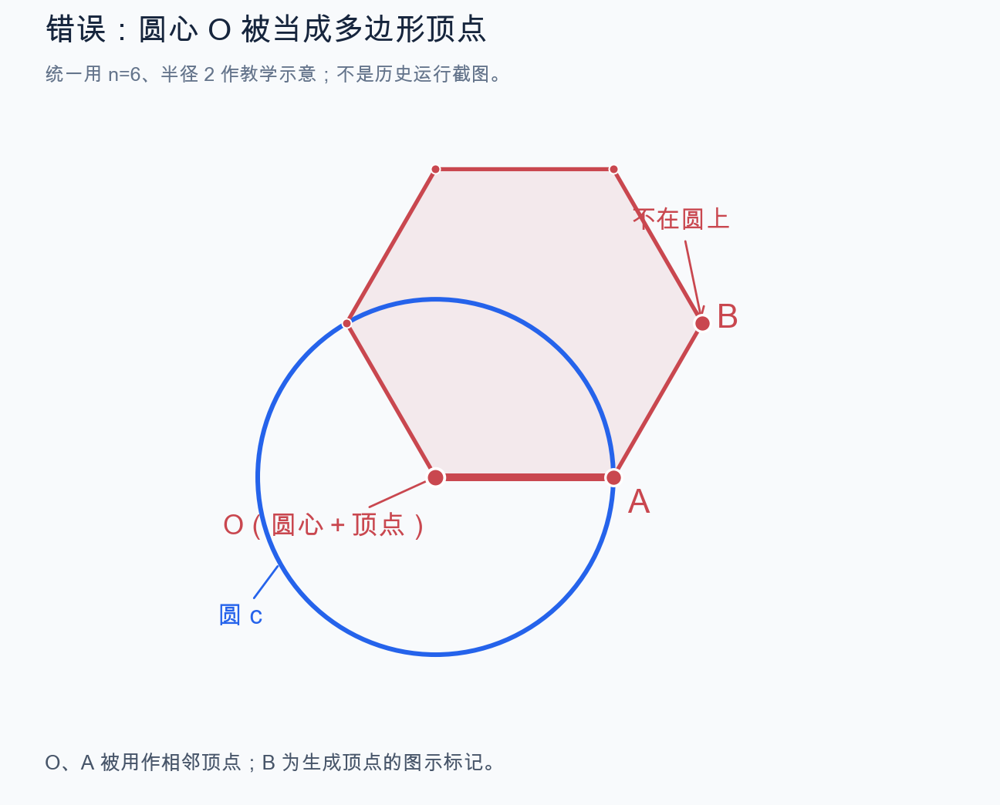
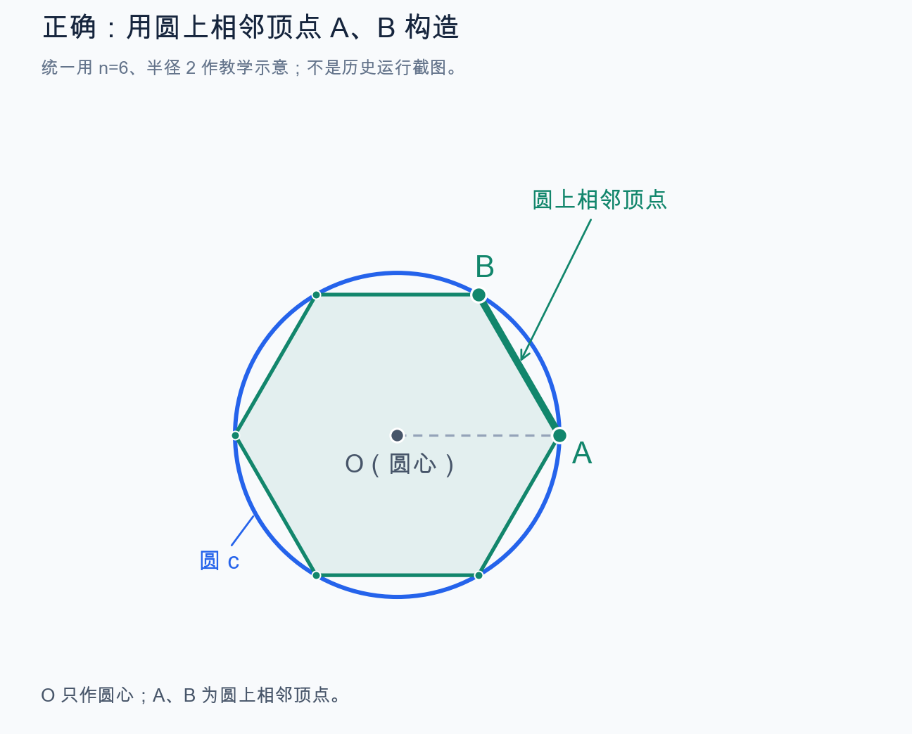
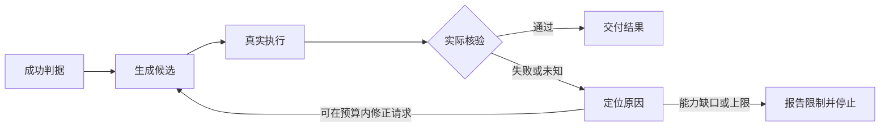
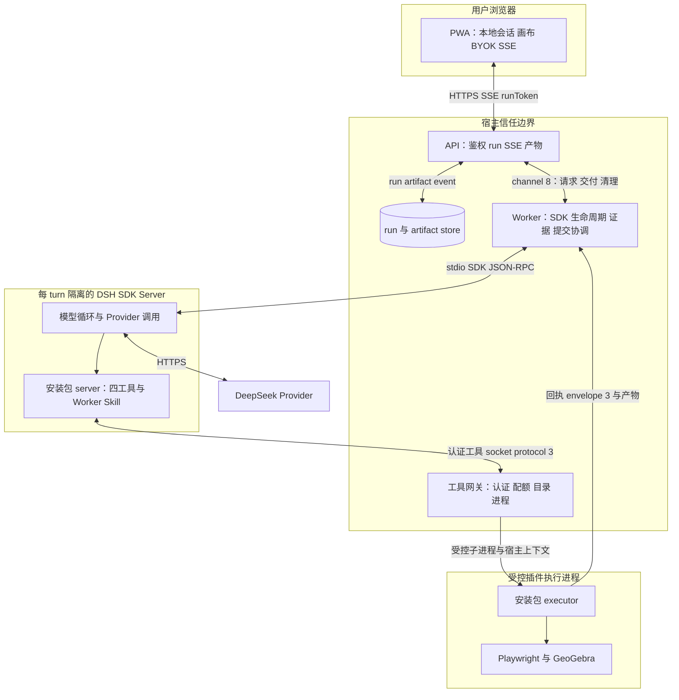
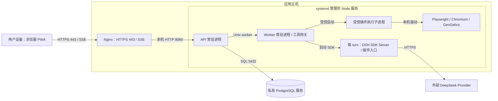

# 从一个问题到 Agent 交付：Concept → Loop → Plugin -> Agent

初稿：2026-10-23。更新：2026-10-25。用途：开发方法分享。

**先把想法变成有成功判据和反馈的 Loop，再把不同问题复用的执行、核验与交付能力做成插件。**

| 分享部分 | 用什么讲 | 要回答的问题 |
| --- | --- | --- |
| 第一部分：Concept → Loop | 圆内接正多边形 | 怎样把“想画什么”变成能执行、能判错、能修正的闭环 |
| 第二部分：案例二 | 抛物线焦点、准线与动点 | 失败如何归因，检查通过为什么仍可能不符合预期 |
| 第三部分：Loop → Plugin | 通用能力与五项契约 | 怎样让新题只换程序与检查，不增加题型分支 |

随后给出软件架构和完整调用链。本文归纳方法，不新建产品协议；当前职责与精确契约以
[README](../README.md)、[安装式设计](ggb-dsh-installed-plugin-design.md)及 [Backlog](ggb-dsh-backlog.md)为准。
历史通过只支持对应版本和环境，不能代替当前包、真实模型或生产验收。

## 1. 第一部分：用圆内接正多边形，把 Concept 变成 Loop

### 1.1 把想法写成可核验的任务

> 画一个圆，并在圆的内部做一个内接正多边形。

会话「Review Agent」中，用户在 10 月 13 日将题目从“内接正六边形”改为“内接正多边形”。
原题没有给定边数；后续成功运行选择 n=6 作为初态，并创建整数滑块。这是构造选择，不是题设。

不先增加 Agent 阶段，先定义“怎样算完成”。生成脚本和画出相似图形，都不能替代这些条件：

| 步骤 | 圆内接正多边形中的具体动作 | 形成的证据 |
| --- | --- | --- |
| 定义成功 | 圆与多边形存在；多边形是正多边形；每个顶点都在圆上 | 从原题提取的四项要求 |
| 选择构法 | 圆上点 A 绕 O 旋转一个圆心角得到 B，以 A、B 为相邻顶点 | 参数角色与构造依赖 |
| 执行候选 | 把程序交给真实 GeoGebra，不凭生成的文字宣布成功 | 实际对象、命令和坐标 |
| 独立核验 | 逐顶点检查到圆的距离，并核验正则性 | 对象是否实际满足要求 |
| 根据反馈行动 | 构法错就修构法；结构错就修字段；证据不足则保留未验证 | 可定位的修正或停止理由 |

### 1.2 用真实反例检验 Loop，而不是只演示成功

以下两图统一使用 n=6、半径 2 和相同视角，说明参数角色，不是历史运行截图。
左图 B 是生成顶点的读图标记，不是原错误脚本变量；右图 B 是旋转得到的圆上相邻顶点。

| 错误：圆心 O 被误当顶点 | 正确：A、B 是圆上相邻顶点 |
| --- | --- |
|  |  |

一次早期运行创建了圆，然后执行：

```text
c=Circle(O,A)
poly=Polygon(O,A,n)
```

`Polygon` 的两个点是相邻顶点，不是“圆心＋圆上点”。O 被当成多边形顶点，
但圆心到自身的距离为 0，非退化圆半径大于 0，因此不可能所有顶点都在圆上。

Plan 与 Review 都曾认可这个错误构法；外部 Playwright 几何检查发现多个顶点不在圆上。
这说明 Loop 不能只检查“对象存在、类型正确”，还必须检查原题中的关系。

后续另一轮成功运行使用了以下构造：

```geogebra
n=Slider[3,12,1]
SetValue[n,6]
O=Point[{0,0}]
A=Point[{2,0}]
c=Circle[O,A]
B=Rotate[A,360/n*deg,O]
poly=Polygon[A,B,n]
```

O 只作为圆心和旋转中心；A、B 才是多边形的相邻顶点。
检查也单独表达：读取实际顶点，用 `Distance(Vertex(poly,i),c)` 检查落圆，用原生参照核验正则性。
不能只因为调用了 `Polygon`，就把“内接”也当作已证明。

### 1.3 Loop 由反馈决定下一步



先人工固定候选验证工具链，再引入模型生成和修正，避免把模型、协议和引擎问题混在一起。
构法或字段错误由模型按证据修正；正确构法触发引擎缺陷时，保留证据并报告能力缺口，
由开发者修复引擎后复验，不让模型靠不断更换构法或删除条件获得通过。

| 历史记录 | 真实结果 | 能支持的结论 |
| --- | --- | --- |
| 10 月 13 日早期运行 | 圆心被用作顶点，产品 completed，但外部几何检查失败 | 模型 Review 和对象存在检查不足以保证关系正确 |
| 10 月 16 日后续运行 | 真实 DeepSeek＋GeoGebra＋Playwright；圆、多边形、正则性、内接四项通过 | 正确候选在本次运行中满足对应检查 |

这是两次不同历史运行，不是同一次任务自动修复前后的对照。
后一次初态 n=6，不能据此宣称所有边数或错误候选拒绝分支均已真实验收；期间仍有结构拒绝和格式恢复。

**Concept 变成 Loop 的标志：成功条件可观察，执行结果可核对，失败能指导下一步，结束有明确条件。**

## 2. 第二部分：案例二——抛物线任务的失败、回退与修复

这是一道观察抛物线几何关系的题目：

> 已知抛物线 y²=4x，焦点为 F，A 是准线上的一点。判断线段 FA 的中垂线与抛物线的位置关系。

Agent 的任务是画出这些对象，供用户观察，不直接给出题目答案。
其中 A 应能沿准线拖动，线段 FA 及其中垂线应随之变化；隐藏标签只是显示调整，不应破坏这些关系。


*静态示意：箭头表示 A 可沿准线移动；图中不标注题目结论。*

本案例按三个阶段讲述。前两阶段来自历史 run `run_00e376f2-0ffa-45aa-b282-ed3554ca1c89`；
最终阶段为后续引擎修复验收，不是该 run 的第三次 build。
以下仅摘录关键构造命令，省略辅助线、核验项和显示参数。前两次均以 `initial: [-1, 2]` 初始化 A。

#### ① 第一次失败

```text
p: y^2=4x
F=Focus(p)
d=Directrix(p)
A=Point(d)
s=Segment(F,A)
M=Midpoint(F,A)
b=PerpendicularBisector(F,A)
```

**根因：脚本关系正确，引擎漏初始化准线路径起点。**
隐藏标签 `setLabelVisible("d", false)` 触发更新，A 的路径参数失效，下游对象随之失效。
标签设置是触发点，漏初始化才是根因。

**验证结果：** A、线段、中点和中垂线未定义，第一次 build 拒绝交付。

#### ② 第二次检查通过，但不完全符合预期

```text
p: y^2=4x
F=(1,0)
d: x=-1
A=Point(d)
s=Segment(F,A)
M=Midpoint(F,A)
b=PerpendicularBisector(F,A)
```

**原因：模型只改写 F、d 两行。** 独立方程绕过故障，却切断它们对 p 的依赖。
A 仍受准线约束，但 F 已是可移动的独立点，拖开后不再是焦点。

**验证结果：** 构造与重载各 48/48、交互采样 1 次通过。通过了当次检查，未完整保留题设语义。

#### ③ 最终修复成功

```text
p: y^2=4x
F=Focus(p)
d=Directrix(p)
A=Point(d)
s=Segment(F,A)
M=Midpoint(F,A)
b=PerpendicularBisector(F,A)
```

**修复：补齐引擎路径起点初始化，不用固定坐标替代依赖。**
插件与 Web Client 同步供应兼容补丁，并升级缓存，确保实际加载修复后的引擎。

**验证结果：** 隐藏标签、独立重载、真实鼠标拖动、缩放及续做均保持依赖。
10 月 24 日本机验收采用最终包、真实 GeoGebra 与 mock Harness；未新增付费模型或生产验收。

前两次命令与回执来自本机该 run 的 `diagnostics/f08bc963-6857-497d-ba1a-a2ccac53f7cb.json`，
触发点见 `output/diagnostics/run-00e376-a-undefined/style.json`；本机运行证据不随分享稿分发。
最终修复依据见 [Backlog 中的引擎补丁与客户端验收](ggb-dsh-backlog.md)。

## 3. 第三部分：从 Loop 获得通用插件

### 3.1 通用的是执行与核验机制，不是固定构图模板

| 随题目变化 | 保持复用 |
| --- | --- |
| 原题、原生命令、对象与构造参数 | 请求解析与受控执行 |
| 每项条件对应的检查 | 事实采集、核验报告与失败反馈 |
| 显示、交互与初态选择 | 导出、独立重载、产物与回执 |

从圆内接正多边形换到抛物线，不增加“如果是这道题”的分支，只改变程序和检查。
若缺少能力，应扩展通用事实或核验能力，并加入正常例与拒绝反例。
截图相同但依赖被切断的反例，应由通用依赖检查识别，不能只给某一道题打补丁。

历史架构也沿这个方向收敛：Pipeline 由宿主管理多阶段数学协议；plugin-core 集中领域执行与核验；
标准 DSH 插件再把工具、Skill、schema 和执行器放入同一发行包，避免宿主维护第二份领域规则。
这是真实演进路线，不是新项目必须重复的开发顺序。

### 3.2 插件只需先说清五项关键契约

| 关键契约 | 简洁约定 |
| --- | --- |
| 输入 | 原题＋程序＋检查＋交互要求；自主选择不能冒充题设，修正不能删除条件 |
| 反馈 | 指明失败阶段、对象或检查及观测事实，让调用方知道该改什么 |
| 核验 | 结构检查与数学核验分开；按要求检查依赖、交互及独立重载，未验证不算通过 |
| 停止 | 全部必需检查通过才交付；预算或重试耗尽就报告限制，不放宽标准 |
| 分工与交付 | 插件执行核验，DSH 驱动模型循环，宿主管权限与最终完成；交付同一份已验证文件 |

当前工具把上述契约接到模型循环：`ggb_request` 提交候选，`ggb_check` 做结构预检，
`ggb_build` 执行、核验、导出并独立重载，`ggb_inspect` 提供按需查询与已有图检查。
Skill 解释用法和修正步骤；强制门禁由代码执行，不能只写在 Prompt 中。

### 3.3 三个可行与三组验证实验

三个“可行”分别是：**工具能做、插件能接、Agent 能完成用户任务。**
“镜头”指一组隔离变量的验证实验：固定程序、安装与集成、真实用户任务。

| 三个可行：要回答什么 | 对应镜头：怎样验证 | 什么证据算通过 | 还不能说明什么 |
| --- | --- | --- | --- |
| ① 工具可行：给定正确候选，能执行和核验吗？ | 固定程序实验：人工候选＋真实 GeoGebra，不调用模型 | 正常构造与独立重载通过，错误反例被拒绝 | 模型会理解题目、生成正确候选 |
| ② 插件可接入：安装后，宿主能发现、调用和接收结果吗？ | 安装与集成实验：先验最终归档＋隔离 SDK，再用 mock Harness 贯通真实执行器与 Web | 工具、Skill 和权限正确；声明范围内的交付与异常路径通过 | 真实模型能选对工具或完成题目 |
| ③ Agent 可交付：只给原题，模型能完成用户任务吗？ | 真实用户任务实验：原始输入＋真实 Provider＋固定安装包＋实际 Client | 模型按证据调用、修正和结束；用户能加载、下载、操作同一已核验文件 | 所有题型、未来版本或生产环境都可用 |

以圆内接正多边形为例：人工写对构造，验工具；用固定工具请求跑通 Web，验接入；只给原题让真实模型完成，验 Agent。
三种实验分别隔离执行问题、集成问题和模型使用问题，证据不能互相替代。

拒绝、取消、重连、下载、交互和缓存升级按影响范围验证。本机通过仍需与目标部署验收分开。

下面的架构和调用链说明这些责任分别由谁承担。

## 4. GeoGebra-DSH-Agent 的软件架构与完整调用链

本节给出当前系统的软件架构，用于分享和评审。它是概览，不替代 [README](../README.md) 的代码结构
与 [安装式设计](ggb-dsh-installed-plugin-design.md)的精确契约；协议版本以
[协议版本规则](../ggb-dsh/docs/protocol-versioning.md)为准。



图中的 API 与 Worker 是两个 Node.js 进程，由同一主机上的 systemd 管理，通过 0600 Unix socket 通信。
Worker 为每个 turn 启动独立的 DSH SDK Server 和 DSH home。DSH 加载安装包的 server patch；
插件 server adapter 只注册领域工具和 Worker Skill，通过签名请求调用宿主网关，不直接访问 Store 或 API。
executor 是 Worker 启动的独立子进程，使用环境白名单、独立输出目录和进程组清理，不继承 Provider Key。
Playwright 与 GeoGebra 由 executor 管理；模型不能提交任意脚本、路径或 shell。
Store 保存 run、事件、artifact 和用量事实；Worker 只在启动时执行 schema admission，
run 终态、artifact 和事件由 API 原子提交。
图中的 channel 8、protocol 3、envelope 3 和 receipt 2 是整理时的当前值，变化以协议规则为准。

| 组件 | 运行位置 | 主要职责 | 明确不负责 |
| --- | --- | --- | --- |
| Web PWA | 浏览器 | 本地 Session、画布、OPFS、BYOK Vault、SSE、下载与基线 | 不运行模型循环；不执行模型生成的 GeoGebra 命令；不连接 DSH |
| API | 独立 Node 进程 | HTTP/SSE、runToken 鉴权、幂等、run 生命周期、产物读取、静态资源、TTL | 不调用模型；不启动浏览器；不做几何核验 |
| Worker | 独立 Node 进程 | 固定安装身份、启动 DSH、工具网关、配额、进程与清理、证据、候选与提交协调 | 不拥有领域 schema 或核验规则；不直接向 Client 提供 HTTP |
| DSH SDK Server | 每 turn 子进程 | 模型循环、Provider 调用、工具调度、Worker Skill 注入 | 不写 Store；不接受模型提供的宿主路径或额度 |
| 插件 server adapter | DSH 进程内 | 注册四工具、加载 Worker Skill、签名工具请求 | 不访问数据库、runToken 或 HTTP 管理接口；不执行构建 |
| 插件 executor | 受控子进程 | 结构检查、构造、核验、导出、重载、回执与产物 | 不决定 run 身份、额度或 deadline；不接收 Provider Key |
| Playwright 与 GeoGebra | executor 子进程 | 隔离 applet 执行、事实采集、渲染与重载 | 不理解题目或 run；不访问未授权资源 |
| Store | SQLite 或 PostgreSQL | run、事件、artifact、用量的持久事实与 CAS 终态 | 不执行几何语义；不被插件直接访问 |
| DeepSeek Provider | 外部 HTTPS | 模型推理 | 不执行工具；不接收宿主路径或产物 |

一次 run 的关键调用链：

1. PWA 以原题、可选图片和可选画布基线创建 run，发送 runToken 和本次 BYOK Key。
   API 校验幂等和请求摘要，固定交付契约，写入 `accepted`。
2. API 以 CAS 将 run 置为 `running`，通过内部 channel 把执行请求交给 Worker。
3. Worker 使用启动时已核对的安装包、SDK、runtime 和协议身份，准备本轮 DSH home，启动 DSH SDK Server，
   注入认证工具 socket、能力令牌和插件 server patch。
4. DSH 注册四工具和 Worker Skill。模型调用工具时，插件 adapter 生成签名请求，经工具网关校验
   run、turn、epoch、nonce、参数摘要和 build 配额。
5. 网关以宿主上下文启动 executor：输出目录、基线引用与摘要、deadline 和 buildId 由宿主提供。
   executor 在隔离目录中调用 Playwright 与 GeoGebra 完成构造、核验、导出和重载。
6. executor 返回回执与产物。Worker 核对回执绑定、实际字节、尺寸和摘要，接受候选。
   模型可在预算内根据证据修正，但失败的新 build 不会回退到旧候选。
7. turn 结束后，Worker 关闭 DSH 和执行资源，确认进程树退出，返回交付与清理结论。
   API 原子提交 run、artifact 和事件，发布 `completed` 或相应终态。
8. Client 通过 SSE 接收状态，加载或下载同一交付。下一次需求以当前画布作为新 run 的基线。

部署与进程边界：

- API 与 Worker 作为两个 Node 服务运行，由 systemd 管理；插件安装根按只读使用，运行输出写入独立的
  `GGB_PLUGIN_CORE_OUTPUT_ROOT`。
- 本地开发默认 SQLite，生产使用 PostgreSQL；启动时通过 schema admission 确认迁移 018 已记录
  （017 是其前置）。
- PWA 静态资源和 GeoGebra runtime 单独供应；Client 与插件分别供应、分别核对版本身份。
- 每 turn 的 DSH home 独立；每次 build 使用独立输出目录；清理失败时隔离执行槽位。
- DSH 插件安装、systemd、PostgreSQL 迁移和崩溃回收按[部署指南](deploy-dsh.md)执行，本机验证不能替代。

架构不变量：

- 浏览器不运行模型循环，也不执行模型生成的任意 GeoGebra 命令。
- 模型输入不可信；模型不能提供宿主路径、身份、额度、deadline 或凭据。
- 插件拥有领域语义；宿主拥有权限、配额、进程、产物接收和最终提交。
- 插件声明的摘要不是权限；宿主必须重新计算实际字节并绑定调用、基线和安装身份。
- 同一 run 只有一个最终候选；清理未确认时不能发布 `completed` 或 `cancelled`。
- 新需求创建新 run，以当前画布为新基线；不提供同一 run 的自动恢复或构建重放。

### 部署视图：组件实际放在哪里

下图按当前 Node + systemd + DSH 插件安装方式绘制，说明部署边界；不是在线环境巡检图。
读图顺序：① 应用主机 → ② systemd 管理的 Node 服务 → ③ Worker 管理的按需子进程。
浏览器、模型服务与数据库单列展示；数据库实际位置由连接配置确定。
目标机器插件安装、数据库迁移与生产 PWA 验收仍以 [Backlog](ggb-dsh-backlog.md)为准。



| 部署位置 | 放什么 | 边界 |
| --- | --- | --- |
| 用户浏览器 | PWA、Session、画布与加密 BYOK vault | 浏览器不运行模型循环 |
| 应用主机的入口 | Nginx；公网 HTTPS 443，转发到本机 8080 | SSE 关闭缓冲；API 不直接暴露公网 |
| Node 服务 | API、Worker；按 turn 启动 DSH，按操作启动插件执行器 | API 与 Worker 用 Unix socket 通信；工具调用回到 Worker 网关 |
| 固定安装目录 | 工作区 `.plugin-core-runtime/<archiveSha256>` 的插件、Chromium 与 GeoGebra runtime | 只读供应，版本与摘要固定 |
| 运行目录 | `/run/ggb-dsh/` 的 socket、DSH home；`/var/lib/ggb-dsh/` 的持久执行状态 | 临时文件与持久状态分开；secret 文件以 0600 权限独立提供 |
| 私有数据库与外部模型 | PostgreSQL 保存服务端事实；DSH 通过 HTTPS 调用 Provider | 数据库位置由连接配置指定；模型服务不执行本机工具 |

systemd 从仓库位置推导工作区，在同一主机启动 API 与 Worker 两个服务；Worker 从安装描述加载 DSH 插件。
使用 cpolar 时由 cpolar 终止公网 TLS，转发到本机 Nginx HTTP 80；采用对应配置，不重复终止 TLS。
部署操作与验收步骤引用 [部署指南](deploy-dsh.md)，此处不新增环境配置。

## 5. 分享依据与证据范围

文中的 S1—S7 用于追溯案例。历史会话 ID 用于本机检索；主题概述不是重新命名会话。

| 编号 | 日期 | 会话 ID | 主要依据 |
| --- | --- | --- | --- |
| S1 | 10 月 11 日 | `01a1289e-32fb-7292-b460-53437d5ab9c8` | Coding Agent 的执行、验证和修正闭环 |
| S2 | 10 月 12 日起 | `01a13087-33ec-71f1-9bd5-e39d3e95eee9` | Review / Manual 修复、七案例真实运行 |
| S3 | 10 月 14 日起 | `01a138ff-dcab-7972-95f9-0866b17b67ff` | 来源遗漏、冻结边界与完成标准冲突 |
| S4 | 10 月 16 日起 | `01a14227-6683-7721-bc67-824dbcfb0b4d` | 插件化目标与宿主 Agent／本地执行的分工 |
| S5 | 10 月 16 日起 | `01a143e6-ffa2-7b40-bb96-35d9e8c100e0` | 调试复杂度、续题与恢复的简化诉求 |
| S6 | 10 月 22 日起 | `01a16282-2b15-7e03-97e9-cd5e9159c0ae` | 安装式设计、分批实施和真实运行问题 |
| S7 | 10 月 23—24 日 | `01a16805-af90-7952-b353-a8ea3d886f0d` | 演进归纳、路径点本机诊断及方法分享诉求 |

案例的本机核对入口如下；路径指向忽略目录，只用于内部复核，不是随仓库发布的附件：

| 案例 | 核对入口 | 本轮文档整理做了什么 |
| --- | --- | --- |
| 圆内接正多边形：早期失败 | `output/playwright/native-seven-20261013-r77/report.md` | 核对圆心被用作顶点及外部几何失败，不重跑 |
| 圆内接正多边形：后续成功 | `output/playwright/native-intake-clarification-r44-20261016-single/report.md` | 核对真实命令、四项核验、初态与证据边界，不重跑 |
| 真实画圆 | `output/playwright/paid-circle/evidence.json` | 读取调用卡片、下载字节、摘要一致性及 Client 版本，未重新运行 |
| 抛物线失败与用量 | run `run_00e376f2-0ffa-45aa-b282-ed3554ca1c89` 的诊断和 `usage.json` | 结合本会话既有定位记录核对用量，未重新调用模型 |
| 标签操作与依赖诊断 | `output/diagnostics/run-00e376-a-undefined/` | 引用本会话已授权完成的历史对照；不作为当前补丁版本的验收 |
| 引擎修复与用户端 | Backlog 中 2026-10-24 的供应、缓存升级及实际交付 iframe 记录 | 查阅已有记录；当前状态仍以 Backlog 为准 |

仓库内的事实入口：

- [plugin-core 采用方案](ggb-dsh-plugin-core-adoption.md)：冻结决策、删除范围与历史取舍。
- [安装式插件设计](ggb-dsh-installed-plugin-design.md)：所有权、公开入口、可信交付和迁移条件。
- [切换交接](ggb-dsh-plugin-core-cutover-handoff.md)：切换证据与旧 run 处理。
- [统一 Backlog](ggb-dsh-backlog.md)：实施、离线、本机真实与未完成事项的分类记录。
- [DSH 兼容与引擎供应](../ggb-dsh/docs/dsh-sdk-compatibility.md)：固定安装组合、引擎补丁及启动准入。
- [插件源码手工验证](ggb-dsh-plugin-manual-verification.md)：源码覆盖实验的操作边界；不能代替最终归档验收。

历史 output 与本机会话不保证随仓库分发。分享前如需截图或定量结论，应整理对应版本的证据，
明确人工输入、mock、真实引擎与真实模型的区别。本文没有重新运行这些历史测试。
